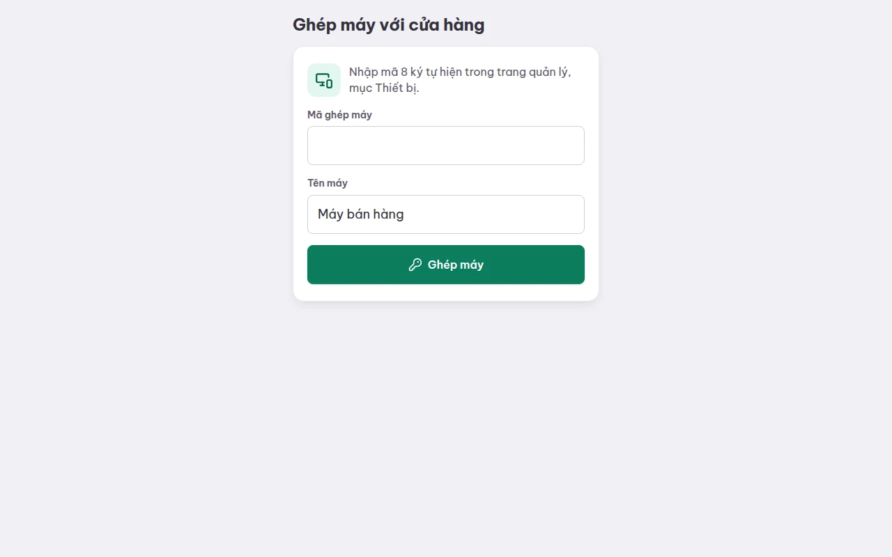
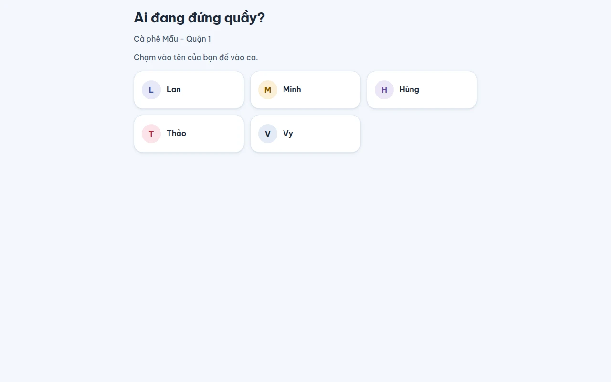
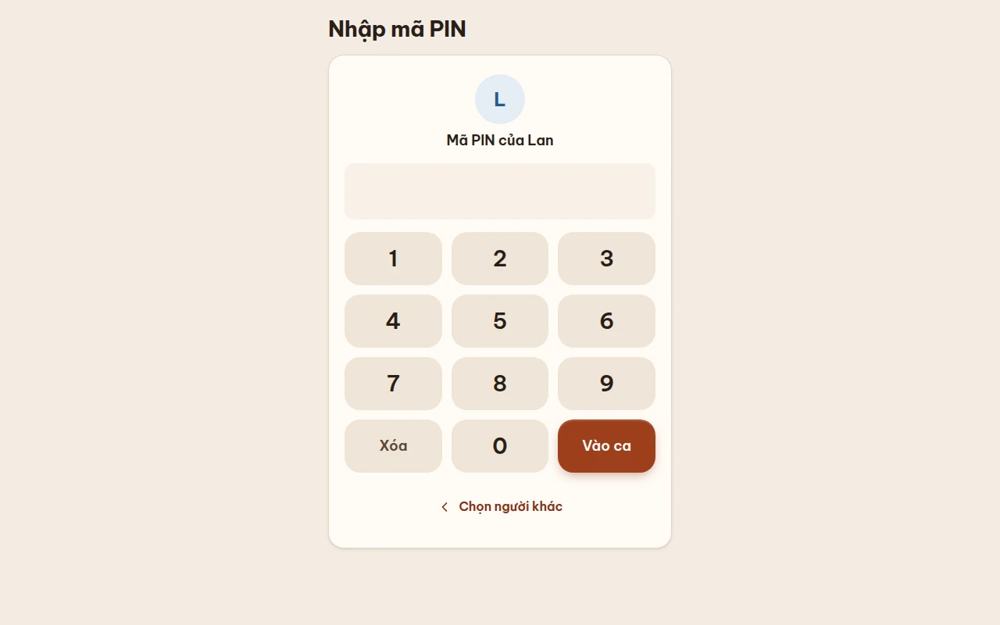
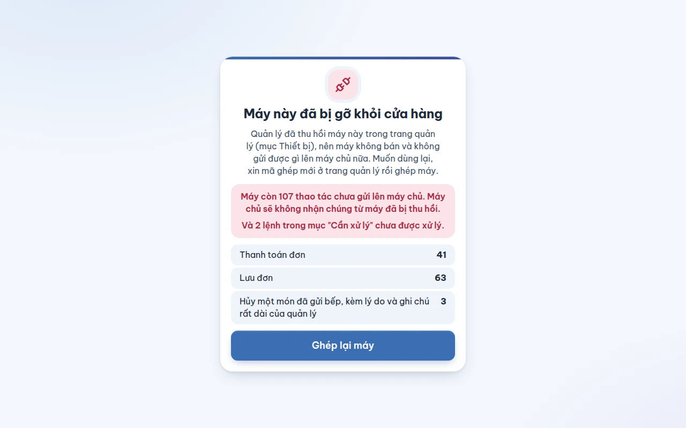
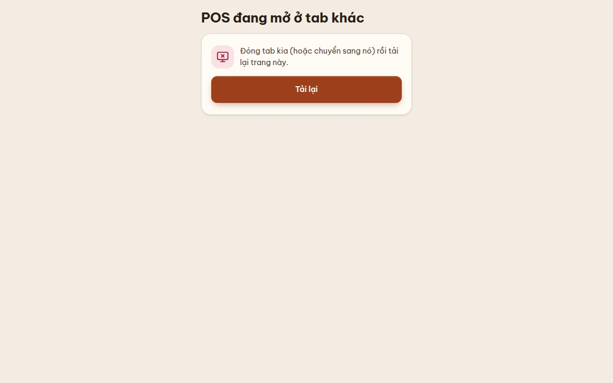
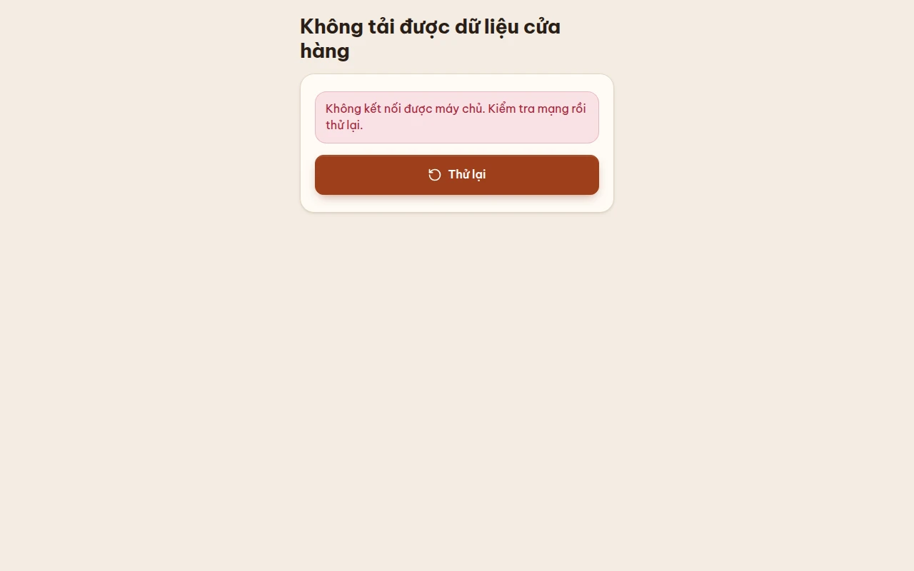

# Ghép máy với cửa hàng và đăng nhập nhân viên

## Dùng để làm gì

- **Ghép máy**: làm **một lần** cho mỗi máy bán hàng (máy tính quầy, tablet). Sau khi ghép, máy biết mình thuộc chi nhánh nào, tải thực đơn, sơ đồ bàn, danh sách nhân viên về máy.
- **Đăng nhập nhân viên**: mỗi lần đổi người đứng quầy. Mỗi người chạm tên mình rồi nhập mã PIN riêng — không dùng chung một mã, để mọi đơn, mọi lần thu chi đều ghi đúng tên người làm.

## Ai dùng, cần quyền gì

| Việc | Ai làm | Quyền |
|---|---|---|
| Tạo mã ghép máy | chủ quán | `manage_devices` (vai trò mẫu: chỉ chủ quán có) — làm ở trang quản lý, mục Thiết bị |
| Nhập mã trên máy | bất kỳ ai đứng cạnh máy | không cần đăng nhập |
| Đăng nhập bằng PIN | mọi nhân viên đang hoạt động của chi nhánh | không cần quyền riêng |

## Các bước

### Ghép máy (một lần)

1. Ở trang quản lý, mục **Thiết bị**, chủ quán tạo một mã ghép máy cho chi nhánh. Mã gồm 8 ký tự chữ và số.
2. Trên máy mới, mở trang POS. Máy hiện màn **Ghép máy với cửa hàng**.

   Cả ba màn của phần này (ghép máy, chọn nhân viên, nhập PIN) là **một thẻ nằm giữa màn hình** trên nền nhạt, không dính lên mép trên, ở cả màn nằm ngang lẫn dựng đứng. Chi nhánh có nhiều nhân viên (30 người, tên rất dài) thì danh sách cuộn **trong thẻ**, tiêu đề và tên chi nhánh luôn ở trên; hàng cuối mờ dần báo còn nữa.

3. Gõ mã vào ô **Mã ghép máy**. Gõ chữ hoa hay chữ thường, có dấu gạch (`ABCD-EFGH`) hay dấu cách đều được — máy tự bỏ đi.

   Có **đường link ghép máy** (dạng `…/?pair=ABCD-EFGH`, ví dụ lệnh chạy thử in ra) thì chỉ cần mở link: máy tự điền mã, tự bấm **Ghép máy** với tên máy mặc định, và xóa mã khỏi thanh địa chỉ ngay lúc mở (tải lại trang hay lưu dấu trang không còn mã). Máy không lưu mã ở đâu. Mã sai hoặc hết hạn thì màn vẫn hiện lỗi như khi gõ tay, sửa mã rồi bấm lại. Máy đã ghép rồi thì link bị bỏ qua.
4. Đặt **Tên máy** (mặc định "Máy bán hàng"; nên đặt "Quầy 1", "Quầy 2"… để phân biệt trên báo cáo). Bấm **Ghép máy**.
5. Máy hiện "Đang tải dữ liệu cửa hàng…" rồi chuyển sang màn chọn nhân viên.

### Đăng nhập đầu ca hoặc khi đổi người

1. Màn **Ai đang đứng quầy?** liệt kê nhân viên của chi nhánh. Chạm vào tên mình.

   

2. Nhập mã PIN bằng bàn phím số to trên màn (hoặc bàn phím thật), bấm **Vào ca**. Mỗi số chạm vào làm sáng thêm một chấm dưới ô PIN (tối đa 6 chấm); nút xóa nhỏ ở cuối ô PIN bỏ **số cuối**, nút **Xóa** bỏ cả mã. Nhập sai PIN thì ô PIN rung nhẹ, viền đỏ, mã bị xóa để gõ lại từ đầu và dòng báo lỗi hiện ngay dưới. Bấm **Chọn người khác** nếu chạm nhầm tên.

   

3. Nếu máy chưa mở ca, màn tiếp theo là **Mở ca** (xem [02-mo-ca.md](02-mo-ca.md)); nếu ca đang mở, vào thẳng màn bán hàng.
4. Trên thanh trên cùng luôn có tên người đang đứng quầy, ngày của ca, nút bảng màu **Giao diện** (đổi màu của máy — xem [03-ban-tai-quay.md](03-ban-tai-quay.md)) và hai nút **Đổi nhân viên** (giao máy cho người khác, không cần đóng ca) và **Đăng xuất**.

### Khi máy bị thu hồi

Nếu chủ quán **thu hồi** máy ở trang quản lý, máy biết ngay ở lần đồng bộ kế tiếp (máy chủ trả "401" về chính thông tin ghép của máy, khác với 401 của phiên nhân viên chỉ đưa về màn PIN). Lúc đó máy hiện màn **Máy này đã bị gỡ khỏi cửa hàng** thay cho mọi màn khác.

- Máy **không xóa gì một mình**. Màn liệt kê các thao tác **chưa gửi** (theo loại, kèm số lượng) và số lệnh còn ở mục **Cần xử lý**: máy chủ sẽ không nhận chúng từ máy đã thu hồi nữa.
- Máy sạch (không còn gì chưa gửi): bấm **Ghép lại máy**, máy xóa thông tin ghép và dữ liệu bán hàng cũ rồi về màn **Ghép máy với cửa hàng**, có dòng giải thích "Máy vừa được gỡ khỏi cửa hàng…".
- Máy còn thao tác chưa gửi: bấm **Ghép lại máy** chỉ mở bước xác nhận (nút đỏ **Xóa N thao tác và ghép lại máy**, kèm nút **Chưa xóa, giữ nguyên**). Chưa bấm nút đỏ thì mọi thứ vẫn nằm trên máy: báo quản lý và ghi lại các đơn đó trước.
- Ghép lại xong là máy **mới** (số máy, số gọi món, số thứ tự lệnh bắt đầu lại), dùng mã ghép mới ở mục Thiết bị.

### Đăng xuất

Nút **Đăng xuất** trên thanh trên cùng đưa máy về màn chọn nhân viên **ngay**, rồi báo máy chủ kết thúc phiên đứng quầy đó (để phiên không còn dùng được tới hết 12 giờ). Mất mạng thì máy vẫn đăng xuất như thường; phiên ở máy chủ tự hết hạn. Còn thao tác của chính phiên đó chưa gửi thì máy **không** kết thúc phiên ở máy chủ (các thao tác ấy gửi lên bằng đúng phiên này); phiên hết hạn như thường. **Đổi nhân viên** thì không kết thúc phiên nào: người trước vẫn gửi được thao tác của họ.

## Luật và giới hạn

- **Mã ghép máy**: 8 ký tự, **hiệu lực 10 phút**, **dùng được một lần**. Hết hạn hoặc đã dùng thì xin mã mới. Mã đi trong đường link cũng vậy: link chỉ giúp khỏi gõ, không làm mã sống lâu hơn.
- Một địa chỉ mạng chỉ được thử ghép **10 lần mỗi phút**; quá thì máy chủ tạm từ chối.
- **PIN** gồm **4 đến 6 chữ số**. Máy không giữ PIN; máy chủ kiểm.
- **Sai PIN 5 lần liền** ⇒ khóa **5 phút**. Mỗi lần bị khóa liên tiếp sau đó, thời gian khóa **gấp đôi** (5 → 10 → 20 phút…), **tối đa 24 giờ**. Chỉ nhập đúng PIN mới đặt lại bộ đếm. Mỗi lần khóa được ghi nhật ký.
- **Phiên đứng quầy kéo dài 12 giờ**. Hết 12 giờ, máy quay về màn nhập PIN và báo lý do.
- Phiên đứng quầy **chỉ dùng trên đúng máy đó**; máy bị thu hồi ở trang quản lý thì mọi phiên trên máy đó cũng hết hiệu lực. Đăng xuất kết thúc phiên ở máy chủ khi máy gọi được và không còn thao tác của phiên đó chờ gửi.
- Nhân viên bị khóa ở trang quản lý: biến mất khỏi danh sách trên máy ngay khi máy đồng bộ, phiên đang mở bị cắt.
- **Đổi nhân viên khi còn lệnh chưa gửi** (ví dụ đang mất mạng): đơn của người trước vẫn được ghi tên người trước, không bị tính sang người sau.
- **Chỉ một tab**: POS chỉ chạy trong một tab của trình duyệt trên mỗi máy (dữ liệu bán hàng nằm trên máy, hai tab sẽ ghi đè nhau).
- Trình duyệt phải giữ được dữ liệu khi mất mạng: dùng **Chrome hoặc Edge bản mới**. iPad dùng ứng dụng cài (khi có), không dùng trình duyệt.

## Khi có lỗi

| Máy báo | Nghĩa là | Làm gì |
|---|---|---|
| Mã gồm đúng 8 ký tự (chữ và số). | Gõ thiếu hoặc thừa ký tự | Gõ lại đủ 8 ký tự |
| Đặt tên cho máy, ví dụ “Quầy 1”. | Ô Tên máy đang trống | Điền tên máy |
| Mã không đúng, đã hết hạn hoặc đã được dùng. Xin mã mới ở trang quản lý. | Mã sai, quá 10 phút, hoặc đã ghép máy khác | Tạo mã mới ở mục Thiết bị |
| Không kết nối được máy chủ. Kiểm tra mạng rồi thử lại. | Máy không có mạng | Kiểm tra wifi/dây mạng |
| Không tải được dữ liệu cửa hàng — kèm nút **Thử lại** | Máy ghép xong nhưng tải dữ liệu lỗi (thường do mạng) | Bấm Thử lại |
| Máy này đã bị gỡ khỏi cửa hàng | Máy đã bị thu hồi ở trang quản lý | Xem các thao tác chưa gửi (nếu có), báo chủ quán, rồi **Ghép lại máy** bằng mã mới |
| Máy vừa được gỡ khỏi cửa hàng và đã xóa dữ liệu bán hàng cũ. Nhập mã ghép mới… | Vừa ghép lại sau khi bị thu hồi | Nhập mã ghép mới ở mục Thiết bị |
| Không xóa được dữ liệu trên máy. Tải lại trang rồi thử lại. | Trình duyệt không xóa được dữ liệu máy | Tải lại trang, bấm lại |
| POS đang mở ở tab khác — Đóng tab kia (hoặc chuyển sang nó) rồi tải lại trang này. | Mở POS ở hai tab | Đóng bớt một tab, bấm **Tải lại** |
| Trình duyệt này không giữ được đơn khi mất mạng — Hãy dùng Chrome hoặc Edge bản mới, hoặc ứng dụng POS cài trên máy. | Trình duyệt quá cũ hoặc không hỗ trợ | Đổi trình duyệt |
| Không mở được dữ liệu bán hàng trên máy — Tải lại trang. Nếu vẫn lỗi, báo cho quản lý. | Dữ liệu trên máy không mở được | Tải lại; vẫn lỗi thì báo quản lý |
| Chi nhánh chưa có nhân viên nào. Thêm nhân viên ở trang quản lý. | Chưa tạo nhân viên | Chủ quán thêm nhân viên |
| PIN gồm 4 đến 6 chữ số. | Gõ thiếu số | Gõ đủ |
| Mã PIN không đúng. | Sai PIN | Thử lại (sai 5 lần sẽ bị khóa) |
| Nhập sai PIN quá nhiều lần. Thử lại lúc 14:35. | Đang bị khóa | Chờ đến giờ ghi trên màn, hoặc nhờ chủ quán đặt lại PIN |
| Không tìm thấy nhân viên này. Tải lại danh sách. | Nhân viên vừa bị xóa/khóa | Tải lại |
| Nhân viên này không làm ở chi nhánh của máy. | Chọn nhầm người của chi nhánh khác | Chọn đúng người |
| Phiên đứng quầy đã hết hạn. Nhập lại mã PIN để làm tiếp. | Quá 12 giờ, hoặc nhân viên vừa bị khóa | Nhập lại PIN |
| Máy gửi quá nhiều yêu cầu cùng lúc nên máy chủ tạm từ chối. Thử lại sau 30 giây. | Thử quá nhiều lần trong một phút | Chờ đúng số giây ghi trên màn |

## Mất mạng thì sao

- **Ghép máy cần mạng.** Không có mạng thì không ghép được.
- **Đăng nhập bằng PIN cần mạng** (máy chủ kiểm PIN). Người **đã đăng nhập** thì vẫn bán tiếp bình thường khi mất mạng; vì vậy nên đăng nhập đầu ca khi mạng còn tốt.
- Khi mất mạng mà đổi người đứng quầy, các lệnh đang chờ vẫn mang tên người đã làm ra chúng.

## Chưa làm / sắp có

- Ứng dụng cài cho Windows, Android, iPad (giữ khóa máy trong kho khóa của hệ điều hành). Hiện chỉ có bản chạy trong trình duyệt; khóa của máy được giữ trong bộ nhớ trang.
- Thao tác chưa gửi của máy bị thu hồi chưa chuyển sang máy khác được: máy chỉ liệt kê rồi xóa khi thu ngân chủ động xác nhận.
- Đăng nhập PIN khi mất mạng.
- Chấm công (giờ vào/ra theo ca).
