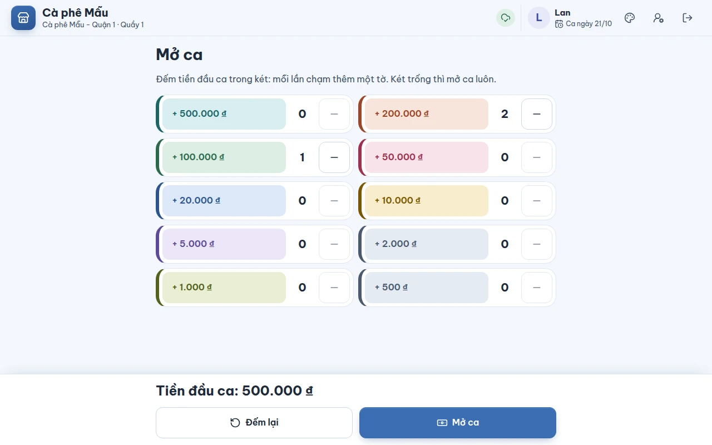

# Mở ca và đếm tiền đầu ca

## Dùng để làm gì

Mỗi máy bán hàng bán trong một **ca**. Mở ca là đếm số tiền đang có sẵn trong két (tiền lẻ để thối) và ghi lại, để cuối ca máy tính được két **phải có bao nhiêu tiền** và so với số đếm thật (xem [07-thu-chi-va-dong-ca.md](07-thu-chi-va-dong-ca.md)).

## Ai dùng, cần quyền gì

Bất kỳ nhân viên nào đã đăng nhập trên máy. Mở ca không cần quyền riêng.

## Các bước

1. Đăng nhập bằng PIN (xem [01-ghep-may-va-dang-nhap.md](01-ghep-may-va-dang-nhap.md)). Nếu máy chưa có ca đang mở, máy hiện màn **Mở ca**.
2. Màn Mở ca là một thẻ **Tiền đầu ca trong két** nằm giữa màn hình. Đếm tiền theo từng mệnh giá (mỗi mệnh giá một hàng mang màu của tờ tiền, nút to dễ chạm; hàng nào đã có tờ thì sáng lên để thấy mình đã đếm): **mỗi lần chạm vào một mệnh giá là thêm một tờ**. Chạm nút **−** cạnh mệnh giá để bớt một tờ nếu chạm thừa. Bấm **Đếm lại** để xóa hết và đếm từ đầu.
3. Dòng **Tiền đầu ca** cộng sẵn tổng số tiền. Kiểm lại rồi bấm **Mở ca**.

   

4. Két trống (không để tiền lẻ) thì bấm **Mở ca** luôn, tiền đầu ca là 0 đ.
5. Máy chuyển sang màn bán hàng. Thanh trên cùng hiện **Ca ngày dd/mm**.

## Luật và giới hạn

- Các mệnh giá đếm được: **500 · 1.000 · 2.000 · 5.000 · 10.000 · 20.000 · 50.000 · 100.000 · 200.000 · 500.000 đ**.
- **Mỗi máy chỉ có một ca đang mở** tại một thời điểm. Hai máy trong cùng quán thì mỗi máy một ca, một két riêng.
- Muốn bán phải có ca đang mở: máy luôn hỏi mở ca trước khi cho bán.
- Đổi nhân viên giữa ca **không** đóng ca: người sau dùng tiếp ca và két đó.
- **Ngày của ca** là **ngày kinh doanh** của chi nhánh, không phải ngày trên lịch: chi nhánh mặc định bắt đầu ngày kinh doanh lúc **04:00**, nên đơn bán lúc 01:00 sáng vẫn thuộc ngày hôm trước.
- Một đơn được tính vào ca **lúc thanh toán**. Đơn bàn còn mở khi đóng ca thì sang ca sau (xem [07-thu-chi-va-dong-ca.md](07-thu-chi-va-dong-ca.md)).
- Chỉ **tiền mặt** đi vào két. Tiền chuyển khoản QR không làm đổi số tiền két.

## Khi có lỗi

| Máy báo | Nghĩa là | Làm gì |
|---|---|---|
| Đang kiểm tra ca… | Máy đang đọc xem đã có ca mở chưa | Chờ vài giây |
| Không mở được ca trên máy. Thử lại; nếu vẫn lỗi, báo cho quản lý. | Máy không ghi được lệnh mở ca vào bộ nhớ của máy | Bấm Mở ca lần nữa; vẫn lỗi thì tải lại trang và báo quản lý |
| Máy chưa mở ca nên không ghi được thao tác này. | Máy chủ nhận một thao tác của máy chưa có ca mở; thao tác nằm trong danh sách **Cần xử lý** | Xem [09-mat-mang-va-dong-bo.md](09-mat-mang-va-dong-bo.md) |

## Mất mạng thì sao

Mở ca **không cần mạng**: máy ghi lệnh mở ca vào bộ nhớ của máy rồi cho bán ngay; lệnh tự gửi lên máy chủ khi có mạng lại. Đơn bán lúc mất mạng vẫn thuộc đúng ca và đúng ngày kinh doanh lúc bán, kể cả khi lên tới máy chủ sau khi ca đã đóng.

## Chưa làm / sắp có

- Một ca dùng chung cho nhiều máy cùng một két (hiện mỗi máy một ca).
- Mở két tiền bằng máy in khi mở ca (cần ứng dụng cài nối máy in — xem [10-phieu-in.md](10-phieu-in.md)).
- Chấm công theo ca.
