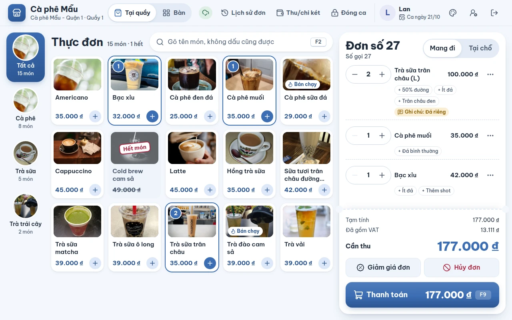
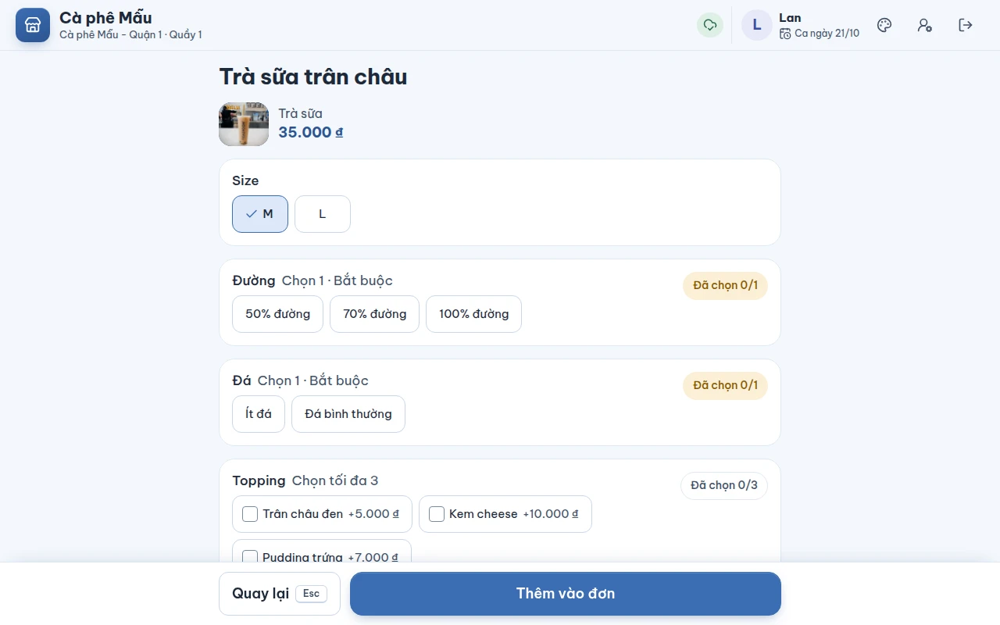
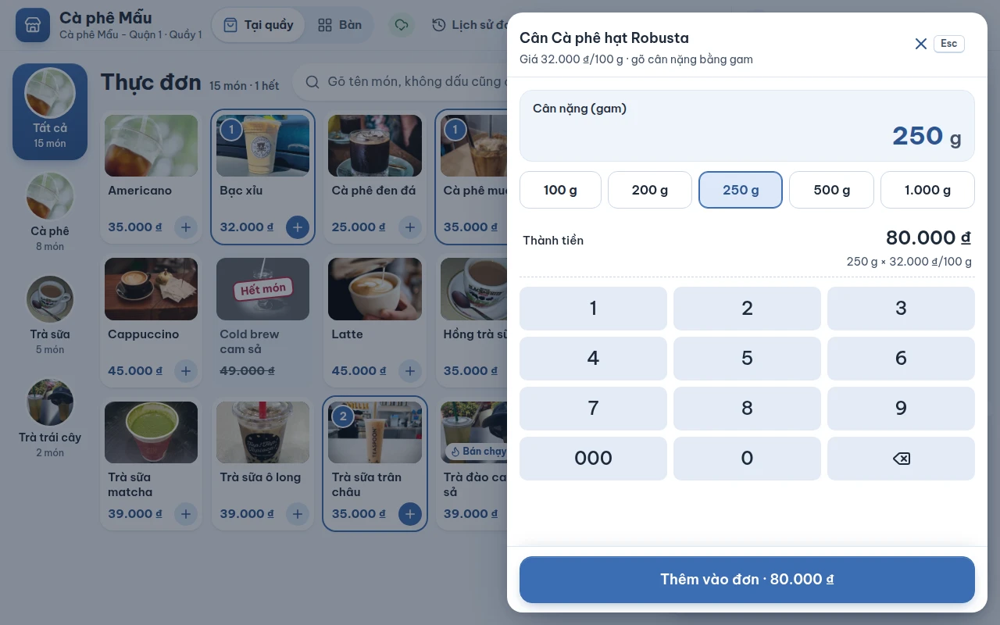
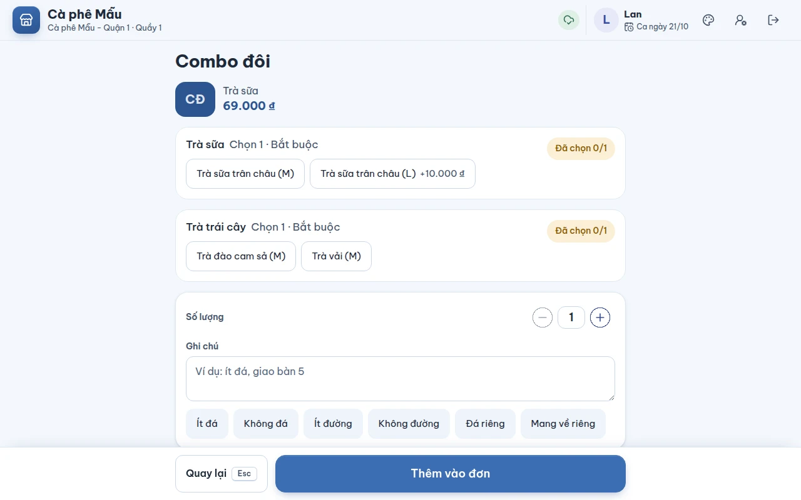
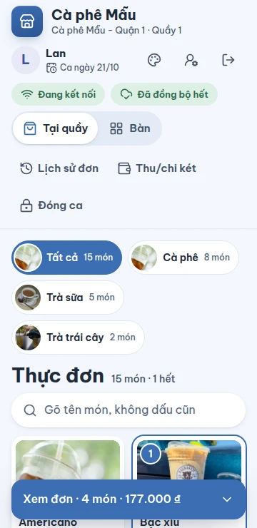
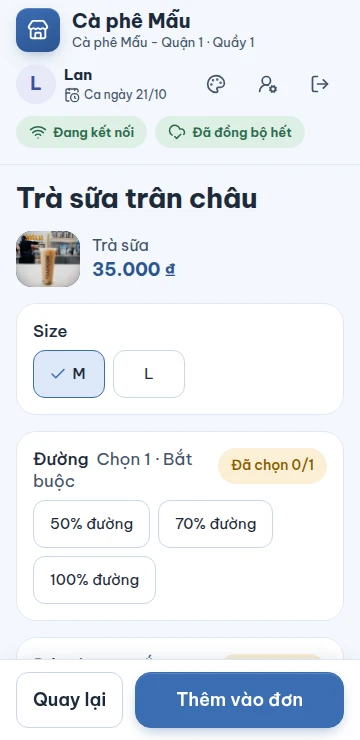
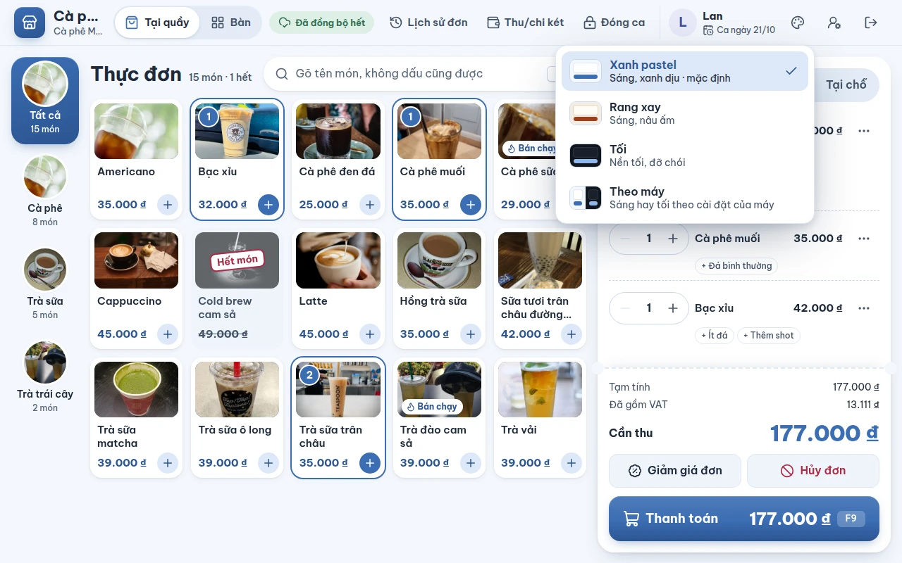

# Bán tại quầy

## Dùng để làm gì

Màn bán hàng là nơi thu ngân ghi món khách gọi: chạm món, chọn size và tùy chọn (đường, đá, topping…), ghi chú, rồi bấm **Thanh toán**. Đây là màn mở ra sau khi mở ca.

Màn chia ba phần:

- **Bên trái**: danh mục (Tất cả, Cà phê, Trà sữa…). Mỗi danh mục có **ảnh tròn** của món đầu tiên trong danh mục có ảnh (danh mục chưa có món nào có ảnh thì hiện biểu tượng), tên và số món trong đó, ví dụ **8 món**. Danh mục đang chọn nằm trên nền màu chính của giao diện (xanh dương ở **Xanh pastel**, nâu ở **Rang xay**).
- **Giữa**: dòng **Thực đơn · 15 món · 1 hết** (số món đang hiện và số món hết), ô tìm món và các ô món: ảnh, tên (tối đa 2 dòng, dài hơn thì cắt bằng "…"), giá và nút tròn **+**. Máy quầy 1280 px hiện 5 cột món bên cạnh đơn, màn 1920 px khoảng 7 cột, máy tính bảng ít cột hơn.
  - Số tròn màu chính ở góc trên ảnh là số ly món đó đang có trong đơn; ô món có viền cùng màu.
  - Nhãn **Bán chạy** ở góc dưới ảnh: tối đa ba món máy này bán được nhiều nhất (mỗi món từ 5 ly trở lên), tính trên các đơn **đã thanh toán** máy đang giữ; nhãn cập nhật khoảng 20 giây sau khi có đơn mới.
  - Món hết: ảnh xám, con dấu **Hết món** trên ảnh, giá gạch ngang.
- **Bên phải**: đơn đang bán, trình bày như một tờ phiếu — số đơn và số gọi, **Mang đi / Tại chỗ**, các món (mỗi món một dòng), tổng tiền, **Giảm giá đơn**, **Hủy đơn** và nút **Thanh toán** (máy từ 1280 px ghi luôn số tiền cần thu trên nút).

Trên cùng là một thanh: tên quán và tên máy, **Tại quầy / Bàn** (chỉ hiện khi chi nhánh bật bán theo bàn), tình trạng đồng bộ (xem [09-mat-mang-va-dong-bo.md](09-mat-mang-va-dong-bo.md)), ba công cụ **Lịch sử đơn**, **Thu/chi két**, **Đóng ca**, rồi người đang đứng quầy, ngày của ca, nút bảng màu **Giao diện** (xem "Đổi giao diện" bên dưới) và hai nút **Đổi nhân viên**, **Đăng xuất** (màn hẹp hơn 1600 px chỉ hiện biểu tượng của hai nút này). Máy hẹp hơn 1280 px đưa **Tại quầy / Bàn** và ba công cụ xuống hàng thứ hai của thanh.

## Ai dùng, cần quyền gì

Mọi nhân viên đã đăng nhập đều bán được. Giảm giá, hủy món đã gửi bếp… cần quyền riêng — xem [06-huy-giam-hoan-va-duyet.md](06-huy-giam-hoan-va-duyet.md). Món **giá nhập tay** cần quyền **Bán món giá nhập tay** (`open_price`; thu ngân, quản lý, chủ quán có sẵn; phục vụ thì không): người không có quyền vẫn gõ giá được nhưng quản lý phải nhập PIN duyệt **đúng giá đó cho đúng món đó**. Món bán theo cân không cần quyền gì.

## Các bước

1. **Chọn kiểu phục vụ**: **Mang đi** (mặc định) hoặc **Tại chỗ**. Chọn Tại chỗ thì có thêm ô **Số bàn** (ví dụ `5` hoặc `A2`) để phục vụ mang món ra đúng chỗ — ô này chỉ là ghi chú, không giữ bàn trên sơ đồ.
2. **Chạm vào món**:
   - Món **không có size, không có tùy chọn** (ví dụ chai nước): chạm là vào đơn ngay, chạm lần nữa là thêm một.
   - Món **có size hoặc tùy chọn**: máy mở màn chọn tùy chọn (bước 3).
   - Món **combo**: máy luôn mở màn chọn combo (bước 3b), kể cả khi combo không có gì để chọn — để thu ngân thấy trong combo có những gì.
   - Món **giá nhập tay** (ô món ghi **Nhập giá**) hoặc **bán theo cân** (ô món ghi giá kèm đơn vị, ví dụ **32.000 ₫/100 g**): máy mở ngăn **nhập giá** / **nhập cân nặng** (bước 3a); món có size/tùy chọn thì chọn trước, nút ở màn chọn đổi thành **Tiếp tục: nhập giá** / **Tiếp tục: nhập cân nặng**.
3. **Chọn tùy chọn** trên màn của món:

   

   - **Size**: chọn một (giá đổi theo size).
   - Mỗi nhóm ghi rõ luật ngay dưới tên: **Bắt buộc**, **Chọn 1**, **Chọn tối đa 3**, **Chọn 1–2**… và đếm **Đã chọn 2/3**.
   - Topping cho chọn nhiều phần thì chạm nhiều lần; nút **Bớt …** để bớt một phần.
   - **Số lượng**: số ly giống hệt nhau.
   - **Ghi chú**: gõ tự do, hoặc chạm **Ghi chú nhanh**: *Ít đá · Không đá · Ít đường · Không đường · Đá riêng · Mang về riêng*. Chạm lần nữa vào cùng ghi chú nhanh là bỏ nó ra.
   - Bấm **Thêm vào đơn · 100.000 đ** (số tiền là giá của các ly đó đã gồm tùy chọn). Bấm **Quay lại** hoặc phím **Esc** để thôi.
3a. **Nhập giá hoặc cân nặng** trong ngăn kéo mở từ bên phải (giống ngăn thanh toán):

   

   - **Giá nhập tay**: gõ giá **cho một món**, bằng đồng, trên bàn phím số (phím **000** để gõ nhanh nghìn) hoặc bàn phím máy; món có giá gợi ý (giá quản lý ghi ở trang quản lý) thì có phím **Giá gợi ý của món**. Dòng **Thành tiền** ghi giá đó. Bấm **Thêm vào đơn · 150.000 ₫**. Người không có quyền thấy câu "Bạn không tự nhập giá được: bấm Thêm để nhờ quản lý duyệt đúng giá này."; bấm thì máy mở màn **Cần quản lý duyệt** "Bán Bánh kem với giá 150.000 ₫" (xem [06](06-huy-giam-hoan-va-duyet.md)). Không ai duyệt thì quay lại ngăn với giá vừa gõ, đơn không đổi.
   - **Bán theo cân**: gõ cân nặng bằng **gam** (cân hiện bao nhiêu gam gõ bấy nhiêu, không có dấu phẩy) hoặc chạm phím **Cân nhanh** **100 g · 200 g · 250 g · 500 g · 1.000 g**. **Thành tiền** = giá × cân nặng, làm tròn tới đồng, ví dụ "351 g × 32.000 ₫/100 g" = **112.320 ₫**. Bấm **Thêm vào đơn**.
   - Đóng ngăn bằng **×**, phím **Esc** hoặc chạm ra ngoài: món không vào đơn.
3b. **Chọn combo**: mỗi **phần** của combo (ví dụ **Đồ uống** · Chọn 1 · Bắt buộc, **Bánh** · Chọn tối đa 2) là một thẻ, có đếm **Đã chọn 1/2**:

   

   - Mỗi món của phần là một nút; món đổi có **phụ thu** ghi ngay trên nút (**Trà sữa trân châu (L) +10.000 ₫**). Phần **chọn 1**: chạm món khác là đổi. Phần **chọn nhiều**: chạm thêm lần nữa là thêm một (×2), nút **Bớt …** để bớt; chạm quá số tối đa thì báo "“Bánh” chỉ lấy 2 món. Bớt một món trước khi chọn món khác.".
   - Món đã chọn mà có tùy chọn riêng (đường, đá, topping) thì hiện ngay dưới phần đó một ô **Tùy chọn của …** với các nhóm như màn tùy chọn thường; hai ly giống nhau trong một phần thì có hai ô (**· phần 1**, **· phần 2**), mỗi ly chọn riêng.
   - Phần **bắt buộc** chỉ có **một** món còn bán thì máy chọn sẵn món đó; còn lại máy **không chọn hộ**.
   - Món **Hết món** hiện xám với nhãn **Hết món**, không chạm được; phần bắt buộc mà mọi món đều hết thì báo "Món của “…” đang hết, chưa bán được combo này.".
   - **Số lượng** và **Ghi chú** như món thường (ghi chú là của cả combo). Nút **Thêm vào đơn · 60.000 ₫** ghi giá combo đã cộng phụ thu và tùy chọn của từng món; còn thiếu thì báo đúng chỗ, ví dụ "Chưa chọn “Đồ uống” — phần này bắt buộc." hoặc "Trà sữa trân châu (L): Chưa chọn “Đường” — mục này bắt buộc.".
4. **Sửa đơn** ở cột bên phải: mỗi món một dòng — nút **−** / **+** ở đầu dòng để bớt / thêm một, rồi tên món, số tiền; tùy chọn hiện thành các nhãn nhỏ dưới tên, ghi chú là nhãn vàng. Bấm nút **⋯** cuối dòng để mở thao tác của món đó (**Xóa món**, **Hủy món**, **Giảm giá** — xem [06](06-huy-giam-hoan-va-duyet.md)); dòng đang mở chuyển nền đậm hơn. Cột đơn hẹp (máy tính bảng dựng đứng, điện thoại) thì nút − / + và ⋯ nằm ở hàng dưới tên.
   - Món **giá nhập tay** có nhãn **Giá nhập · 150.000 ₫** dưới tên: chạm vào để **đổi giá** (giá mới cần duyệt lại nếu người bán không có quyền). Nút − / + vẫn dùng được (2 cái bánh cùng giá).
   - **Combo** có các món đã chọn thành nhãn nhỏ dưới tên, mỗi món kèm tùy chọn của nó (**+ Trà sữa trân châu (L) · 50% đường, Trân châu đen**); số tiền của dòng là giá combo đã cộng phụ thu và tùy chọn. Muốn đổi món trong combo chưa gửi bếp thì xóa combo rồi chọn lại.
   - Món **bán theo cân** có nhãn **351 g × 32.000 ₫/100 g** dưới tên và **không có** nút − / +: một dòng là một lần cân; chạm nhãn để **cân lại**, muốn thêm phần khác thì chạm món lần nữa (thành dòng mới).
5. **Tìm món**: bấm vào ô tìm hoặc phím **F2**, gõ tên — **không dấu cũng được** ("tra sua" tìm ra "Trà sữa", "d" khớp cả "đ"). Máy tìm trong danh mục đang chọn; chọn **Tất cả** để tìm khắp thực đơn.
6. Bấm **Thanh toán** hoặc phím **F9** — xem [04-thanh-toan.md](04-thanh-toan.md).

### Trên điện thoại hoặc màn hẹp

Đơn thu gọn thành một thanh dưới cùng **Xem đơn · 4 món · 177.000 đ**; chạm vào để mở đơn.

| Bán hàng (360 px) | Chọn tùy chọn (360 px) |
|---|---|
|  |  |

### Ảnh món

- Ảnh món do quản lý tải lên ở trang quản lý; máy tự nhận khi đồng bộ.
- Món chưa có ảnh (hoặc ảnh không tải được) hiện **hai chữ cái đầu** của tên trên nền màu của danh mục, ví dụ "Cà phê sữa" → **CP**.
- Ảnh đã xem một lần được **giữ lại trên máy**, nên mất mạng vẫn thấy ảnh.

### Phím tắt

| Phím | Ở đâu | Làm gì |
|---|---|---|
| **F2** | màn bán | nhảy vào ô tìm món |
| **F9** | màn bán, màn bàn, ngăn thanh toán | mở thanh toán / hoàn tất thanh toán |
| **F8** | màn bàn | in tạm tính |
| **F10** | màn bàn | gửi bếp |
| **Esc** | màn chọn tùy chọn, ngăn kéo (thanh toán…) | đóng, quay lại |

Phím tắt chạy cả khi con trỏ đang ở trong ô nhập, trừ lúc bộ gõ tiếng Việt đang ghép chữ. Phím tắt tắt đi khi nút tương ứng đang mờ (ví dụ đơn trống thì F9 không làm gì).

### Đổi giao diện

1. Bấm nút bảng màu **Giao diện** trên thanh trên cùng (cạnh **Đổi nhân viên**).
2. Chọn một trong bốn giao diện; giao diện đang dùng có dấu ✓:
   - **Xanh pastel** — sáng, xanh dương dịu. Mặc định của máy mới.
   - **Rang xay** — sáng, nâu ấm như quán cà phê.
   - **Tối** — nền tối, đỡ chói khi quán tối đèn hoặc ca đêm.
   - **Theo máy** — máy (hệ điều hành) đang để sáng thì dùng Xanh pastel, để tối thì dùng Tối, và tự đổi theo khi máy đổi.
3. Giao diện đổi **ngay**, không tải lại trang, đơn đang bán giữ nguyên. Bấm ra ngoài hoặc phím **Esc** để đóng danh sách mà không đổi.

Máy **nhớ** giao diện đã chọn: tắt mở lại, đăng xuất, đổi nhân viên vẫn giữ. Ảnh trong sổ tay này chụp ở giao diện Xanh pastel.

Ở giao diện nào thì bản xem trước của phiếu in (hóa đơn, phiếu bếp, phiếu hủy món, tem ly, phiếu tạm tính, phiếu trả hàng, phiếu đóng ca) cũng là **giấy trắng chữ đen** như cuộn giấy in nhiệt, kể cả ở **Tối**. Thanh trạng thái của điện thoại / thanh tiêu đề của POS đã cài cũng đổi theo màu thanh trên cùng của giao diện đang dùng.

Tên quán trên thanh trên cùng hiện đủ khi tên ngắn (ví dụ "Cà phê Mẫu" ở máy 1280 px); tên dài quá thì cắt bằng "…", thanh không bao giờ tràn khỏi màn.

## Luật và giới hạn

- Giá trên máy **đã gồm VAT** hay **cộng VAT** tùy cài đặt chi nhánh; dưới tổng có dòng **Đã gồm VAT** hoặc **VAT**, và **Phí dịch vụ** nếu chi nhánh có thu. Máy chủ **tính lại** tổng tiền của mọi đơn, không tin số máy gửi lên.
- Bảng giá theo giờ (ví dụ giờ vàng) áp theo **giờ của máy lúc bán**.
- Món **Hết món** (bật ở trang quản lý) hiện ảnh xám với con dấu **Hết món**, giá gạch ngang, không chạm được. Món **Chưa có giá** cũng không chạm được. Món hết hoặc chưa có giá không có nút **+** và không mang nhãn **Bán chạy**.
- Máy quầy bán món **giá cố định**, **giá nhập tay**, **bán theo cân** và **combo**. Món theo cân mà bản sao trên máy chưa có đơn vị (từ trước khi có đơn vị) thì chưa hiện, tới lần đồng bộ sau; combo chưa có phần nào (bản sao cũ) cũng chưa hiện.
- **Combo**: tiền = giá combo (kể cả giá theo khung giờ) + phụ thu của từng món đã chọn + tùy chọn của từng món; mọi món trong combo tính **thuế của combo**. Máy chủ tính lại toàn bộ và từ chối combo chọn sai phần, quá số món, thiếu phần bắt buộc, có món đã ngừng bán hoặc **hết món** (kể cả khi đổi món trong combo đã có trên đơn). Combo đã gửi bếp thì khóa như món thường: thêm số combo được, đổi món trong combo thì không — phải **Hủy món** cả combo (hủy và trả hàng combo luôn theo **nguyên combo**, các món bên trong đi theo).
- **Giá nhập tay**: lớn hơn 0 ₫, tối đa **100.000.000 ₫ một món**; gõ quá thì báo "Giá tối đa 100.000.000 ₫ cho một món." và không thêm được. Máy chủ tính lại tiền theo giá đã gõ và **chỉ nhận lần duyệt đúng đơn, đúng món, đúng giá** — một lần duyệt không dùng cho món thứ hai hay cho giá khác.
- **Bán theo cân**: cân nặng là **số gam nguyên**, từ 1 g tới **100 kg (100.000 g)** một dòng; quá thì báo "Một lần cân tối đa 100 kg (100.000 g).". Tiền dòng = giá mỗi kg (hoặc mỗi 100 g) × cân nặng, **làm tròn tới đồng (nửa đồng làm tròn lên)**, đúng như máy chủ tính; phiếu pha chế và hóa đơn in **"351 g x …"**.
- **Đơn dài** (nhiều món): cột đơn tự cuộn, phần tổng tiền, **Giảm giá đơn**, **Hủy đơn** và **Thanh toán** luôn đứng yên ở dưới.
- Số lượng một dòng: tối đa **999**. Ghi chú: tối đa **500 ký tự**. Số bàn ghi tay: tối đa **20 ký tự**.
- Nhóm tùy chọn có giới hạn theo size (ví dụ size L được thêm nhiều topping hơn) thì máy áp đúng theo size đang chọn.
- **Số đơn** đếm riêng trên từng máy (1, 2, 3…). **Số gọi** để gọi khách lấy món là số đơn quay vòng từ **1 đến 100** (đơn 101 có số gọi 1).
- **Thực đơn nhớ chỗ đang bán**: danh mục đang chọn giữ nguyên suốt phiên (qua thanh toán, sang bàn, mở công cụ); quay lại cùng một đơn thì giữ cả chữ đang tìm và chỗ đang cuộn; sang đơn mới (khách sau) thì xóa ô tìm và cuộn về đầu, vẫn giữ danh mục.
- Món đã gửi bếp, đã giảm giá hoặc đã hủy một phần thì **không bớt / xóa** bằng nút −: phải dùng **Hủy món**.
- Đơn đang có **giảm giá toàn đơn** thì các món đang có trên đơn bị khóa sửa/xóa; gỡ giảm giá đơn trước.
- **Giao diện là của từng máy** (lưu trong trình duyệt của máy đó), không phải cài đặt của quán: đổi ở máy này không đổi máy khác hay trang quản lý, và không cần quyền gì. Xóa dữ liệu trình duyệt, cửa sổ ẩn danh hoặc trình duyệt chặn lưu thì máy dùng **Xanh pastel**. Giao diện không đổi phiếu in; ảnh món giữ nguyên màu ở mọi giao diện.

## Khi có lỗi

| Máy báo | Nghĩa là | Làm gì |
|---|---|---|
| Chưa có món nào để bán. Thêm món ở trang quản lý. | Thực đơn trống | Quản lý thêm món |
| Không có món nào khớp. | Không tìm ra món | Gõ ít chữ hơn, hoặc chọn **Tất cả** |
| Chưa chọn “Đường” — mục này bắt buộc. | Bỏ trống nhóm bắt buộc | Chọn một lựa chọn trong nhóm |
| “Topping” cần chọn ít nhất 1. / “Topping” chỉ được chọn tối đa 3. | Chọn thiếu / thừa | Chọn lại cho đúng số |
| “Kem cheese” chỉ chọn được một lần. / “Trân châu đen” tối đa 2 phần mỗi món. | Chọn một lựa chọn quá số lần cho phép | Bớt đi |
| “Topping” không áp dụng cho size này. / Chọn size trước. | Nhóm không dùng cho size đang chọn / chưa chọn size | Chọn size phù hợp |
| Món này vừa đổi trên thực đơn. Đóng lại và chọn lại món. | Quản lý vừa sửa món trong lúc đang chọn | Bấm Quay lại, chạm lại món |
| Chưa chọn “Đồ uống” — phần này bắt buộc. / “Bánh” cần chọn ít nhất 1 món. / “Bánh” chỉ được chọn tối đa 2 món. | (combo) Thiếu / thừa món ở một phần | Chọn lại cho đúng số |
| “Bánh” chỉ lấy 2 món. Bớt một món trước khi chọn món khác. | (combo) Chạm thêm món khi phần đã đủ | Bấm **Bớt …** rồi chọn món khác |
| Trà sữa trân châu (L): Chưa chọn “Đường” — mục này bắt buộc. | (combo) Món trong combo thiếu tùy chọn bắt buộc của nó | Chọn trong ô **Tùy chọn của …** |
| Món của “…” đang hết, chưa bán được combo này. | (combo) Mọi món của một phần bắt buộc đều hết | Bán món khác; báo quản lý |
| Combo vừa đổi trên thực đơn. Đóng lại và chọn lại combo. | (combo) Quản lý vừa sửa combo trong lúc đang chọn | Bấm Quay lại, chạm lại combo |
| Combo vừa đổi trên thực đơn: một món đã chọn không còn trong combo. … / Combo còn thiếu một phần bắt buộc … / Combo có nhiều món hơn thực đơn cho phép … | Máy chủ từ chối combo vì thực đơn đổi khi máy mất mạng (hiện ở **Cần xử lý**) | Mở lại đơn, xóa combo rồi chọn lại |
| Có món vừa bị gỡ khỏi thực đơn. Xóa món đó khỏi đơn rồi thanh toán. | Món trong đơn vừa bị gỡ | Xóa món đó rồi thanh toán |
| Không lưu được đơn trên máy. Thử lại; nếu vẫn lỗi, báo cho quản lý. | Máy không ghi được đơn vào bộ nhớ máy | Thử lại; tải lại trang; báo quản lý |
| Món đã gửi bếp, đã giảm giá hoặc đã hủy một phần nên không bớt, đổi hay xóa được: muốn bớt thì hủy món. … | Sửa món đã khóa | Dùng **Hủy món** |
| Tổng tiền trên máy khác tổng máy chủ tính (đơn hoặc giá vừa đổi ở nơi khác). Mở lại đơn để tính lại. | Giá vừa đổi trên máy chủ | Mở lại đơn |
| Giá tối đa 100.000.000 ₫ cho một món. | Gõ giá quá lớn (thường là thừa số 0) | Xóa bớt số |
| Một lần cân tối đa 100 kg (100.000 g). | Gõ cân nặng quá lớn | Xóa bớt số |
| Bạn không có quyền làm thao tác này và không ai duyệt hộ được. | Không ai có quyền duyệt giá nhập tay | Báo chủ quán |
| Giá gõ vượt 100.000.000 ₫ cho một món nên máy chủ không nhận. Gõ lại giá. / Món bán theo cân cần cân nặng lớn hơn 0 g. Cân lại món. / Cân nặng không tròn gam theo đơn vị của món (đơn vị vừa đổi). Cân lại món. / Một lần cân tối đa 100 kg. Cân lại món. | Máy chủ từ chối dòng (hiện ở **Cần xử lý**) | Mở lại đơn, gõ lại giá / cân lại |
| Lần duyệt này dành cho đơn, món hoặc ca khác với thao tác máy gửi. … / Quản lý đã duyệt một con số khác với thao tác máy gửi … | Lần duyệt giá nhập tay không khớp món / giá | Đổi giá lại, xin duyệt lại |

## Mất mạng thì sao

Bán tại quầy **không cần mạng** (cả combo): thực đơn, giá, ảnh đã có sẵn trên máy; đơn lưu vào máy và tự gửi lên khi có mạng. Món bán theo cân và giá nhập tay của người **có quyền** cũng bán được khi mất mạng; người **không có quyền** gõ giá thì cần mạng để quản lý duyệt (màn duyệt báo "Duyệt cần mạng…"). Món bị đổi giá hay hết món ở trang quản lý trong lúc mất mạng thì máy chỉ biết khi có mạng lại. Xem [09-mat-mang-va-dong-bo.md](09-mat-mang-va-dong-bo.md). Đổi giao diện không cần mạng.

## Chưa làm / sắp có

- Combo: chưa có **món mặc định** chọn sẵn khi phần còn nhiều lựa chọn; chưa **hủy riêng một món** trong combo (hủy nguyên combo); chưa sửa món trong combo ngay trên dòng (xóa rồi chọn lại).
- **Cân điện tử** nối với máy: chưa có; ngăn nhập cân đã chừa nút **Đọc cân** (chỉ hiện khi máy có cân), hiện thu ngân gõ số gam cân hiện.
- **Hủy món bán theo cân đã gửi bếp** (bàn): hủy được **cả lần cân** (xem [06-huy-giam-hoan-va-duyet.md](06-huy-giam-hoan-va-duyet.md)), không hủy một phần; trước khi gửi bếp thì **Xóa món** bình thường.
- In lại hóa đơn cũ của món theo cân đọc đơn vị **hiện tại** của món; đổi đơn vị (kg ↔ 100 g) khi còn đơn đang mở hoặc cần in lại thì phiếu ghi sai đơn vị.
- Giữ đơn (treo đơn để bán khách khác rồi quay lại) ở chế độ tại quầy — hiện mỗi máy giữ **một** đơn quầy đang bán; đơn chưa thanh toán mở lại được từ **Lịch sử đơn** (xem [08](08-lich-su-don.md)).
- Kênh giao hàng, khuyến mãi, voucher, tích điểm khách hàng.
- Tem dán ly và phiếu pha chế in ra giấy (hiện là bản xem trước — xem [10-phieu-in.md](10-phieu-in.md)).
