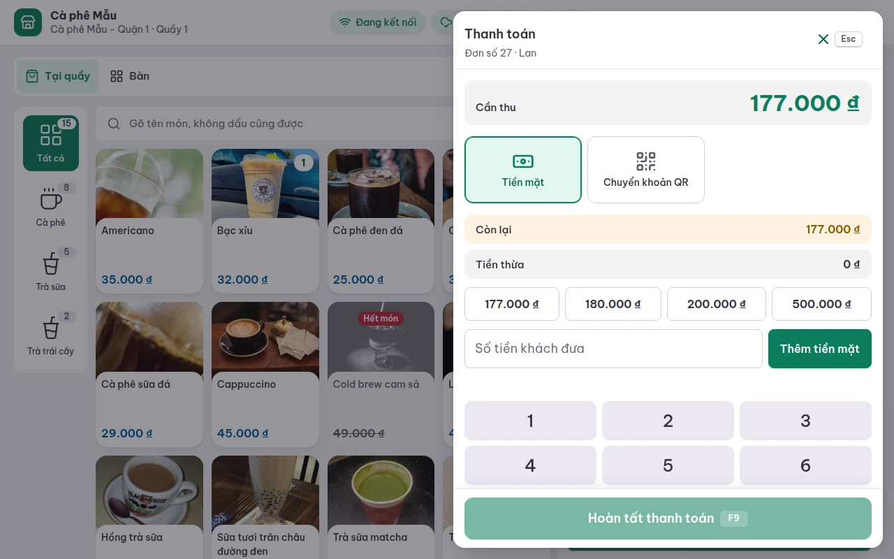
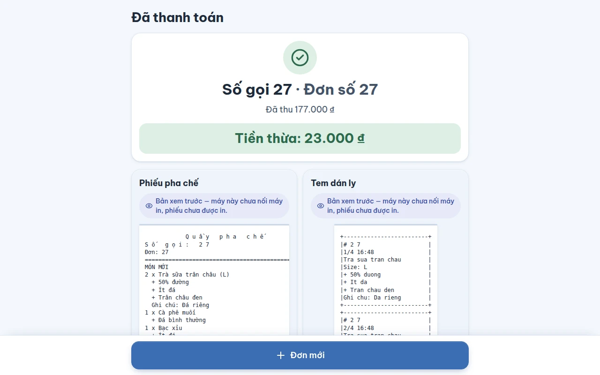
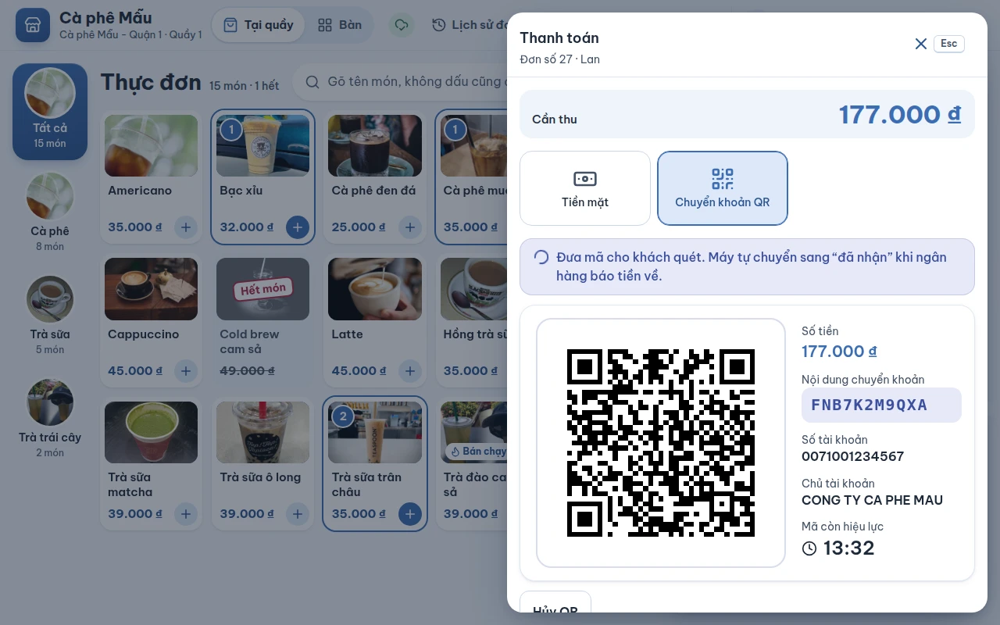
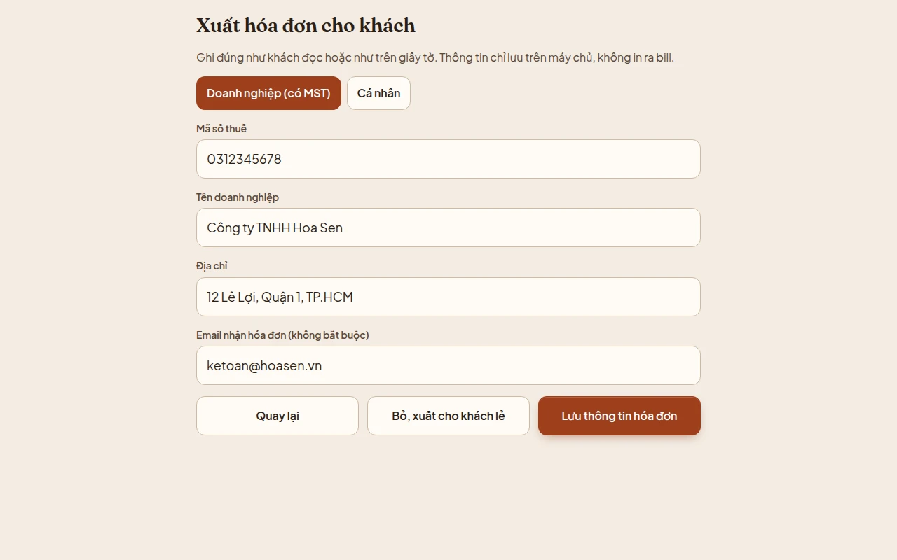
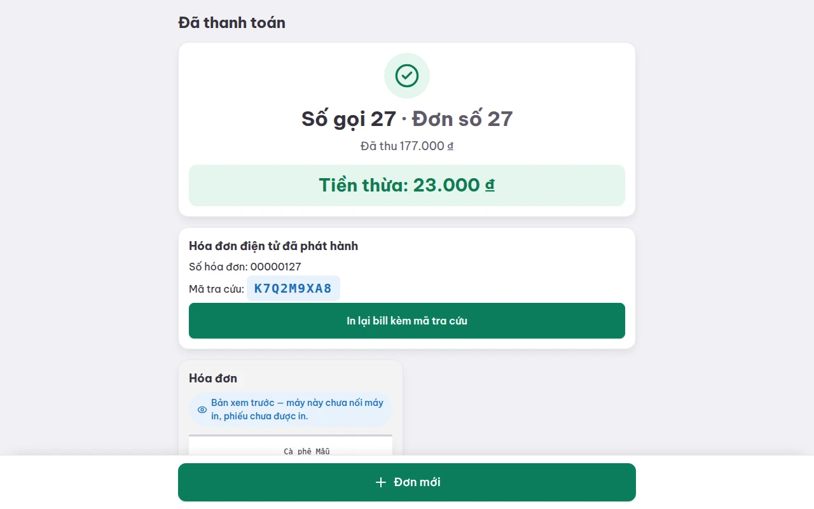
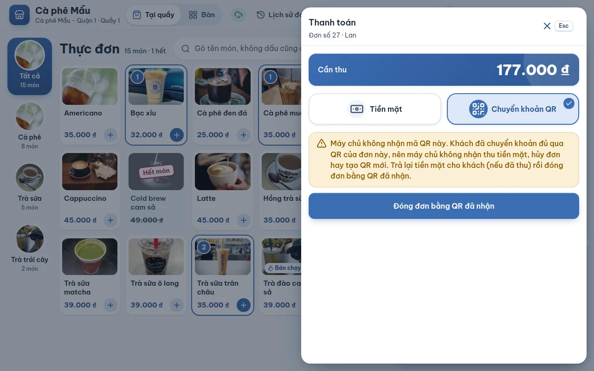

# Thanh toán

## Dùng để làm gì

Thu tiền của đơn đang bán (tại quầy hoặc tại bàn), tính tiền thừa, ghi người mua hóa đơn điện tử khi khách cần, rồi chuyển sang đơn mới.

## Ai dùng, cần quyền gì

Mọi nhân viên đã đăng nhập. Không cần quyền riêng để thu tiền. Cài tài khoản nhận chuyển khoản (để có mã QR) là việc của chủ quán ở trang quản lý (Cài đặt, mục **Tài khoản nhận tiền**); bật ví điện tử (ZaloPay) cũng vậy (Cài đặt, mục **Ví điện tử**).

## Các bước

### Mở ngăn thanh toán

Ở màn bán (hoặc màn bàn), bấm **Thanh toán** hoặc phím **F9**. Ngăn **Thanh toán** trượt ra từ bên phải, ghi số đơn và người bán, số **Cần thu** to ở trên, và hai thẻ: **Tiền mặt** và **Chuyển khoản QR**. Chi nhánh đã bật ví điện tử thì có thêm một thẻ cho mỗi ví (hiện có **ZaloPay**), đứng sau thẻ QR; không bật ví nào thì vẫn đúng hai thẻ. Mỗi lần chỉ chọn **một** cách.

### Thu tiền mặt

1. Chạm một nút số tiền gợi ý — số đúng bằng tiền cần thu, rồi các số làm tròn lên theo tờ tiền khách hay đưa (ví dụ đơn 177.000 đ: **177.000 · 180.000 · 200.000 · 500.000**). Hoặc gõ số tiền khách đưa vào ô **Số tiền khách đưa** (bằng bàn phím số trên màn hoặc bàn phím thật) rồi bấm **Thêm tiền mặt**.
2. Khách trả làm nhiều lần (ví dụ đưa 100.000 rồi đưa thêm 100.000): thêm từng lần. Mỗi lần nhận hiện thành một dòng, có nút **Bỏ** để gỡ nếu nhập nhầm.
3. Máy hiện **Còn lại** (khi chưa đủ) và **Tiền thừa** (khi đưa dư).
4. Đủ tiền thì bấm **Hoàn tất thanh toán** hoặc **F9**.
5. Màn **Đã thanh toán** hiện **Số gọi · Đơn số**, số đã thu, **Tiền thừa** thật to để thối cho khách, và các phiếu (xem [10-phieu-in.md](10-phieu-in.md)). Bấm **Đơn mới** cho khách tiếp theo.

   

### Thu bằng chuyển khoản QR (tự xác nhận)

1. Chọn thẻ **Chuyển khoản QR**. Máy vẽ mã VietQR cho **đúng số tiền cả đơn**, kèm số tiền, **nội dung chuyển khoản**, số tài khoản, chủ tài khoản và thời gian **Mã còn hiệu lực**.

   

2. Đưa mã cho khách quét. **Không cần bấm gì**: khi ngân hàng báo tiền về đúng số, máy tự chuyển sang "Đã nhận đủ tiền chuyển khoản. Đang hoàn tất đơn…" rồi sang màn **Đã thanh toán**.
3. Khách đổi ý trả tiền mặt: bấm **Thu cách khác** (hoặc **Hủy QR**) — máy gỡ mã QR trên máy chủ để một lần chuyển muộn không bị tính hai lần.
4. Mã hết hạn mà khách chưa chuyển: bấm **Tạo QR mới**.

### Thu bằng ví ZaloPay (khi chi nhánh bật ZaloPay)

1. Chọn thẻ **ZaloPay**. Máy gửi đơn lên máy chủ rồi nhờ máy chủ tạo mã thanh toán ZaloPay cho **đúng số tiền cả đơn** do máy chủ tính (máy quầy không tự đặt số tiền). Trong lúc chờ, ngăn ghi "Đang tạo mã ZaloPay…".
2. Màn hiện mã QR của ZaloPay, **Số tiền** và **Mã còn hiệu lực** (15 phút theo giờ máy chủ). Khách mở app ZaloPay, quét mã và bấm xác nhận — số tiền đã khóa sẵn trong mã, khách không gõ gì.
3. **Không cần bấm gì**: khi ZaloPay báo đã trả đúng số, máy chuyển sang "ZaloPay báo đã nhận đủ tiền. Đang hoàn tất đơn…" rồi sang màn **Đã thanh toán**, giống hệt QR chuyển khoản.
4. Khách đổi ý: bấm **Hủy mã** (hoặc **Thu cách khác**) — mã bị gỡ trên máy chủ; nếu khách vẫn trả muộn, khoản đó vào danh sách tiền chờ xử lý ở trang quản lý, không tự trả đơn.
5. Mã hết hạn hoặc ví không tạo được mã: bấm **Tạo mã mới** / **Thử lại**, hoặc thu cách khác.

### Hóa đơn điện tử cho khách (khi chi nhánh bật hóa đơn điện tử)

1. Trong ngăn thanh toán, dưới thẻ tiền mặt có dòng **Xuất hóa đơn cho khách**. Mặc định là **Khách lẻ — hóa đơn không ghi tên người mua.**
2. Khách cần hóa đơn: bấm vào, chọn **Doanh nghiệp (có MST)** hoặc **Cá nhân**, điền thông tin, bấm **Lưu thông tin hóa đơn**. Bấm **Bỏ, xuất cho khách lẻ** để quay về khách lẻ.

   

3. Quên hỏi trước khi thu tiền: vẫn sửa được ở màn **Đã thanh toán** (**Sửa thông tin hóa đơn**) cho tới khi hóa đơn được gửi đi phát hành.
4. Khi hóa đơn đã phát hành, màn Đã thanh toán hiện **Hóa đơn điện tử đã phát hành**, **Số hóa đơn**, **Mã tra cứu** và nút **In lại bill kèm mã tra cứu**. Chưa xong thì hiện "Hóa đơn điện tử đang chờ phát hành."

   

### In lại

- Ngay sau khi bán: các phiếu hiện trên màn **Đã thanh toán**.
- Về sau: **Lịch sử đơn** → chọn đơn đã trả → **In lại hóa đơn số …** (xem [08-lich-su-don.md](08-lich-su-don.md)).

## Luật và giới hạn

- **Ví ZaloPay** theo đúng luật của QR: một mã đang chờ mỗi đơn (QR chuyển khoản hay ví đều tính), mã sống **15 phút theo giờ máy chủ**, số tiền là **tổng máy chủ tính**; máy quầy hiện tổng khác (đơn vừa đổi ở nơi khác) thì máy chủ từ chối, không tạo mã. Ví báo số khác số của đơn (thiếu/thừa) thì đơn **không** tự đóng. Một lần trả chỉ được tính **một lần** dù ZaloPay báo nhiều lần.
- Ví không trộn với tiền mặt: chỉ chọn được thẻ ví khi chưa nhận đồng tiền mặt nào.
- **Không trộn tiền mặt với QR trong một đơn.** Mã QR luôn đòi đúng cả số cần thu (máy chủ kiểm), nên chỉ chọn được QR khi chưa nhận đồng tiền mặt nào; đã nhận tiền mặt mà khách muốn chuyển khoản thì **Bỏ** phần tiền mặt trước.
- Tiền mặt nhận được **nhiều lần**, tối đa **10 lần trả** mỗi đơn. Số gõ tay chỉ gồm chữ số (dấu chấm, dấu cách được bỏ qua), tối đa **11 chữ số**.
- Không ghi được "chuyển khoản tay": tiền chuyển khoản chỉ được ghi khi ngân hàng báo về qua đúng mã QR của đơn.
- Mã QR có hiệu lực **15 phút**, tính theo **giờ máy chủ** (đồng hồ máy quầy sai cũng không kéo dài được). Mỗi đơn chỉ có **một mã QR đang chờ**. Nội dung chuyển khoản là **FNB + 8 ký tự**, không dùng lại trong **7 ngày**.
- Khách chuyển **thiếu** hoặc **thừa**: đơn **không** tự đóng. Thu đủ bằng cách khác; khoản khách đã chuyển vào danh sách **cần hoàn** ở trang quản lý, người có quyền xử lý ở đó.
- Khách **đã chuyển đủ qua QR** mà thu ngân lại thu tiền mặt / hủy đơn / tạo QR mới: máy chủ từ chối. Trả lại tiền mặt cho khách, rồi bấm **Đóng đơn bằng QR đã nhận**.
- Tiền chuyển đến **sau khi mã hết hạn**: không tự trả đơn; quản lý khớp tay ở trang quản lý.
- Chỉ **tiền mặt** đi vào két của ca. Đơn tính vào ca **lúc thanh toán**.
- **Thông tin người mua** chỉ lưu trên máy chủ, **không in ra bill**. MST: 10 số, mã chi nhánh 10 số + gạch + 3 số (`0312345678-001`), hoặc 12 số của cá nhân; gõ liền 13 số máy hiểu là mã chi nhánh. Cá nhân phải có **số CCCD (12 số)** hoặc **số điện thoại** (bắt đầu bằng 0 hoặc +84, 10–11 số).
- Phím **F9** trong ngăn thanh toán là **Hoàn tất thanh toán**; tắt khi chưa đủ tiền.

## Khi có lỗi

| Máy báo | Nghĩa là | Làm gì |
|---|---|---|
| Nhập số tiền lớn hơn 0. | Số tiền bằng 0 | Gõ lại |
| Số tiền chỉ gồm chữ số, ví dụ 200000. | Gõ chữ / ký tự lạ | Gõ lại |
| Đơn đã đủ tiền, không cần nhận thêm. | Đã đủ, còn bấm thêm | Bấm Hoàn tất thanh toán |
| Một đơn nhận tối đa 10 lần trả. | Quá 10 lần | Bỏ bớt các lần nhỏ rồi nhập gộp |
| Chuyển khoản chỉ được ghi khi ngân hàng báo tiền về qua mã QR của đơn. | Định ghi chuyển khoản không qua QR | Dùng thẻ Chuyển khoản QR |
| Mã QR nhận đúng cả đơn: bỏ phần tiền mặt đã nhận nếu khách muốn chuyển khoản. | Đã nhận một phần tiền mặt | Bỏ dòng tiền mặt, rồi chọn QR |
| Chưa có tài khoản nhận chuyển khoản nên chưa tạo được QR. Quản lý nhập tài khoản ở trang quản lý (Cài đặt, mục Tài khoản nhận tiền). | Chi nhánh chưa cài tài khoản | Thu tiền mặt; báo chủ quán |
| Khách chuyển thiếu 20.000 ₫ — xử lý ở quầy. (hoặc **thừa**) | Ngân hàng báo số khác số của đơn | Thu đủ bằng cách khác; khoản đã chuyển nằm trong danh sách cần hoàn ở trang quản lý |
| Mã QR đã hết hạn. Nếu khách chưa chuyển, tạo mã mới. | Quá 15 phút | Bấm Tạo QR mới |
| Mã QR đã hết hạn và có tiền chuyển đến muộn. Báo quản lý khớp tay trước khi thu lại của khách. | Khách chuyển sau khi hết hạn | Báo quản lý, **đừng** thu thêm của khách |
| Mã QR này đã bị gỡ (đơn đã thu cách khác hoặc đã đổi). Tạo mã mới nếu cần. | QR đã bị gỡ | Tạo mã mới |
| Máy chủ không nhận mã QR này. — kèm câu lý do | Máy chủ từ chối mã | Làm theo câu lý do |
| Khách đã chuyển khoản đủ qua QR của đơn này, nên máy chủ không nhận thu tiền mặt, hủy đơn hay tạo QR mới. Trả lại tiền mặt cho khách (nếu đã thu) rồi đóng đơn bằng QR đã nhận. | Thu hai lần | Trả tiền mặt lại, bấm **Đóng đơn bằng QR đã nhận** |
| Máy chưa thấy QR đã được trả của đơn này. Chờ đồng bộ xong rồi thử lại. | Máy chưa nhận tin ngân hàng | Chờ vài giây khi có mạng |
| Không tạo được mã QR trên máy. Thu cách khác hoặc báo quản lý. | Lỗi vẽ mã | Thu tiền mặt |
| Không lưu được thanh toán trên máy. Thử lại; nếu vẫn lỗi, báo cho quản lý. | Máy không ghi được | Thử lại |
| Thanh toán ZaloPay cần có mạng: máy đang mất kết nối. Thu tiền mặt hoặc chuyển khoản QR. | Máy quầy mất mạng / không gọi được máy chủ | Thu tiền mặt hoặc QR |
| ZaloPay nhận đúng cả đơn: bỏ phần tiền mặt đã nhận nếu khách muốn trả bằng ví. | Đã nhận một phần tiền mặt | Bỏ dòng tiền mặt, rồi chọn ZaloPay |
| Chưa gửi được đơn lên máy chủ nên chưa tạo được mã ZaloPay. Kiểm tra mạng rồi thử lại. | Đơn còn nằm trên máy, chưa đồng bộ | Chờ có mạng rồi bấm Thử lại |
| Chi nhánh chưa bật ví này hoặc chưa nhập khóa. Quản lý bật ở trang quản lý (Cài đặt, mục Ví điện tử). | Quản lý vừa tắt ví / chưa nhập khóa | Thu cách khác; báo chủ quán |
| Ví chưa tạo được mã thanh toán (ví từ chối hoặc không trả lời). Thử lại hoặc thu cách khác. | ZaloPay từ chối hoặc không trả lời | Bấm Thử lại, hoặc thu cách khác |
| Ví báo nhận thiếu 20.000 ₫ — xử lý ở quầy. (hoặc **thừa**) | ZaloPay báo số khác số của đơn | Thu đủ bằng cách khác; khoản đó nằm trong danh sách cần hoàn |
| Mã đã hết hạn. Tạo mã mới nếu khách vẫn muốn trả bằng ví. | Quá 15 phút | Bấm Tạo mã mới |
| MST gồm 10 chữ số, mã chi nhánh thêm gạch và 3 số (0312345678-001), hoặc 12 số của cá nhân. | MST sai dạng | Sửa MST |
| Ghi tên doanh nghiệp đúng như đăng ký thuế. / Ghi số CCCD hoặc số điện thoại của khách. / Số CCCD gồm đúng 12 chữ số. / Số điện thoại bắt đầu bằng 0 hoặc +84, 10–11 chữ số. / Email chưa đúng dạng, ví dụ ketoan@congty.vn. / Dài quá mức hóa đơn cho phép. | Thiếu hoặc sai thông tin người mua | Sửa ô bị báo |
| Chi nhánh chưa bật hóa đơn điện tử nên không ghi được người mua. | Chi nhánh không phát hóa đơn | Báo chủ quán |
| Hóa đơn đã gửi đi phát hành nên không đổi được thông tin người mua nữa. | Sửa quá muộn | Không sửa được trên máy |
| Tổng các khoản đã thu khác số tiền cần thu của đơn. / Tổng tiền trên máy khác tổng máy chủ tính … Mở lại đơn để tính lại. | Đơn hoặc giá vừa đổi ở nơi khác | Mở lại đơn, thu lại cho đúng |

## Mất mạng thì sao

- **Tiền mặt**: thu bình thường, đơn tự gửi lên khi có mạng.
- **QR**: máy vẫn vẽ được mã (nội dung chuyển khoản do máy tạo), nhưng **chỉ biết khách đã chuyển khi có mạng** (tin ngân hàng đi qua máy chủ). Mất mạng thì nên thu tiền mặt.
- **Ví ZaloPay**: cần mạng — mã do máy chủ xin ZaloPay, không vẽ được trên máy. Máy báo mất kết nối thì thẻ ZaloPay ghi rõ lý do; thu tiền mặt hoặc QR.
- Hóa đơn điện tử: máy chủ phát hành khi nhận được đơn; mất mạng thì chờ.

## Chưa làm / sắp có

- Ví **MoMo**, **VNPay** (làm sau ZaloPay, cùng một lớp cổng ví); hoàn tiền qua ví (hiện tiền ví thừa/thiếu do người xử lý tay ở trang quản lý). Báo cáo cuối ngày chưa tách riêng tiền ví với tiền chuyển khoản QR (đều ghi là chuyển khoản).
- Thẻ ngân hàng (máy POS rời), thẻ trả trước, voucher, ghi nợ.
- Trộn nhiều cách trả trong một đơn (ví dụ một phần tiền mặt, một phần QR); chia bill.
- Làm tròn tiền mặt.
- QR tĩnh dự phòng khi không có tin báo của ngân hàng.
- Bill, tem ly, phiếu pha chế ra giấy (hiện là bản xem trước — xem [10-phieu-in.md](10-phieu-in.md)).
