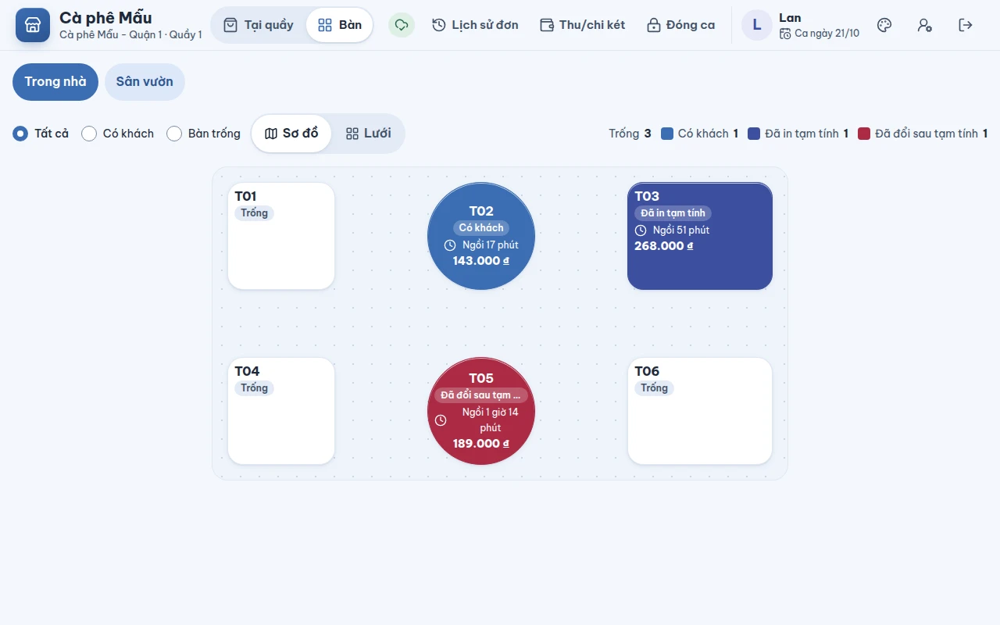
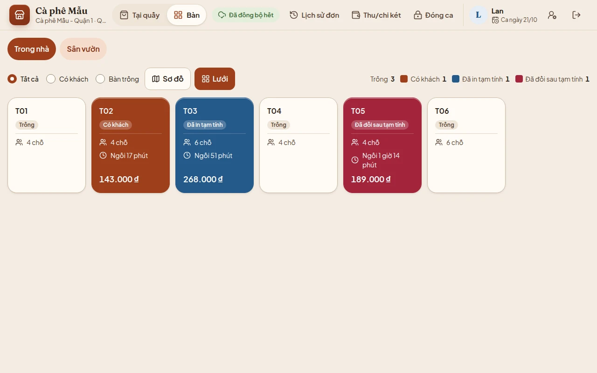
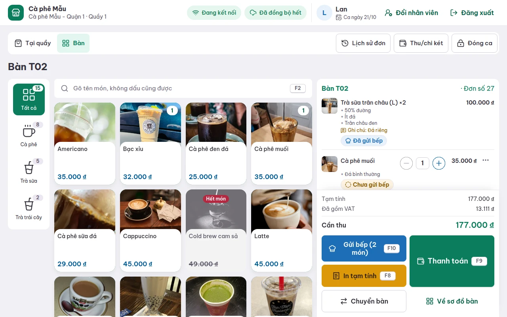
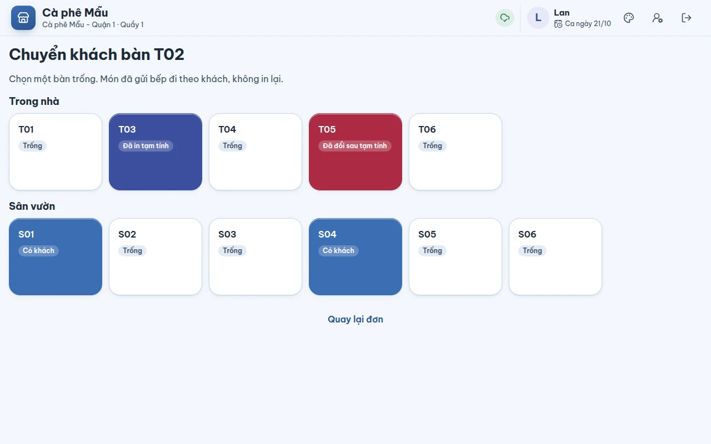

# Bán theo bàn

## Dùng để làm gì

Cho quán có chỗ ngồi: khách ngồi trước, gọi món nhiều lượt, **trả tiền sau**. Máy giữ đơn theo từng bàn, gửi bếp từng lượt (chỉ phần mới), in tạm tính cho khách xem, chuyển khách sang bàn khác, rồi thu tiền tại bàn.

## Ai dùng, cần quyền gì

- Mọi nhân viên đã đăng nhập mở bàn, gọi món, gửi bếp, in tạm tính, thu tiền được.
- **Chuyển bàn** cần quyền `transfer_table` (vai trò mẫu: thu ngân, phục vụ, quản lý đều có). Người không có quyền thì quản lý duyệt tại chỗ (xem [06](06-huy-giam-hoan-va-duyet.md)).
- **Hủy đơn bàn đã in tạm tính hoặc đã gửi bếp** cần quyền `close_unpaid_table` — xem [06](06-huy-giam-hoan-va-duyet.md).
- Chủ quán bật **bán theo bàn** và vẽ sơ đồ (khu, bàn, số chỗ) ở trang quản lý, mục **Sơ đồ bàn**. Công tắc tắt thì máy quầy không hiện nút **Bàn**.

## Các bước

### Xem sơ đồ bàn

1. Trên thanh thứ hai, bấm **Bàn** (bấm **Tại quầy** để về bán tại quầy — đơn quầy đang dở vẫn còn nguyên).
2. Chọn khu (ví dụ **Trong nhà**, **Sân vườn**). Lọc **Tất cả / Có khách / Bàn trống**. Chọn cách xem **Sơ đồ** (bàn đặt đúng chỗ như vẽ ở trang quản lý) hoặc **Lưới**.

   

   

3. Mỗi bàn ghi tên, trạng thái, khách đã **ngồi bao lâu** và số tiền đang có. Chú thích ở góc phải đếm số bàn mỗi trạng thái:

   | Trạng thái | Nghĩa |
   |---|---|
   | **Trống** | chưa có đơn |
   | **Có khách** | đang có đơn chưa trả |
   | **Đã in tạm tính** | đã in (hoặc đã xem) phiếu tạm tính, đang chờ khách trả |
   | **Đã đổi sau tạm tính** | đơn đổi sau khi in tạm tính: phiếu khách đang cầm không còn đúng |

### Mở bàn và gọi món

1. Chạm vào một bàn. Màn **Bàn T02** mở ra: thực đơn bên trái, đơn của bàn bên phải.

   

2. Chạm món như bán tại quầy (xem [03-ban-tai-quay.md](03-ban-tai-quay.md)). Bàn chỉ chuyển sang **Có khách** khi đơn đã có **món đầu tiên**.
3. Mỗi món ghi **Đã gửi bếp** hoặc **Chưa gửi bếp**.

### Gửi bếp từng lượt

1. Bấm **Gửi bếp (2 món)** hoặc phím **F10**. Mỗi trạm (quầy pha chế, bếp…) nhận một phiếu **chỉ gồm món mới** từ lượt trước.
2. Khách gọi thêm: chạm thêm món rồi gửi bếp lần nữa — lượt sau chỉ có phần mới.
3. Muốn rời bàn (**Về sơ đồ bàn**) khi còn món chưa gửi, máy hỏi **Còn món chưa gửi bếp** — chọn **Ở lại gửi bếp** hoặc **Vẫn rời**.

### In tạm tính

Bấm **In tạm tính** hoặc **F8**. Bàn chuyển sang **Đã in tạm tính**. Nếu sau đó có ai thêm/bớt món, máy báo "Đơn đã đổi sau khi in tạm tính…" và bàn chuyển sang **Đã đổi sau tạm tính**: in tạm tính lại trước khi thu tiền.

### Thu tiền tại bàn

Bấm **Thanh toán** hoặc **F9** — cùng ngăn thanh toán như tại quầy (xem [04-thanh-toan.md](04-thanh-toan.md)). Trả xong, bàn trở về **Trống**. Thu tiền không gửi bếp lại những món đã gửi.

### Chuyển bàn

1. Trong đơn của bàn, bấm **Chuyển bàn**.
2. Chọn **một bàn trống**. Món đã gửi bếp đi theo khách, **không in lại**.

   

3. Máy về sơ đồ và báo "Đã chuyển khách từ bàn T02 sang bàn T04."

## Luật và giới hạn

- **Mỗi bàn chỉ có một đơn đang mở** (máy chủ chặn). Hai máy cùng mở một bàn trống cùng lúc: máy nào lưu trước giữ bàn, máy sau được báo để mở lại đơn đang có rồi gọi thêm vào đó.
- **Hai máy cùng thêm món vào một bàn**: máy lưu sau tự gộp lại một lần trên bản mới nhất, **giữ món của cả hai máy** (ưu tiên không mất món; một món vừa xóa có thể hiện lại, xóa lại là được). Gộp xong vẫn lệch thì máy dừng lưu và báo.
- Món **đã gửi bếp** chỉ còn đọc: không sửa, không bớt bằng nút −; gọi thêm thì thành dòng mới; muốn bớt thì **Hủy món** (có phiếu hủy cho bếp).
- **Chuyển bàn chỉ sang bàn trống.** Bàn đang có khách thì máy từ chối (chưa gộp được hai bàn).
- Tạm tính **in hay chỉ xem trên màn đều tính là đã đưa khách xem** (bàn chuyển sang "Đã in tạm tính"); máy in kẹt giấy thì **không** tính.
- Sơ đồ bàn có sẵn trên máy (tải về khi ghép máy và cập nhật khi đồng bộ), trạng thái bàn lấy từ đơn máy đang giữ.
- Số đơn của bàn lấy từ dãy số đơn của chính máy mở bàn đó (giống tại quầy).

## Khi có lỗi

| Máy báo | Nghĩa là | Làm gì |
|---|---|---|
| Đang tải sơ đồ bàn… / Không tải được sơ đồ bàn. Kiểm tra mạng; máy sẽ tự thử lại. | Máy chưa có sơ đồ | Chờ; kiểm tra mạng |
| Chi nhánh chưa có bàn nào. Thêm khu và bàn ở trang quản lý, mục Sơ đồ bàn. | Chưa vẽ sơ đồ | Chủ quán vẽ sơ đồ |
| Khu này chưa có bàn. / Không có bàn nào khớp bộ lọc. | Khu trống / lọc không ra bàn | Đổi khu hoặc bộ lọc |
| Đơn của bàn này chưa về máy. Chờ máy đồng bộ (vài giây khi có mạng) rồi chạm lại vào bàn. | Máy khác vừa mở bàn, đơn chưa tới máy này | Chờ vài giây, chạm lại |
| Bàn T05 đang có khách. Máy chưa gộp được hai bàn: chọn một bàn trống, hoặc thanh toán riêng từng bàn. | Chuyển sang bàn có khách | Chọn bàn trống |
| Không còn bàn trống nào ở chi nhánh. | Hết bàn trống | — |
| Máy khác vừa mở bàn này trước nên đơn bạn gọi chưa được lưu vào bàn. Về sơ đồ bàn, chạm lại vào bàn để mở đơn đang có rồi gọi thêm vào đó. | Hai máy mở cùng một bàn | Làm đúng như câu báo |
| Máy khác vừa sửa bàn này — đã cập nhật, kiểm lại món rồi lưu. | Hai máy cùng sửa đơn | Kiểm lại món |
| Bàn muốn chuyển đến vừa có khách (máy khác mở trước) nên khách vẫn ở bàn cũ. Chọn một bàn trống khác. | Bàn đích vừa bị chiếm | Chọn bàn khác |
| Bạn chưa được tự chuyển bàn: nhờ quản lý chuyển giúp, hoặc đăng nhập người có quyền chuyển bàn. | Thiếu quyền chuyển bàn | Nhờ quản lý |
| Bàn này vừa được gỡ khỏi sơ đồ ở trang quản lý. Về sơ đồ bàn rồi chọn bàn khác cho khách. (hoặc "Máy chủ không thấy bàn này…") | Bàn bị xóa/gỡ | Chọn bàn khác |
| Đơn này vừa được chuyển sang bàn khác ở máy khác. Về sơ đồ bàn rồi mở đơn ở bàn mới. | Máy khác đã chuyển bàn | Mở ở bàn mới |
| Đơn này đã được thanh toán (có thể ở máy khác) nên không sửa được nữa. Về sơ đồ bàn: bàn đã trống. | Máy khác đã thu tiền | Về sơ đồ |
| Đơn này đã bị hủy nên không sửa được nữa. Về sơ đồ bàn rồi mở bàn để gọi đơn mới. | Đơn đã hủy | Mở đơn mới |
| Số đơn của máy trùng với một đơn khác. Về sơ đồ bàn rồi mở lại bàn để máy cấp số mới. | Trùng số đơn | Mở lại bàn |
| Đơn này không lưu được nữa. Về sơ đồ bàn rồi mở lại bàn. | Máy chủ từ chối đơn | Mở lại bàn để thấy đơn như máy chủ giữ |

## Mất mạng thì sao

- Sơ đồ bàn **vẫn hiện** (đã có trên máy), mở bàn, gọi món, gửi bếp, in tạm tính, thu tiền mặt đều được trên máy đang dùng.
- Máy **không thấy** bàn mà máy khác vừa mở hay vừa trả trong lúc mất mạng; hai máy cùng đụng một bàn thì khi có mạng lại, máy chủ quyết định và máy báo bằng các câu ở bảng trên.
- Chuyển bàn khi mất mạng: máy ghi lại và gửi khi có mạng; nếu bàn đích đã có khách thì khách ở lại bàn cũ và máy báo.

## Chưa làm / sắp có

- **Phiếu bếp ra giấy.** Bản đang chạy (trong trình duyệt) chưa nối máy in: bấm **Gửi bếp** chỉ hiện phiếu trên màn để đọc cho bếp, và **món vẫn ở trạng thái "Chưa gửi bếp"** (máy chỉ đánh dấu đã gửi khi máy in nhận phiếu). Lượt sau bấm Gửi bếp sẽ hiện lại các món đó. Xem [10-phieu-in.md](10-phieu-in.md).
- Gộp bàn, ghép bàn, tách món sang bàn khác, chia bill.
- Giữ món / gọi món theo lượt (course), màn hình bếp (KDS).
- Phục vụ gọi món bằng điện thoại, khách tự gọi món bằng QR tại bàn.
- Đặt bàn trước.
- Máy chính trong mạng nội bộ để các máy thấy nhau khi mất internet.
