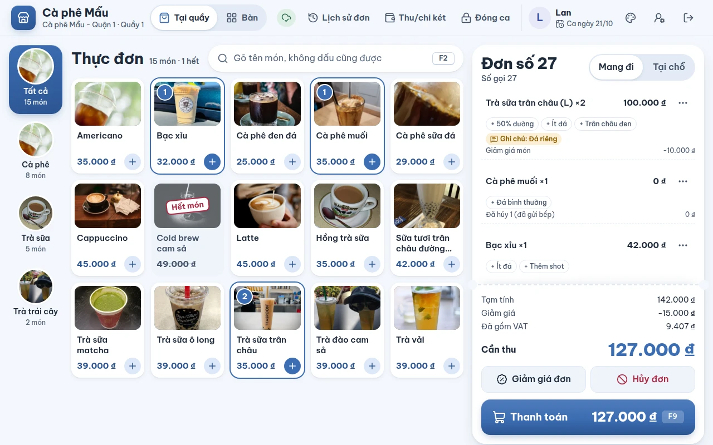
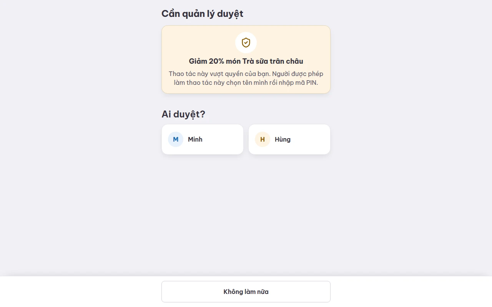
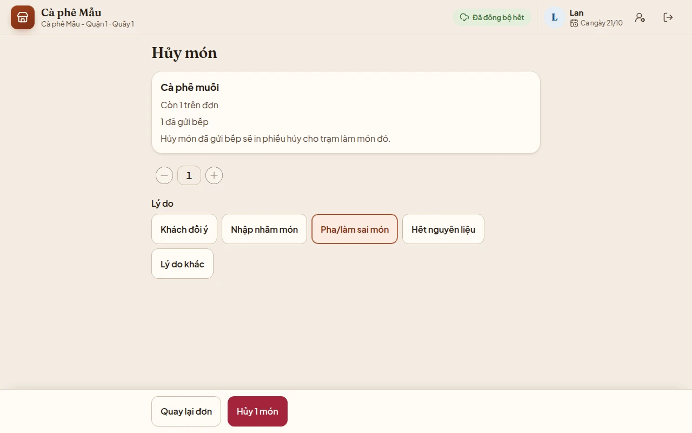
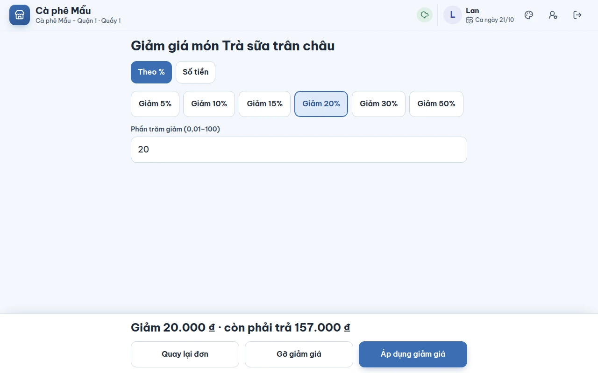
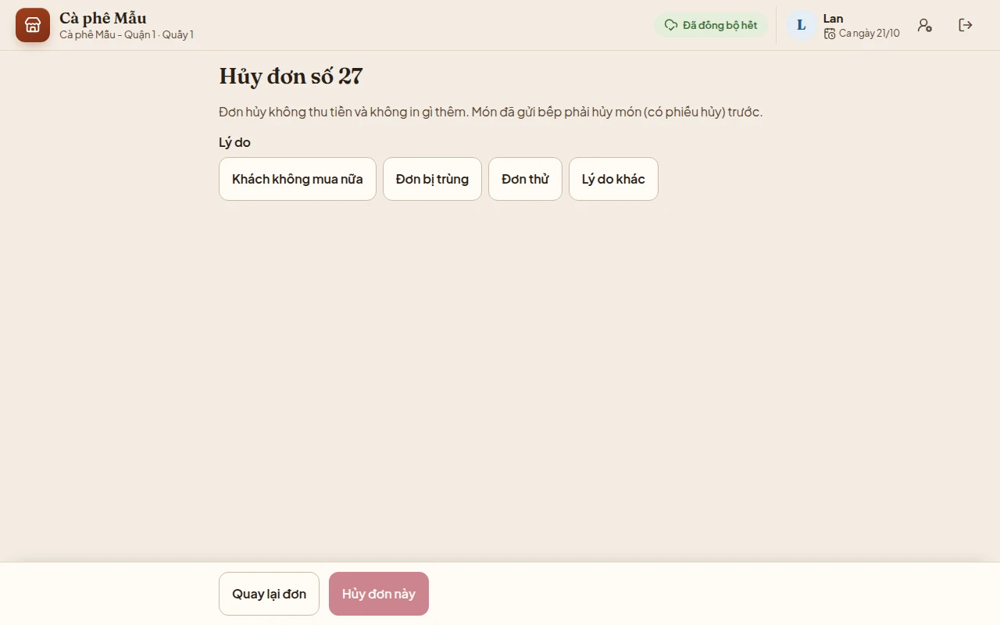
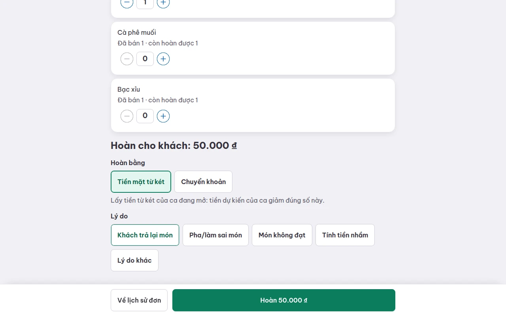

# Hủy món, giảm giá, hủy đơn, hoàn tiền và duyệt tại chỗ

## Dùng để làm gì

Những thao tác làm **bớt tiền** của quán đều đi qua một luồng chung: máy xem người đang đứng quầy có được tự làm không; nếu vượt quyền, một người có quyền (thường là quản lý) **chọn tên mình và nhập PIN ngay trên máy** để cho phép **đúng một lần** thao tác đó. Mọi lần duyệt được ghi nhật ký (ai xin, ai duyệt, duyệt cái gì).

| Thao tác | Khi nào dùng | Ở đâu |
|---|---|---|
| **Xóa món** / nút − | món **chưa gửi bếp**, chưa giảm giá | nút ⋯ của món |
| **Hủy món** | món đã gửi bếp (bếp đã làm hoặc đang làm) | nút ⋯ của món |
| **Giảm giá** món | giảm cho một món | nút ⋯ của món |
| **Giảm giá đơn** | giảm cho cả đơn | dưới tổng tiền |
| **Hủy đơn** | khách không mua nữa, đơn chưa trả | dưới tổng tiền |
| **Hoàn tiền** | đơn **đã trả**, khách trả lại món | Lịch sử đơn → đơn đã trả |

## Ai dùng, cần quyền gì

Quyền nằm ở **vai trò** của nhân viên (chủ quán sửa ở trang quản lý). Vai trò mẫu khi tạo quán:

| Quyền | Thu ngân | Quản lý ca | Chủ quán |
|---|---|---|---|
| Giảm giá món (`line_discount`) | tự làm tới **10%** mỗi món | không giới hạn | không giới hạn |
| Giảm giá đơn (`order_discount`) | phải xin duyệt | không giới hạn | không giới hạn |
| Hủy món đã gửi bếp (`void_after_sent`) | phải xin duyệt | có | có |
| Hủy đơn đã in tạm tính / đã gửi bếp (`close_unpaid_table`) | phải xin duyệt | có | có |
| Hoàn tiền (`refund`) | phải xin duyệt | có | có |
| Thu/chi két (`cash_move`) | tự làm tới **500.000 đ** cộng dồn trong ca | không giới hạn | không giới hạn |
| Chuyển bàn (`transfer_table`) | có | có | có |
| Chấp nhận lệch két khi đóng ca (`accept_close_difference`) | phải xin duyệt | có | có |

Pha chế không có quyền nào trong số này. Các quyền quản trị (sửa thực đơn, nhân viên, thiết bị, cài đặt, xem báo cáo) **không duyệt hộ được**: người có quyền phải tự làm ở trang quản lý.

## Các bước

### Duyệt tại chỗ (chung cho mọi thao tác)

1. Thu ngân làm thao tác như bình thường. Nếu vượt quyền, máy thay màn hiện tại bằng màn **Cần quản lý duyệt**, ghi rõ đang xin duyệt gì, ví dụ "Giảm 20% món Trà sữa trân châu".

   

2. Ở mục **Ai duyệt?**, người duyệt chạm vào tên mình, nhập PIN, bấm **Duyệt**. Chạm **Chọn người khác** nếu nhầm người.
3. Duyệt xong, thao tác được ghi luôn. Bấm **Không làm nữa** để bỏ — máy không ghi gì.

### Bớt / xóa món chưa gửi bếp

Nút **−** bên cạnh món, hoặc **⋯** → **Xóa món**. Không cần lý do, không cần duyệt.

### Hủy món (đã gửi bếp)

1. Bấm **⋯** của món → **Hủy món**. Màn ghi **Còn 2 trên đơn · 1 đã gửi bếp**.

   

2. Chọn **Số lượng hủy** và **Lý do**: *Khách đổi ý · Nhập nhầm món · Pha/làm sai món · Hết nguyên liệu · Lý do khác*.
3. Bấm **Hủy 1 món**. Phần **chưa gửi bếp** được hủy trước; phần đã gửi bếp cần duyệt (nếu chi nhánh bật) và in **phiếu hủy** cho trạm đã làm món đó.
4. Trên đơn, món bị hủy hiện thêm dòng "Đã hủy 1 (đã gửi bếp)".

### Giảm giá món hoặc giảm giá đơn

1. Món: **⋯** → **Giảm giá**. Cả đơn: nút **Giảm giá đơn**.
2. Chọn **Theo %** (nút nhanh **5% · 10% · 15% · 20% · 30% · 50%**, hoặc gõ) hoặc **Số tiền** (đồng).
3. Máy xem trước "Giảm 18.000 ₫ · còn phải trả 159.000 ₫". Bấm **Áp dụng giảm giá**.

   

4. Bấm **Gỡ giảm giá** để bỏ — gỡ không cần duyệt.

### Hủy đơn (chưa trả)

1. Bấm **Hủy đơn** dưới tổng tiền. Màn ghi "Đơn hủy không thu tiền và không in gì thêm. Món đã gửi bếp phải hủy món (có phiếu hủy) trước."

   

2. Chọn **Lý do**: *Khách không mua nữa · Đơn bị trùng · Đơn thử · Lý do khác*. Bấm **Hủy đơn này**.
3. Đơn chưa từng in tạm tính, chưa từng gửi bếp: thu ngân tự hủy. Đơn **đã in tạm tính** hoặc **đã gửi bếp**: cần duyệt (chặn kiểu "in tạm tính → thu tiền khách → hủy đơn").

### Hoàn tiền đơn đã trả

1. **Lịch sử đơn** → chọn đơn đã trả → **Hoàn tiền đơn số …** (xem [08-lich-su-don.md](08-lich-su-don.md)).
2. Chọn số lượng hoàn của từng món (mỗi món ghi **Đã bán 2 · còn hoàn được 2**). Máy tính **số tiền hoàn theo đúng giá đã bán** (đã trừ giảm giá) — thu ngân không gõ số tiền.
3. Chọn **Hoàn bằng**: **Tiền mặt từ két** (két của ca đang mở giảm đúng số này) hoặc **Chuyển khoản** (máy chỉ ghi lại; thu ngân tự chuyển từ tài khoản cửa hàng; két không đổi).
4. Chọn **Lý do**: *Khách trả lại món · Pha/làm sai món · Món không đạt · Tính tiền nhầm · Lý do khác*. Bấm **Hoàn 35.000 ₫**.

   

5. Máy in phiếu hoàn tiền (xem [10-phieu-in.md](10-phieu-in.md)).

## Luật và giới hạn

- **Ngưỡng tính cộng dồn**, không tính từng lần:
  - Giảm giá: so **tổng phần trăm mọi giảm giá cùng loại** trên món đó (hoặc trên đơn) **sau khi** thêm lần này, **làm tròn lên**. Ví dụ thu ngân giới hạn 10% đã giảm 10% cho một ly, giảm thêm 5% nữa là 15% ⇒ phải xin duyệt; màn duyệt ghi "(tổng giảm sau lần này: 15%)".
  - Thu/chi két: so **tổng số tiền đã thu và đã chi khỏi két trong cả ca** (mọi nhân viên trên két đó cộng chung, lấy độ lớn — rút 400.000 rồi bỏ lại 400.000 là 800.000 đ). Màn duyệt ghi "(két đã thu và chi trong ca, kể cả lần này: …)".
- **Duyệt dùng một lần**, cho đúng thao tác và đúng con số đã xin. Đơn vừa đổi ở máy khác làm con số khác đi thì phải xin lại.
- **Hạn duyệt**: thao tác phải được ghi trong **10 phút** sau khi duyệt (cho phép đồng hồ máy chậm 2 phút), và phải tới máy chủ trong **2 giờ**.
- **Không tự duyệt cho mình**. Người duyệt phải có quyền tự làm thao tác đó; danh sách **Ai duyệt?** là mọi nhân viên đang hoạt động của chi nhánh trừ người xin, máy chủ quyết định ai đủ quyền.
- Hủy món đã gửi bếp **cần duyệt** theo cài đặt chi nhánh `void_after_sent_needs_approval` (mặc định **bật**). Tắt thì ai cũng hủy được món đã gửi bếp.
- Hủy món **không trả nguyên liệu về kho** (chưa có kho).
- Món đang giảm giá: gỡ giảm giá trước rồi mới hủy. Món đã hủy một phần: không giảm giá thêm.
- Đơn có **giảm giá toàn đơn**: các món đang có bị khóa sửa/xóa; hủy món làm phần giảm toàn đơn vượt mức được tự giảm thì máy chặn.
- Hoàn tiền tạo một **đơn hoàn riêng** gắn với đơn gốc; số còn hoàn được trừ cả những lần hoàn trước. Hoàn **không nhập lại kho**. Chỉ hoàn được đơn **đã trả**.
- Giảm theo % gõ được số lẻ tới 2 chữ số sau dấu phẩy (ví dụ `12,5`), từ trên 0 đến 100.

## Khi có lỗi

| Máy báo | Nghĩa là | Làm gì |
|---|---|---|
| Duyệt cần mạng: máy chưa kết nối được máy chủ. Kiểm tra mạng rồi thử lại, hoặc không làm thao tác này. | Mất mạng lúc xin duyệt | Chờ có mạng, hoặc người có quyền tự đăng nhập làm |
| Mã PIN không đúng. / Nhập sai PIN quá nhiều lần. Thử lại lúc … | PIN người duyệt sai / bị khóa | Nhập lại / chờ |
| Người này cũng không được tự làm thao tác này nên không duyệt được. Chọn người khác. | Người duyệt thiếu quyền | Chọn quản lý khác |
| Không tự duyệt cho mình được. Chọn người khác. | Chọn chính mình | Chọn người khác |
| Thao tác này không duyệt hộ được: người có quyền phải tự làm. | Quyền quản trị | Người có quyền tự làm |
| Bạn không có quyền làm thao tác này và không ai duyệt hộ được. | Không ai duyệt được | Báo chủ quán |
| Chi nhánh không có ai khác để duyệt. Thêm quản lý ở trang quản lý. | Chỉ có một nhân viên | Thêm quản lý |
| Phiên đứng quầy đã hết hạn. Nhập lại mã PIN để làm tiếp. | Phiên hết hạn giữa chừng | Nhập lại PIN |
| Lần duyệt đã quá hạn khi thao tác được ghi. / Lần duyệt này đã được dùng rồi … / Quản lý đã duyệt một con số khác với thao tác máy gửi … / Máy chủ không tìm thấy lần duyệt này. / Lần duyệt này dành cho người khác hoặc máy khác. (… Làm lại thao tác và nhờ quản lý duyệt lại.) | Lần duyệt không còn dùng được | Làm lại và xin duyệt lại |
| Máy chủ cần quản lý duyệt thao tác này mà lệnh không kèm lần duyệt nào. … | Máy chủ đòi duyệt | Làm lại, nhờ quản lý nhập PIN |
| Hủy món đã gửi bếp cần quản lý duyệt. | — | Xin duyệt |
| Số lượng hủy nhiều hơn số còn lại trên đơn. | Hủy quá số | Giảm số lượng hủy |
| Món đang được giảm giá: gỡ giảm giá của món trước rồi mới hủy. | — | Gỡ giảm giá |
| Hủy món làm phần giảm giá toàn đơn lớn hơn mức bạn được tự giảm. Gỡ giảm giá đơn trước, hủy món, rồi giảm lại. | — | Làm theo câu báo |
| Bếp đã có món của đơn này chưa được hủy. Hủy từng món đã gửi bếp (in phiếu hủy) trước, rồi mới hủy đơn. | Hủy đơn khi còn món đã gửi bếp | Hủy món trước |
| Nhập số: phần trăm từ 1 đến 100, hoặc số tiền chỉ gồm chữ số. | Gõ sai mức giảm | Gõ lại |
| Mức giảm này làm tròn ra 0 ₫ trên số còn phải trả. | Mức quá nhỏ | Tăng mức giảm |
| Số tiền giảm lớn hơn số còn phải trả. / Nhập mức giảm lớn hơn 0. / Món đã hủy một phần nên không giảm giá thêm được. | — | Sửa mức giảm |
| Chọn ít nhất một món để hoàn. / Số lượng hoàn nhiều hơn số còn chưa hoàn của món. / Chỉ hoàn được đơn đã thanh toán. / Đơn này đã hoàn hết. | Hoàn sai | Chọn lại |
| Đơn chưa lưu xong trên máy (hoặc lần lưu vừa rồi lỗi). Quay lại đơn rồi thử lại. | Đơn đang lưu dở | Quay lại đơn, thử lại |

## Mất mạng thì sao

- Thao tác **trong quyền của mình** (xóa món chưa gửi, giảm giá trong ngưỡng, hủy đơn chưa in/chưa gửi) làm được khi mất mạng; máy gửi lên khi có mạng.
- **Xin duyệt cần mạng** (máy chủ kiểm PIN người duyệt). Mất mạng thì hoặc chờ, hoặc người có quyền tự đăng nhập trên máy làm thao tác đó (nếu họ đã đăng nhập từ trước khi mất mạng).
- Hủy món đã gửi bếp khi mất mạng: phiếu hủy vẫn hiện/in từ bản trên máy; máy báo "Phiếu hủy đã in nhưng máy chưa báo được máy chủ…" và ghi lại khi có mạng.

## Chưa làm / sắp có

- Chủ quán tự sửa danh sách lý do hủy/hoàn (hiện cố định, mỗi danh sách có "Lý do khác").
- Đổi giá món tại quầy (`price_override`), tặng món (`comp_item`), mở két không bán (`open_drawer`), mở lại đơn đã trả (`reopen_paid_order`): đã có quyền trong vai trò nhưng máy quầy chưa có nút.
- Hoàn tiền có nhập lại kho; hóa đơn điều chỉnh khi hoàn đơn đã xuất hóa đơn điện tử.
- Phiếu hủy ra giấy (hiện là bản xem trước — xem [10-phieu-in.md](10-phieu-in.md)).
