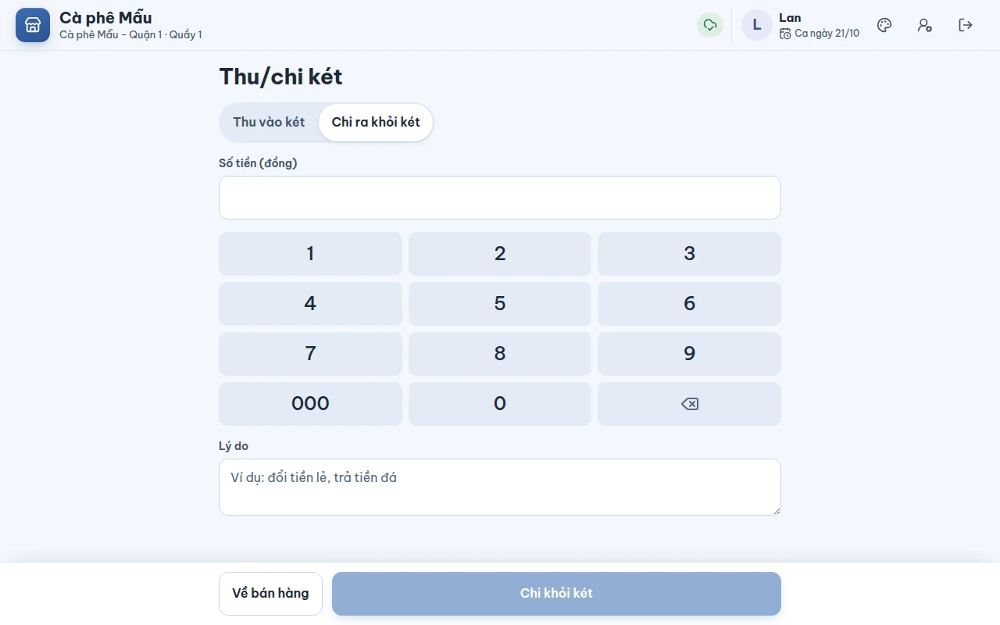
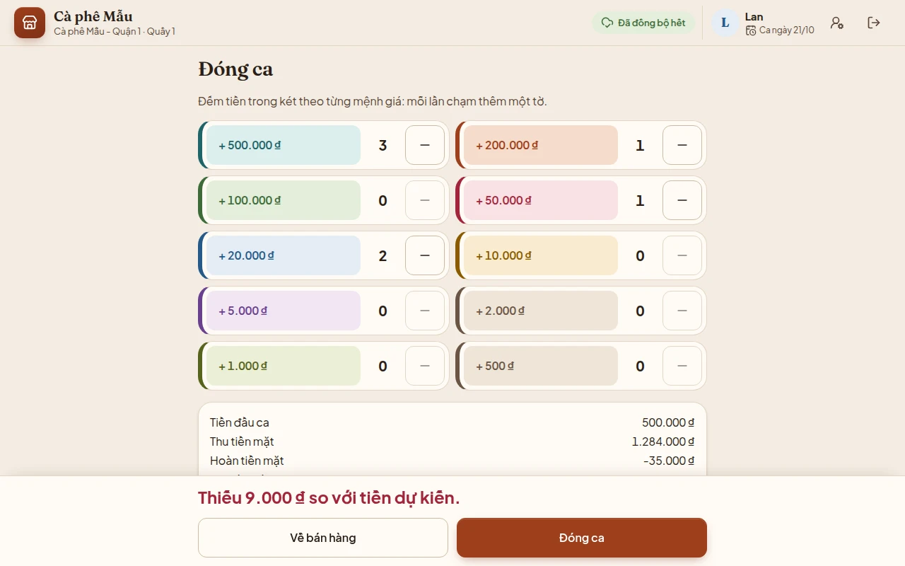

# Thu/chi két và đóng ca

## Dùng để làm gì

- **Thu/chi két**: ghi mọi lần bỏ tiền vào hoặc lấy tiền ra khỏi két **ngoài bán hàng** — đổi tiền lẻ, trả tiền đá, tiền sữa giao tới… — kèm lý do, để cuối ca két vẫn khớp.
- **Đóng ca**: đếm tiền trong két, so với **tiền dự kiến** máy tính ra, ghi chênh lệch và in phiếu chốt ca.

## Ai dùng, cần quyền gì

- Thu/chi két: quyền `cash_move`. Thu ngân (vai trò mẫu) tự làm được khi **tổng thu + chi trong ca không quá 500.000 đ**; quá thì quản lý duyệt tại chỗ. Quản lý ca, chủ quán không giới hạn.
- Đóng ca: ai đang đứng quầy cũng đóng được. Két **lệch** quá mức cho phép của quán thì cần người có quyền `accept_close_difference` (quản lý ca, chủ quán) duyệt **đúng số tiền lệch đó**.
- Chủ quán đặt **mức lệch cho phép** ở trang quản lý → **Cài đặt** → **Ngưỡng chênh lệch khi đóng ca** (tính bằng đồng; đặt cho cả thương hiệu, chi nhánh hoặc riêng từng máy — xem [09-cai-dat](../quan-ly/09-cai-dat.md)). Máy quầy nhận mức đó qua đồng bộ như mọi cài đặt khác.

## Các bước

### Thu hoặc chi tiền két

1. Trên thanh trên cùng bấm **Thu/chi két**.
2. Chọn **Thu vào két** hoặc **Chi ra khỏi két**, gõ **Số tiền (đồng)**, ghi **Lý do** (ví dụ "đổi tiền lẻ", "trả tiền đá").
3. Máy hiện trước **Tiền dự kiến trong két sau đó: …**. Bấm **Thu … vào két** / **Chi … khỏi két**.

   

4. Vượt ngưỡng thì máy hiện màn **Cần quản lý duyệt** (xem [06](06-huy-giam-hoan-va-duyet.md)). Xong, máy báo "Đã chi 150.000 ₫ khỏi két." Bấm **Về bán hàng**.

### Đóng ca

1. Bấm **Đóng ca** trên thanh trên cùng.
2. Đếm tiền trong két theo **từng mệnh giá**: mỗi lần chạm là thêm một tờ, nút **−** để bớt.
3. Dưới bảng đếm, máy liệt kê: **Tiền đầu ca**, **Thu tiền mặt**, **Hoàn tiền mặt**, **Thu vào két**, **Chi khỏi két**, **Tiền dự kiến**, **Tiền đếm được**, **Chênh lệch**. Dòng cuối màn báo **Khớp với tiền dự kiến.** hoặc **Thiếu / Thừa … so với tiền dự kiến.**

   

4. Bấm **Đóng ca**. Lệch quá mức cho phép thì máy báo "Chênh lệch vượt mức cho phép của quán: cần quản lý duyệt khi đóng ca." và mở màn duyệt, ghi rõ "Đóng ca lệch −9.000 ₫ so với tiền dự kiến".
5. Máy hiện **Đã đóng ca** — "Ca đã đóng, chênh lệch …" — và **phiếu chốt ca** (xem [10-phieu-in.md](10-phieu-in.md)). Bấm **Mở ca mới** để bắt đầu ca sau (xem [02-mo-ca.md](02-mo-ca.md)).

## Luật và giới hạn

- **Tiền dự kiến = tiền đầu ca + thu tiền mặt − hoàn tiền mặt + thu vào két − chi khỏi két.** Chỉ tiền mặt; chuyển khoản QR không tính vào két.
- Tiền dự kiến lấy theo **sổ ca của máy chủ** (mọi khoản tiền mặt vào két ca này), **cộng thêm** các khoản máy này chưa gửi được. Thu/chi làm lúc mất mạng được tính ngay.
- Ngưỡng thu/chi **cộng dồn trong cả ca**, **mọi nhân viên trên két đó cộng chung**, tính theo độ lớn (thu 400.000 rồi chi 400.000 là 800.000 đ đã qua tay). Không chia nhỏ để lách được.
- Lý do thu/chi **bắt buộc**, tối đa **200 ký tự**. Số tiền chỉ gồm chữ số, lớn hơn 0.
- **Mức lệch cho phép** mặc định là **0 đ**: chưa cài thì **mọi** lần lệch (dù 1.000 đ) đều cần quản lý duyệt. Lệch trong mức cho phép (tính cả hai chiều thiếu/thừa) thì tự đóng: chênh lệch **vẫn được ghi lại** trên ca và phiếu chốt ca, chỉ không cần quản lý xác nhận.
- Chỉ có **một** mức, cho **tiền mặt**: két chỉ chứa tiền mặt; tiền QR khớp bằng tin ngân hàng (thiếu/thừa xử lý ở trang quản lý), không đếm ở két.
- Quản lý duyệt **đúng con số lệch của đúng ca đang đóng**; lần duyệt thu/chi két cũng chỉ dùng cho ca đang mở lúc duyệt. Nếu máy chủ tính ra con số khác (ví dụ có đơn vừa trả tiền mặt vào ca ở máy khác), máy báo con số của máy chủ và xin duyệt lại cho số đó.
- **Được đóng ca khi bàn còn khách**: đơn bàn chưa trả **chuyển sang ca sau** (đơn tính vào ca lúc thanh toán).
- Ca đã đóng **không sửa được**. Tiền của đơn bán lúc mất mạng tới máy chủ sau khi ca đã đóng vẫn thuộc ca lúc bán (được đánh dấu "ghi sau khi đóng ca").

## Khi có lỗi

| Máy báo | Nghĩa là | Làm gì |
|---|---|---|
| Số tiền chỉ gồm chữ số, lớn hơn 0. | Gõ sai số tiền | Gõ lại |
| Chênh lệch vượt mức cho phép của quán: cần quản lý duyệt khi đóng ca. | Két lệch quá mức | Đếm lại; vẫn lệch thì nhờ quản lý duyệt |
| Máy chủ tính ra chênh lệch −19.000 ₫ với số đã đếm, cần quản lý duyệt. Đếm lại nếu cần rồi đóng ca, quản lý sẽ được hỏi duyệt đúng số này. | Sổ ca máy chủ khác máy | Đếm lại, rồi đóng ca và nhờ duyệt |
| Không ghi được lệnh đóng ca trên máy. Thử lại; nếu vẫn lỗi, báo cho quản lý. | Máy không ghi được | Thử lại |
| Duyệt cần mạng: … | Xin duyệt khi mất mạng | Chờ có mạng |

## Mất mạng thì sao

- Thu/chi két **làm được** khi mất mạng nếu trong ngưỡng của mình; tiền dự kiến tính ngay.
- Đóng ca **làm được** khi mất mạng nếu két khớp (hoặc lệch trong mức cho phép máy nhận được lần cuối); máy dùng sổ ca máy chủ gửi về lần cuối cộng với các khoản máy chưa gửi. Lệch quá mức thì cần mạng để xin duyệt.
- Nên đóng ca khi có mạng để tiền dự kiến đầy đủ (gồm cả tiền mặt các máy khác ghi vào ca này, nếu có).

## Chưa làm / sắp có

- Mở két tiền tự động qua máy in.
- Đối soát cuối ca theo từng phương thức (QR khớp ngân hàng, thẻ khớp máy POS…).
- Danh mục loại thu/chi (hiện chỉ có lý do gõ tay).
- Chốt ngày kinh doanh làm ở trang quản lý, không trên máy quầy.
