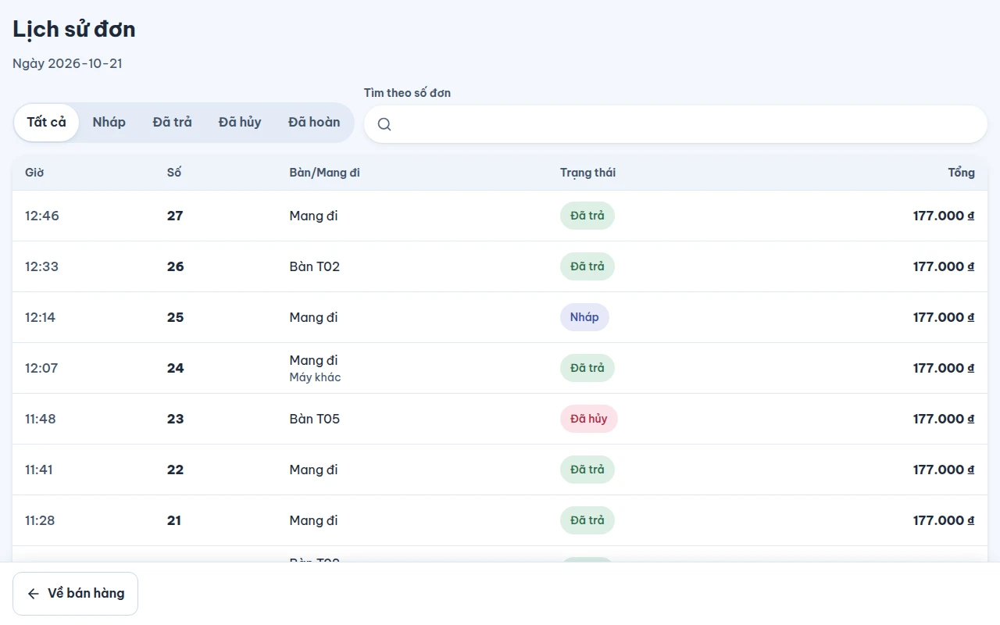
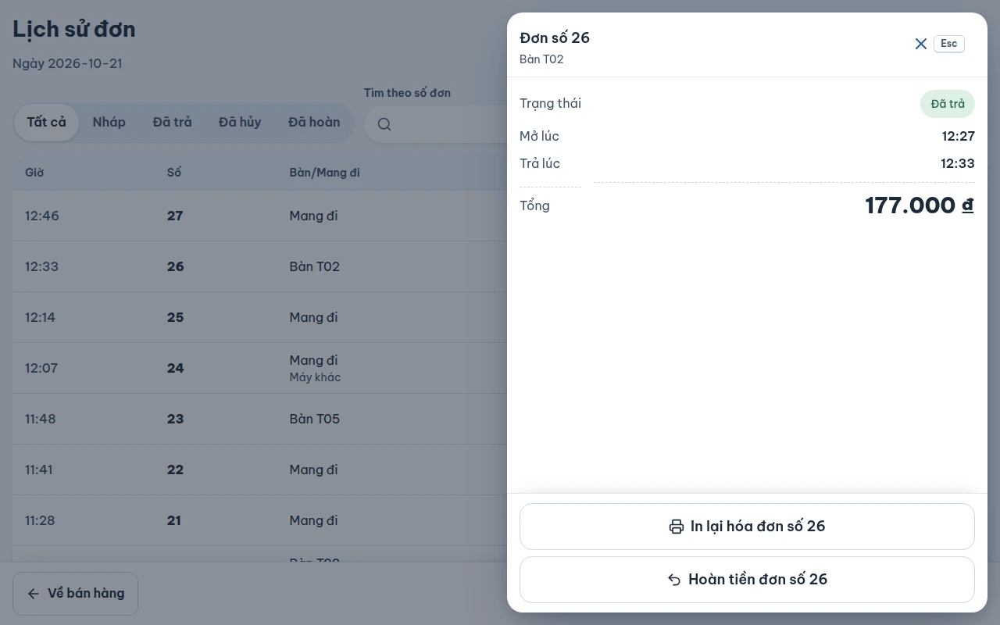

# Lịch sử đơn

## Dùng để làm gì

Xem lại các đơn của **ngày kinh doanh hôm nay** trên máy: tìm đơn theo số, mở lại đơn chưa trả, hoàn tiền đơn đã trả, in lại hóa đơn.

## Ai dùng, cần quyền gì

Mọi nhân viên đã đăng nhập đều xem được, **sau khi máy đã mở ca** (chưa mở ca thì máy hiện màn **Mở ca** trước, chưa có nút **Lịch sử đơn**): tiền hoàn luôn ra khỏi két của ca đang mở. Hoàn tiền cần quyền `refund` hoặc quản lý duyệt (xem [06](06-huy-giam-hoan-va-duyet.md)). In lại và mở lại đơn chưa trả không cần quyền riêng.

## Các bước

1. Trên thanh trên cùng bấm **Lịch sử đơn**. Màn ghi **Ngày dd/mm** (ngày kinh doanh), đơn **mới nhất ở trên** (theo giờ trả; đơn nháp theo giờ mở).

   

2. Lọc theo trạng thái: **Tất cả · Nháp · Đã trả · Đã hủy · Đã hoàn**. Gõ vào ô **Tìm theo số đơn** để tìm (khớp một phần số cũng ra). Không có đơn nào khớp thì màn nhắc đổi bộ lọc về **Tất cả** hoặc xóa số đang tìm.
3. Trên máy quầy (màn rộng từ 1024px) đơn xếp thành **bảng**: **Giờ · Số · Bàn/Mang đi · Trạng thái · Tổng** — giờ là giờ khách trả (đơn **Nháp** ghi giờ mở đơn), tổng canh phải. Đơn do máy khác của chi nhánh bán ghi thêm **Máy khác**; đơn đã hoàn một phần ghi thêm **Đã hoàn …** dưới tổng. Trên điện thoại mỗi đơn là một thẻ có giờ, nơi bán, số tiền và các nút ngay trên thẻ.
4. Chạm vào một dòng của bảng: ngăn kéo **Đơn số …** mở bên phải, ghi trạng thái, giờ mở, giờ trả, số đã hoàn và tổng; các nút nằm ở chân ngăn kéo:
   - Đơn **Nháp** (chưa trả) tại quầy: **Mở lại đơn số …** — đơn quay về màn bán tại quầy để bán tiếp.
   - Đơn **Nháp** của bàn: **Mở ở sơ đồ bàn** — máy chuyển sang sơ đồ, chạm vào bàn để mở.
   - Đơn **Đã trả** (hoặc đã hoàn một phần): **In lại hóa đơn số …** (bill hiện lại ở màn **In lại hóa đơn**) và **Hoàn tiền đơn số …** (xem [06-huy-giam-hoan-va-duyet.md](06-huy-giam-hoan-va-duyet.md)).

   Đóng ngăn kéo bằng nút ✕, phím Esc hoặc chạm ra ngoài.

   

5. Bấm **Về bán hàng** để quay lại.

## Luật và giới hạn

- Chỉ hiện đơn của **ngày kinh doanh hiện tại** (ngày bắt đầu lúc 04:00 theo mặc định của chi nhánh), gồm đơn máy này bán và đơn máy khác của chi nhánh mà máy đã nhận về khi đồng bộ.
- Đơn hoàn tiền **không** là một dòng riêng: nó nằm dưới đơn bán mà nó hoàn, và đơn bán được đánh dấu đã hoàn. Một lần hoàn đã bị hủy thì không tính.
- Mất trang (tải lại trang, đổi người) thì đơn quầy chưa trả **không mất**: mở lại từ lịch sử.
- In lại hóa đơn đã có hóa đơn điện tử: bill in lại kèm **mã tra cứu**; khi hóa đơn còn đang chờ phát hành thì chưa có nút in lại kèm mã tra cứu.

## Khi có lỗi

| Máy báo | Nghĩa là | Làm gì |
|---|---|---|
| Không có đơn nào khớp. | Không đơn nào khớp bộ lọc / số đang tìm | Đổi bộ lọc, xóa chữ tìm |
| Đơn này đã hoàn hết. | Không còn gì để hoàn | — |

## Mất mạng thì sao

Lịch sử đọc từ dữ liệu trên máy nên **vẫn xem được** khi mất mạng; chỉ thiếu những đơn máy khác bán trong lúc máy này mất mạng. Hoàn tiền mà cần quản lý duyệt thì cần mạng.

## Chưa làm / sắp có

- Xem đơn của ngày trước, tìm theo tên món / số tiền / tên khách.
- Mở lại đơn đã trả để sửa (`reopen_paid_order`).
- Báo cáo doanh thu trên máy quầy (báo cáo ở trang quản lý).
