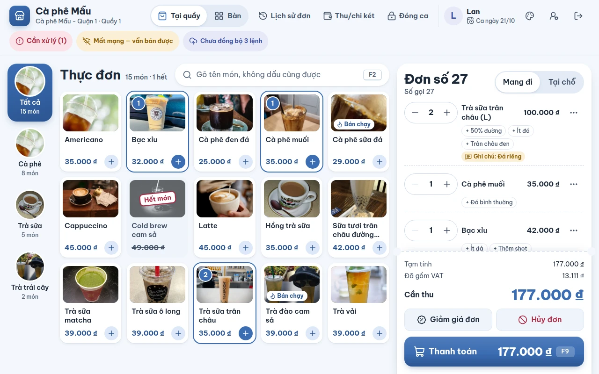
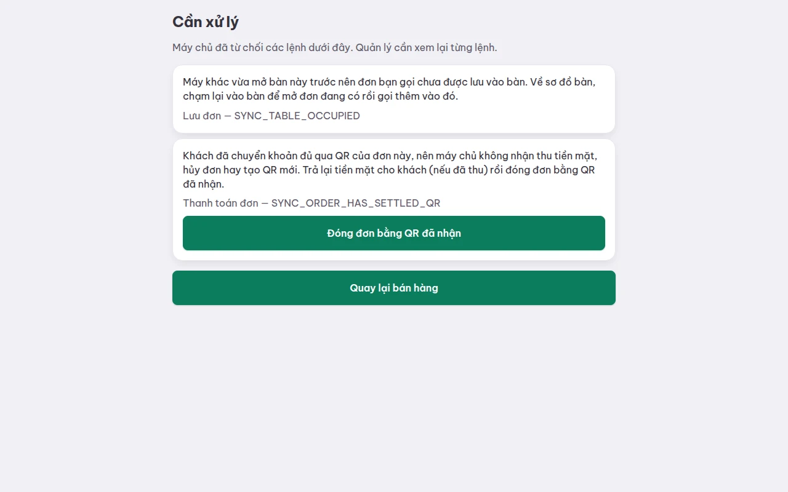

# Mất mạng, đồng bộ và "Cần xử lý"

## Dùng để làm gì

Máy quầy **bán được khi mất mạng**. Mọi thao tác (lưu đơn, thu tiền, mở ca, thu/chi…) được ghi ngay vào bộ nhớ của máy thành một **lệnh**, rồi máy tự gửi lệnh lên máy chủ khi có mạng. Phần này giải thích cách đọc tình trạng đồng bộ, việc gì làm được và không làm được khi mất mạng, và xử lý khi máy chủ **từ chối** một lệnh.

## Ai dùng, cần quyền gì

- Thu ngân: đọc tình trạng trên thanh trên cùng, báo quản lý khi có **Cần xử lý**.
- Quản lý: xem lại từng lệnh trong **Cần xử lý**.
- Người vận hành máy chủ: khôi phục máy chủ từ bản sao lưu (máy quầy tự gửi bù — xem cuối trang).

## Các bước

### Đọc tình trạng trên thanh trên cùng

| Máy ghi | Nghĩa |
|---|---|
| **Đang kiểm tra kết nối** | vừa mở máy, đang thử gọi máy chủ |
| **Đang kết nối** | có mạng, máy chủ trả lời bình thường |
| **Mất mạng — vẫn bán được** | không gọi được máy chủ; cứ bán, máy giữ lệnh lại |
| **Máy chủ đang lỗi — vẫn bán được** | có mạng nhưng máy chủ trả lỗi; cứ bán |
| **Máy chủ không nhận thao tác từ địa chỉ trang POS này. …** | địa chỉ mở POS không được máy chủ cho phép — báo quản lý |
| **Đã đồng bộ hết** | máy chủ đã nhận hết lệnh của máy |
| **Chưa đồng bộ 3 lệnh** | còn 3 lệnh chờ gửi |
| **Cần xử lý (1)** — nút đỏ | có lệnh bị máy chủ từ chối hẳn; bấm để xem |

### Xem "Cần xử lý"

1. Bấm nút **Cần xử lý (n)** trên thanh trên cùng.
2. Mỗi lệnh bị từ chối có **một câu giải thích** (việc gì đã xảy ra, làm gì tiếp) và dòng nhỏ **tên lệnh — mã lỗi** (ví dụ "Lưu đơn — SYNC_TABLE_OCCUPIED") để báo cho người hỗ trợ.

   

3. Làm theo câu giải thích. Với đơn khách **đã chuyển khoản QR đủ** mà máy lại ghi thu tiền mặt, có nút **Đóng đơn bằng QR đã nhận** ngay trong danh sách (trả lại tiền mặt cho khách trước).
4. Bấm **Quay lại bán hàng**.

Tên lệnh trong danh sách: *Lưu đơn · Thanh toán đơn · Ghi người mua hóa đơn · Gửi phiếu pha chế · Tạo mã QR chuyển khoản · Gỡ mã QR chuyển khoản · Mở ca · Báo kết quả in · In tạm tính · Chuyển bàn*.

## Luật và giới hạn

- Máy đồng bộ (gửi lệnh chờ và nhận thay đổi từ máy chủ) **khoảng 5 giây một lần**, và ngay sau khi có người đăng nhập. Một thao tác vừa làm thường lên máy chủ trong vài giây.
- Lệnh của một máy tới máy chủ **đúng thứ tự** đã làm; gửi trùng hay gửi lại không bao giờ làm đơn bị ghi hai lần.
- **Máy chủ tính lại** mọi số tiền; máy quầy chỉ gửi "ý định" (món, số lượng, cách trả…).
- **Giờ của lệnh do máy chủ quyết**: đồng hồ máy quầy **nhanh hơn quá 2 phút** thì lệnh bị từ chối; chậm hơn quá **12 giờ** thì máy chủ dùng giờ của mình và ghi nhật ký. Đơn bán đêm lúc mất mạng vẫn giữ đúng **ngày kinh doanh** và **ca** lúc bán.
- Lệnh bị từ chối **không tự mất**: nằm trong **Cần xử lý** để người xem lại.
- Máy giữ nhật ký các lệnh đã gửi **7 ngày** để gửi bù nếu máy chủ phải khôi phục từ bản sao lưu.
- Một máy gửi quá nhiều yêu cầu trong một phút thì máy chủ tạm từ chối (máy báo số giây phải chờ).

### Khi mất mạng

| Làm được | Không làm được / phải chờ mạng |
|---|---|
| Bán tại quầy, bán theo bàn, gửi bếp, in tạm tính (trên máy này) | Ghép máy mới |
| Thu tiền mặt, thối tiền | Đăng nhập bằng PIN (người đã đăng nhập thì vẫn bán) |
| Mở ca, thu/chi két trong ngưỡng, đóng ca khi két khớp | Xin quản lý duyệt tại chỗ |
| Hủy món chưa gửi bếp, giảm giá trong ngưỡng | Biết khách đã chuyển khoản QR (tin ngân hàng qua máy chủ) |
| Xem lịch sử đơn trên máy | Thấy đơn/bàn mà máy khác vừa làm |
| Thấy ảnh món đã xem trước đó | Nhận món mới, giá mới, "hết món" vừa đổi ở trang quản lý |
| | Phát hành hóa đơn điện tử (máy chủ làm khi nhận đơn) |

### Khi máy chủ được khôi phục từ bản sao lưu

Nếu máy chủ phải khôi phục từ bản sao lưu cũ hơn những gì máy quầy đã gửi, máy quầy **tự nhận ra** và **gửi lại** những lệnh máy chủ bị mất, đúng thứ tự, rồi tải lại dữ liệu từ đầu. Trong lúc đó thanh trên cùng ghi:

> Máy chủ vừa được khôi phục — đang gửi lại 12 thao tác của máy này

Lệnh gửi lại mà bị từ chối thì vào **Cần xử lý**. Nếu bản sao lưu cũ hơn **7 ngày** nhật ký máy còn giữ, máy cảnh báo (không tự tắt):

> Máy chủ được khôi phục từ bản sao lưu quá cũ: 5 thao tác không còn trên máy để gửi lại. Báo quản lý trước khi bán tiếp.

## Khi có lỗi

| Máy báo | Nghĩa là | Làm gì |
|---|---|---|
| Đồng hồ của máy nhanh hơn máy chủ quá 2 phút. Chỉnh lại giờ của máy rồi làm lại thao tác. | Giờ máy sai | Chỉnh giờ hệ điều hành (bật tự đồng bộ giờ) |
| Máy chủ không nhận thao tác từ địa chỉ trang POS này. Báo quản lý kiểm tra địa chỉ mở POS trong cài đặt máy chủ. | Mở POS bằng địa chỉ lạ | Mở POS đúng địa chỉ quán dùng |
| Máy gửi quá nhiều yêu cầu cùng lúc nên máy chủ tạm từ chối. Thử lại sau … giây. | Bị giới hạn tần suất | Chờ |
| Lệnh từ máy thiếu hoặc sai thông tin. Báo cho quản lý. | Lệnh hỏng | Báo quản lý/hỗ trợ kèm mã lỗi |
| Máy chủ không tìm thấy đơn này ở chi nhánh của máy. | Đơn không có trên máy chủ | Báo quản lý |
| Có lỗi xảy ra. Thử lại sau ít phút. | Lỗi máy quầy chưa biết tên | Báo hỗ trợ kèm mã lỗi dưới câu |
| Các câu về bàn, QR, giảm giá, duyệt… | Xem câu tương ứng ở [04](04-thanh-toan.md), [05](05-ban.md), [06](06-huy-giam-hoan-va-duyet.md) | |

## Mất mạng thì sao

Cả trang này nói về việc đó. Tóm tắt: **cứ bán**, đừng tải lại trang liên tục, đừng xóa dữ liệu trình duyệt khi **Chưa đồng bộ** còn lệnh — lệnh nằm trên máy cho tới khi máy chủ nhận.

## Chưa làm / sắp có

- Máy chính trong mạng nội bộ (LAN) để các máy trong quán thấy đơn của nhau và bếp vẫn nhận phiếu khi mất internet.
- Xác nhận chuyển khoản tay khi mất mạng (hiện QR chỉ xác nhận qua tin ngân hàng tới máy chủ).
- Khóa hẳn một số thao tác khi mất mạng (sửa thực đơn, khuyến mãi theo mã…) — chưa có các tính năng đó trên máy quầy.
- Ứng dụng cài cho iPad (trình duyệt Safari có thể xóa dữ liệu chưa đồng bộ, nên iPad không dùng bản trình duyệt để bán).
