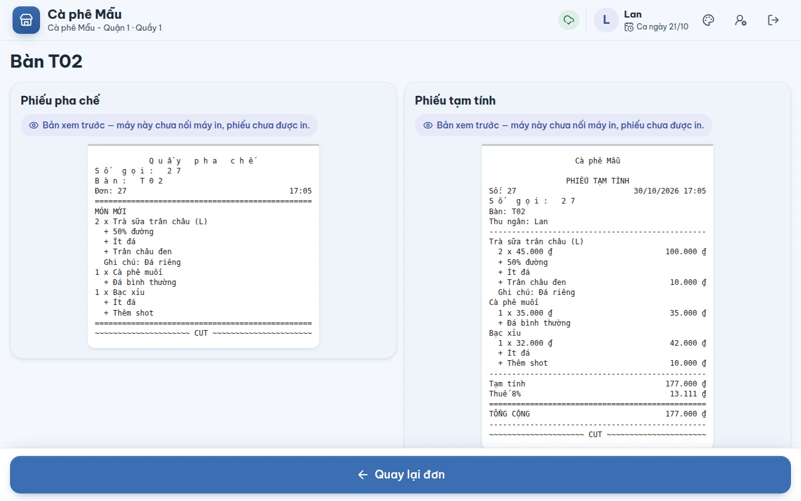
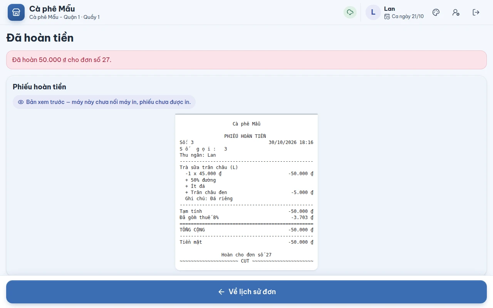
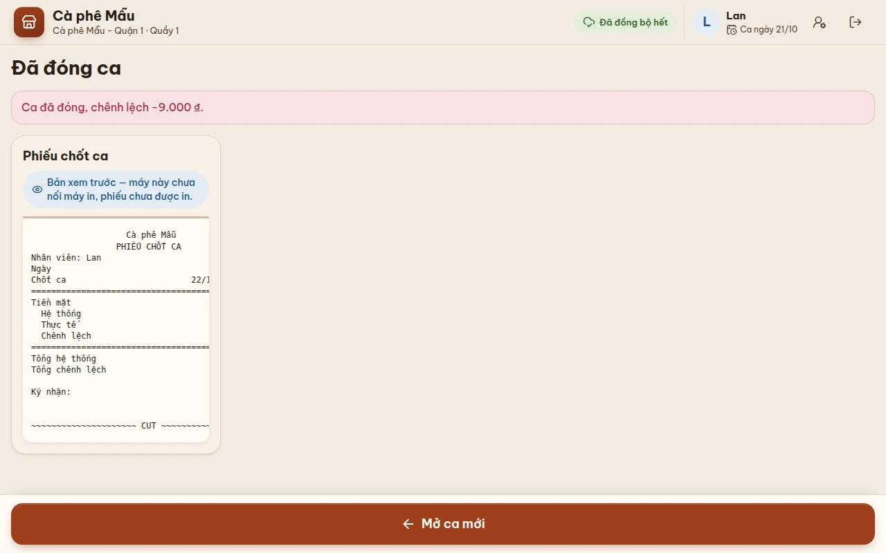

# Phiếu in

## Dùng để làm gì

Máy quầy làm ra các phiếu sau, mỗi phiếu đúng lúc cần:

| Phiếu | Khi nào | Cho ai |
|---|---|---|
| **Phiếu pha chế** (một phiếu cho mỗi trạm: quầy pha chế, bếp…) | thanh toán đơn quầy; mỗi lần **Gửi bếp** ở bàn (chỉ món mới) | pha chế / bếp |
| **Tem dán ly** (một tem cho mỗi ly, ghi topping, ghi chú) | thanh toán đơn **quầy** (đơn bàn hiện không có tem — xem Luật) | dán lên ly |
| **Hóa đơn** (bill) | thanh toán xong; in lại từ Lịch sử đơn | khách |
| **Phiếu tạm tính** (đầu phiếu "PHIẾU TẠM TÍNH") | **In tạm tính** ở bàn | khách xem trước khi trả |
| **Phiếu hủy món** | hủy món đã gửi bếp | trạm đã làm món đó |
| **Phiếu hoàn tiền** (đầu phiếu "PHIẾU HOÀN TIỀN") | hoàn tiền xong | khách / lưu két |
| **Phiếu chốt ca** | đóng ca xong | lưu két, nộp quản lý |

## Ai dùng, cần quyền gì

Phiếu tự ra theo thao tác; không cần quyền riêng. In lại hóa đơn: ai đứng quầy cũng làm được.

## Các bước

### Hiện tại: phiếu là bản xem trước trên màn

**Bản máy quầy đang chạy (trong trình duyệt) chưa nối máy in.** Mọi phiếu hiện trên màn, mỗi phiếu có dòng:

> Bản xem trước — máy này chưa nối máy in, phiếu chưa được in.

Thu ngân đọc phiếu trên màn (hoặc xoay màn cho pha chế xem). Tem ly hiện **không dấu** (đúng như máy in tem sẽ in); các phiếu khác hiện đầy đủ tiếng Việt. Phiếu giữ đúng cột như trên giấy 80 mm, nên ô phiếu hẹp hơn tờ giấy thì cột số tiền bên phải bị khuất: **kéo ngang trong ô phiếu** để xem hết.

1. **Sau khi thanh toán đơn quầy**: màn **Đã thanh toán** xếp các phiếu: phiếu pha chế, tem dán ly, hóa đơn (xem ảnh ở [04-thanh-toan.md](04-thanh-toan.md)).
2. **Ở bàn**: bấm **Gửi bếp** hoặc **In tạm tính** ⇒ màn phiếu mở ra (**Phiếu bếp vừa gửi** / **Phiếu tạm tính**); bấm **Quay lại đơn**.

   

3. **Hoàn tiền**: màn **Đã hoàn tiền** hiện phiếu hoàn tiền; bấm **Về lịch sử đơn**.

   

4. **Đóng ca**: màn **Đã đóng ca** hiện phiếu chốt ca (tiền hệ thống, tiền thực tế, chênh lệch, chỗ ký nhận); bấm **Mở ca mới**.

   

5. **In lại hóa đơn**: Lịch sử đơn → đơn đã trả → **In lại hóa đơn số …** (xem [08-lich-su-don.md](08-lich-su-don.md)). Đơn đã có hóa đơn điện tử: **In lại bill kèm mã tra cứu** ở màn Đã thanh toán.

### Khi có máy in (ứng dụng cài — sắp có)

Mỗi phiếu ghi một trong ba trạng thái: **Đang in…**, **Đã in**, hoặc **In lỗi (mã lỗi) — phiếu chưa ra giấy.** Máy ghi lại kết quả mỗi lần in lên máy chủ (để tra "phiếu đã ra giấy chưa").

## Luật và giới hạn

- **Phiếu pha chế chia theo trạm** của món (trạm đặt ở trang quản lý). Mỗi lượt gửi bếp ở bàn chỉ in **phần mới** của từng trạm.
- **Món chỉ được đánh dấu "Đã gửi bếp" khi máy in nhận phiếu.** Phiếu chỉ xem trên màn, hoặc máy in kẹt, thì món **vẫn "Chưa gửi bếp"** và lần gửi sau in lại. Hệ quả hiện nay (chưa có máy in): ở bàn, món không bao giờ chuyển sang "Đã gửi bếp", nên **bớt / xóa món vẫn tự do** và không có phiếu hủy.
- **Phiếu tạm tính**: in hoặc chỉ xem trên màn đều tính là khách đã được đưa phiếu (bàn sang "Đã in tạm tính"); máy in kẹt thì không tính.
- **Tem dán ly**: một tem cho **mỗi ly** (ghi "1/4", "2/4"…), chỉ cho món được đánh dấu "in tem ly" ở trang quản lý, và **chỉ cho đơn quầy**. Đơn bàn: lúc thanh toán máy bỏ tem (vì coi như đã có lúc gửi bếp), nhưng lúc gửi bếp hiện cũng chưa làm tem — nên đơn bàn **không có tem ly** nào.
- Khổ giấy đang dùng để dựng phiếu: bill **80 mm**, tem ly **40 × 30 mm**. Khi in thật, chữ được in **không dấu** cho tới khi cài được bảng mã tiếng Việt của từng máy in (bảng mã sai thì mọi chữ có dấu thành ký tự lạ).
- **Tên món dài tự xuống dòng; số tiền luôn nằm cùng dòng đầu của tên.** Tên hoặc ghi chú có dấu xuống dòng ở đầu (thường do dán từ Excel) không còn đẩy số tiền lên một dòng trống phía trên tên.
- Thông tin người mua hóa đơn điện tử **không in** lên bill.
- Món **bán theo cân** in **số gam** thay cho số lượng: bill ghi "351 g x 32.000 ₫/100 g" rồi số tiền (giấy 58 mm hẹp thì "351 g" cùng dòng số tiền, "x 32.000 ₫/100 g" xuống dòng dưới); phiếu pha chế ghi "351 g x Cà phê hạt Robusta". Món **giá nhập tay** in như món thường, với giá đã gõ: "2 x 180.000 ₫".

## Khi có lỗi

| Máy báo | Nghĩa là | Làm gì |
|---|---|---|
| Bản xem trước — máy này chưa nối máy in, phiếu chưa được in. | Bản web, không có máy in | Đọc phiếu trên màn |
| In lỗi (…) — phiếu chưa ra giấy. | Máy in không nhận (hết giấy, kẹt, mất kết nối) | Kiểm tra máy in; gửi bếp lại / in lại |
| Không có món nào cần gửi bếp. | Gửi bếp khi không còn món mới | — |
| Phiếu hủy đã in nhưng máy chưa báo được máy chủ: khi có mạng, lần gửi bếp sau có thể in lại phiếu hủy này. | Hủy món khi mất mạng | Báo bếp bỏ qua phiếu hủy in trùng |

## Mất mạng thì sao

Phiếu dựng ngay trên máy từ dữ liệu của máy, không cần mạng. (Khi có máy in nối vào máy quầy, in vẫn chạy khi mất mạng.)

## Chưa làm / sắp có

- **In ra giấy**: cần ứng dụng cài trên máy quầy (Windows, Android) để gửi phiếu tới máy in nhiệt ESC/POS và máy in tem; mở két qua máy in. Trang web không in thẳng ổn định được ra máy in trong mạng quán.
- Cài máy in theo từng máy quầy (khổ giấy, bảng mã tiếng Việt).
- Hàng đợi in có thử lại tự động.
- Công tắc **In tem ly** ở trang quản lý **chưa có tác dụng** trên máy quầy: tem ly hiện cho mọi món được đánh dấu "in tem ly", dù công tắc bật hay tắt.
- Màn hình bếp (KDS) thay cho phiếu giấy.
