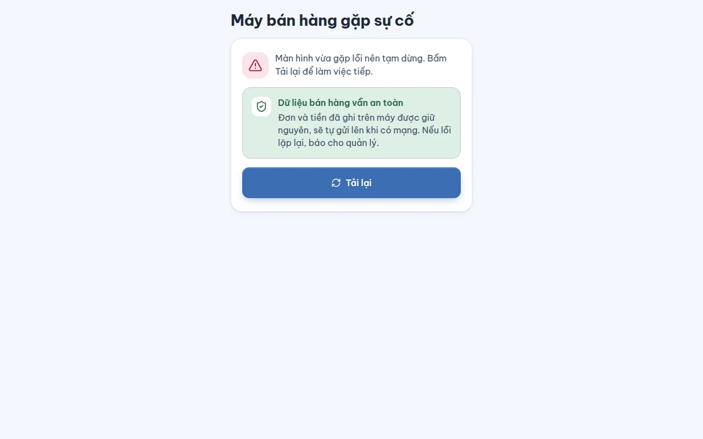

# Màn hình sự cố của máy quầy

## Dùng để làm gì

Khi một màn hình của máy quầy gặp lỗi không lường trước và không vẽ được nữa, máy không để màn trắng: nó hiện màn **"Máy bán hàng gặp sự cố"**, nói rõ **dữ liệu bán hàng vẫn an toàn trên máy**, và cho một nút **Tải lại**. Cùng lúc máy ghi lại lỗi (không kèm tên nhân viên, tên khách hay nội dung đơn) để người vận hành xem ở nhật ký máy chủ — xem [Nhật ký lỗi từ máy quầy và trang quản lý](../van-hanh/05-nhat-ky-loi-may-quay-va-trang-quan-ly.md).

## Ai dùng, cần quyền gì

Bất kỳ ai đứng quầy; không cần quyền riêng và không cần đăng nhập.

## Các bước

1. Thấy màn "Máy bán hàng gặp sự cố": đọc dòng giải thích, đừng tắt máy.
2. Bấm **Tải lại**. Máy mở lại, vào lại màn đăng nhập PIN hoặc màn bán như bình thường; đơn đã ghi trước đó vẫn còn và tự gửi lên máy chủ khi có mạng.
3. Nếu màn này hiện lại ngay sau khi tải lại, hoặc lặp lại nhiều lần trong ngày, báo cho quản lý kèm giờ xảy ra để người vận hành tra nhật ký.

## Luật và giới hạn

- Mỗi thao tác bán đã được ghi vào cơ sở dữ liệu trên máy **trước** khi làm bất cứ việc gì khác, nên tải lại không làm mất đơn, tiền hay ca đang mở. Món đang chọn dở trên màn bán mà chưa bấm gửi bếp/thanh toán có thể phải chọn lại.
- Máy ghi lỗi trên máy và gửi lên máy chủ khi đã ghép máy và có mạng. Tối đa **50** lỗi chờ gửi (quá thì bỏ lỗi cũ nhất); cùng một lỗi lặp lại trong **60 giây** chỉ tính một lần; lỗi chờ quá **24 giờ** thì bỏ.
- Máy chủ chỉ giữ tên màn, thông báo lỗi và dấu vết kỹ thuật đã che email, số điện thoại, dãy số dài, mã đăng nhập, bỏ phần sau dấu `?` và `#` của địa chỉ; thông báo cắt ở 500 ký tự, dấu vết ở 4 KB. Nhật ký chỉ ghi mã cửa hàng và mã máy, không ghi tên ai.
- Lỗi xảy ra trong một thao tác bấm nút hoặc trong tác vụ nền (không phải lúc vẽ màn) không làm hiện màn này; máy vẫn ghi lại lỗi đó.

## Khi có lỗi

| Thấy gì | Nghĩa là | Làm gì |
|---|---|---|
| "Máy bán hàng gặp sự cố" — "Màn hình vừa gặp lỗi nên tạm dừng. Bấm Tải lại để làm việc tiếp." | Một màn không vẽ được | Bấm **Tải lại** |
| "Dữ liệu bán hàng vẫn an toàn" — "Đơn và tiền đã ghi trên máy được giữ nguyên, sẽ tự gửi lên khi có mạng. Nếu lỗi lặp lại, báo cho quản lý." | Lời nhắc, không phải lỗi mới | Làm theo câu cuối nếu lỗi lặp lại |

## Mất mạng thì sao

Màn này không cần mạng. Lỗi được giữ trên máy và gửi đi khi máy có mạng lại (và đã ghép máy với cửa hàng).

## Chưa làm / sắp có

- Chưa có trang trong trang quản lý để xem danh sách lỗi: hiện người vận hành đọc nhật ký máy chủ.
- Chưa có nút "gửi báo cáo cho hỗ trợ" kèm mô tả của thu ngân.
