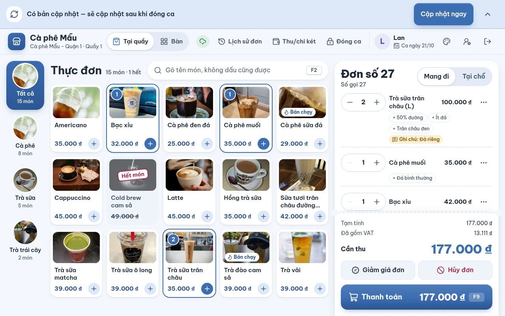
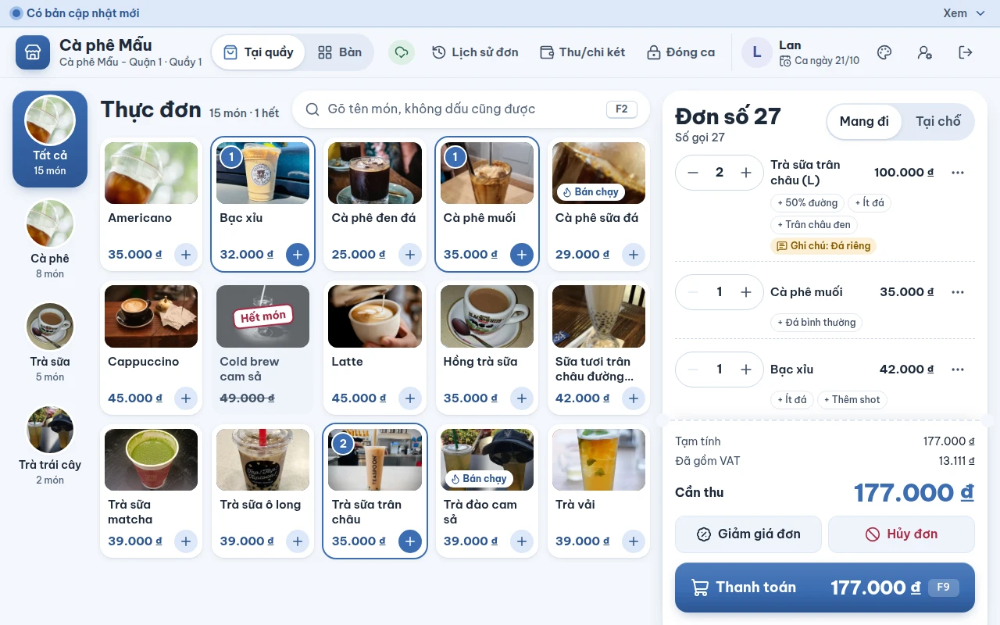

# Cập nhật bản mới của máy quầy

## Dùng để làm gì

Khi người vận hành đưa bản POS mới lên server, máy quầy tự biết và tự đổi sang bản mới **vào lúc không làm hỏng việc đang bán**: không bao giờ giữa lúc còn lệnh chưa gửi lên máy chủ, không giữa lúc đang thanh toán hay đang mở một bảng (duyệt, đếm tiền…). Nếu máy đang có ca mở, thẻ **"Có bản cập nhật — sẽ cập nhật sau khi đóng ca"** hiện ở góc dưới màn hình.

Dải cập nhật nằm **ngang đầu màn hình**, trên thanh của máy quầy, và **chiếm chỗ riêng**: màn bán nằm dưới dải nên không có món, nút hay đơn nào bị che. Bấm mũi tên **Thu nhỏ** (góc phải dải) thì dải thành một dòng mỏng "Có bản cập nhật mới · Xem"; chạm vào dòng đó để mở lại. Thu nhỏ rồi vẫn thấy là có bản mới.

## Ai dùng, cần quyền gì

Thu ngân đang đứng quầy; không cần quyền riêng. Người vận hành xem [Đặt hệ thống lên server](../van-hanh/02-dat-len-server.md) để đưa bản mới lên.

## Các bước

**Máy chưa mở ca** (đầu ngày, hoặc sau khi đóng ca): máy tự tải lại sang bản mới khi **20 giây** không ai chạm vào màn hình, không còn lệnh chưa gửi và không có bảng nào đang mở. Thu ngân không phải làm gì.

**Máy đang có ca mở**:

1. Dải "Có bản cập nhật — sẽ cập nhật sau khi đóng ca" hiện ở đầu màn hình. Cứ bán bình thường; nếu thấy vướng, bấm **Thu nhỏ**.
2. Muốn cập nhật ngay (giờ vắng khách): bấm **Cập nhật ngay**. Nút chỉ bấm được khi **mọi lệnh đã lên máy chủ** và không có bảng nào đang mở; không thì nút mờ và thẻ nói phải chờ gì.
3. Hoặc đóng ca như thường lệ. Sau khi đóng ca, khi máy nhàn rỗi 20 giây, máy tự cập nhật.

Sau khi tải lại, máy vào lại màn đăng nhập PIN (hoặc mở ca) như khi mở máy; đơn đã ghi vẫn còn.

## Luật và giới hạn

- Máy hỏi máy chủ "đang phát hành bản nào" (`version.json`) khi mở, **mỗi 5 phút**, khi có mạng lại và khi trang hiện lại sau lúc bị ẩn.
- **Bản khác bản đang chạy là có cập nhật**, không phải "bản mới hơn": nếu người vận hành quay lui một bản trên server thì máy quầy cũng đổi về bản đó theo đúng cách này.
- Không bao giờ tự tải lại khi: còn lệnh chưa đồng bộ (kể cả khi đang chờ biết số lệnh), đang mở một ngăn kéo/bảng (thanh toán, duyệt, đếm tiền, chọn tùy chọn…), hoặc có người vừa chạm màn hình trong 20 giây (khi máy không có ca mở).
- Một bản đã thử tự tải lại rồi mà trang vẫn ở bản cũ (trình duyệt giữ bản cũ) thì máy **không tự tải lại lần nữa** trong phiên đó, để không vòng lặp; thu ngân vẫn bấm **Cập nhật ngay** được, hoặc người vận hành xóa bộ nhớ đệm.
- Máy chủ luôn nhận lệnh của **bản POS ngay trước** bản đang phát hành, để máy chưa kịp cập nhật vẫn đẩy được lệnh của nó (xem Vận hành).

## Khi có lỗi

| Thấy gì | Nghĩa là | Làm gì |
|---|---|---|
| "Có bản cập nhật — sẽ cập nhật sau khi đóng ca" | Có bản mới, máy đang có ca mở | Đóng ca, hoặc bấm **Cập nhật ngay** khi được |
| "Còn N thao tác chưa gửi lên máy chủ. Chờ gửi xong rồi cập nhật." (nút Cập nhật ngay mờ) | Còn lệnh trên máy chưa tới máy chủ | Chờ máy đồng bộ xong (xem biểu tượng đồng bộ trên thanh trên); không có mạng thì có mạng lại đã |
| "Máy đang kiểm tra thao tác chưa gửi. Chờ một chút rồi cập nhật." | Máy chưa biết còn bao nhiêu lệnh | Chờ vài giây |
| "Xong thao tác đang làm rồi hãy cập nhật." | Đang mở một bảng (thanh toán, duyệt…) | Xong hoặc đóng bảng đó |
| Dòng mỏng "Có bản cập nhật mới · Xem" | Dải đã thu nhỏ | Chạm để mở lại, rồi bấm **Cập nhật ngay** khi được |
| Nút "Đang cập nhật…" | Máy đang tải lại | Chờ |

## Mất mạng thì sao

Máy không hỏi được bản đang phát hành thì giữ bản đang chạy và hỏi lại khi có mạng. Đang có thẻ cập nhật mà mất mạng: nút **Cập nhật ngay** chỉ bấm được khi không còn lệnh chưa gửi, nên mất mạng sau khi vừa bán thì nút mờ cho tới khi lệnh đã lên máy chủ — máy không đổi bản làm mất lệnh chưa gửi.

## Chưa làm / sắp có

- Chưa có "bản tối thiểu bắt buộc": không ép được máy quầy cũ phải cập nhật.
- Chưa áp dụng cho vỏ app cài trên máy (Tauri, Capacitor): chỉ bản web POS.
- Chưa có thông báo cho quản lý biết máy quầy nào còn chạy bản cũ.
