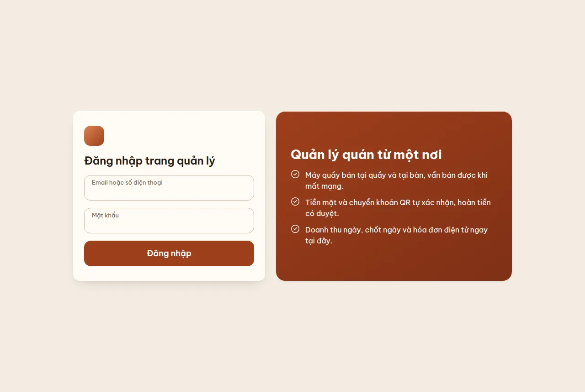
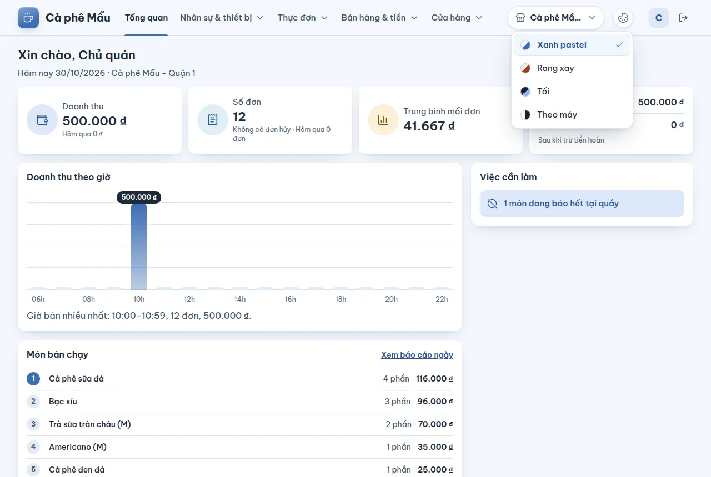

# Đăng nhập trang quản lý và chọn chi nhánh

## Dùng để làm gì

Trang quản lý (backoffice) là nơi chủ quán và người quản lý làm mọi việc không làm ở máy quầy: sửa thực đơn, thêm nhân viên, ghép máy, xem doanh thu, chốt ngày, cài đặt. Trang mở bằng trình duyệt trên máy tính hoặc điện thoại, cùng địa chỉ với cửa hàng (ví dụ `https://quan.example.vn/`).

Nhân viên đứng quầy **không** đăng nhập ở đây: họ đăng nhập máy quầy bằng PIN (xem phần máy quầy của sổ tay).

## Ai dùng, cần quyền gì

- Ai có **tài khoản** (email hoặc số điện thoại + mật khẩu) thuộc ít nhất một cửa hàng đang hoạt động.
- Mỗi tài khoản trong một cửa hàng mang **đúng một vai trò** (cùng danh sách vai trò với nhân viên, xem [Nhân viên, vai trò và quyền](06-nhan-vien-vai-tro-quyen.md)). Vai trò quyết định menu hiện những mục nào: mục cần quyền mà vai trò không có thì không hiện trên menu; mở thẳng bằng địa chỉ thì trang báo **"Bạn chưa có quyền xem mục này"** kèm gợi ý "Nhờ chủ quán thêm quyền cho vai trò của bạn ở mục Vai trò."

| Mục trên menu | Nhóm | Quyền cần để mở |
|---|---|---|
| Thiết bị | Nhân sự & thiết bị | Quản lý thiết bị |
| Nhân viên, Vai trò | Nhân sự & thiết bị | Quản lý nhân viên và vai trò |
| Món, Danh mục, Hết món | Thực đơn | ai đăng nhập cũng xem được; **sửa** cần quyền Sửa menu |
| Doanh thu ngày, Chốt ngày, Khớp chuyển khoản, Phiếu in lỗi | Bán hàng & tiền | Xem báo cáo |
| Sơ đồ bàn, Cài đặt | Cửa hàng | Cài đặt cửa hàng |

## Các bước

1. Mở địa chỉ của cửa hàng. Chưa đăng nhập thì trang tự chuyển tới **Đăng nhập trang quản lý**.
2. Nhập **Email hoặc số điện thoại** và **Mật khẩu**, bấm **Đăng nhập**.
3. Tài khoản thuộc nhiều tổ chức (ví dụ bạn làm cho hai công ty) thì trang hiện **Chọn tổ chức** — bấm **Vào <tên tổ chức>**. Muốn đổi tài khoản thì bấm **Đăng nhập tài khoản khác**.
4. Vào được thì trang mở lại đúng trang bạn định mở trước khi bị hỏi đăng nhập (chỉ trang trong cùng trang quản lý; địa chỉ lạ thì về trang Tổng quan).
5. Ở góc trên, nút **Chi nhánh đang xem** (biểu tượng cửa hàng, tên chi nhánh) chọn chi nhánh mà mọi trang đang hiện số liệu: bấm vào để thả danh sách rồi bấm một chi nhánh (chi nhánh đang xem có dấu tích). Dùng bàn phím: Tab tới nút, mũi tên lên/xuống để đi trong danh sách, **Enter** để chọn, **Esc** để đóng không đổi; gõ chữ đầu của tên để nhảy tới chi nhánh đó. Trình duyệt nhớ lựa chọn này cho lần sau (trên đúng máy đó).
6. Trên máy tính menu nằm ngay trong thanh trên cùng (rộng từ 1280px: tên quán · 4 nhóm · chi nhánh · nút giao diện · tài khoản trên một hàng; từ 1024 đến 1279px các nhóm xuống hàng thứ hai của thanh). Tên quán ngắn luôn hiện đủ (ví dụ "Cà phê Mẫu" ở 1280px): thiếu chỗ thì ô chi nhánh và tên người đăng nhập thu lại trước; tên quán dài quá mới bị cắt bằng "…", thanh không bao giờ tràn khỏi màn. Nhóm của trang đang mở có gạch màu chủ đạo (xanh dương ở giao diện Xanh pastel) ở chân thanh; bấm tên nhóm để thả danh sách trang, trang đang mở được tô nền. Dưới mỗi tiêu đề trang có dòng **Tổng quan › nhóm › trang** để biết mình đang ở đâu. Trên điện thoại và máy tính bảng bấm nút **Mở menu** để mở ngăn kéo.
7. Mọi danh sách dài (món, nhân viên, thiết bị…) có ô tìm và bộ lọc ở trên, hiện **25 dòng mỗi trang**; dưới danh sách ghi đang xem dòng nào trong bao nhiêu (ví dụ "1–25 trong 60"), có ô chọn **25 / 50 / 100 dòng / trang** và nút **Trang trước** / **Trang sau**. Hàng tiêu đề của bảng luôn ở trên cùng khi cuộn. Gõ tìm, đổi bộ lọc hay đổi cách sắp xếp thì quay về trang 1. Danh sách không quá 25 dòng thì không có phần chia trang.
8. Một ô nhập chỉ báo lỗi (chữ đỏ dưới ô, viền đỏ) **sau khi** bạn đã gõ rồi rời ô, hoặc sau khi bấm nút lưu/thêm — không bao giờ đỏ sẵn khi bạn chưa làm gì. Sửa đúng là lỗi tự tắt.
9. Việc không hoàn tác được (thu hồi máy, khóa nhân viên, lưu trữ vai trò, xóa khu vực/bàn, ngừng bán món, trả lại tiền QR) luôn hỏi lại bằng một khung có dấu cảnh báo: **Hủy** bên trái, nút đỏ đậm làm việc đó bên phải. Nút đỏ chỉ mờ đi khi đang làm ("Đang thu hồi…").
10. Xong việc bấm **Đăng xuất** (màn rộng 1280–1599px chỉ còn biểu tượng cửa ra, dưới 1440px tên người đăng nhập cũng chỉ còn chữ cái đầu; trình đọc màn hình vẫn đọc đủ tên).

## Đổi giao diện

1. Trên thanh trên cùng, ngay trước tên người đăng nhập, bấm nút **Giao diện** (biểu tượng bảng màu). Trên điện thoại và máy tính bảng nút này vẫn ở thanh trên cùng, và có thêm ô **Giao diện** ở cuối ngăn kéo menu (bấm **Mở menu**).
2. Danh sách thả xuống có bốn giao diện, mỗi cái kèm một chấm màu nhỏ; giao diện đang dùng có dấu tích:
   - **Xanh pastel** — sáng, xanh dương dịu. Là giao diện **mặc định**.
   - **Rang xay** — sáng, tông kem và nâu cà phê ấm.
   - **Tối** — nền tối, chữ sáng; dễ chịu khi quán tắt bớt đèn hay làm ca đêm.
   - **Theo máy** — máy tính / điện thoại đang để chế độ sáng thì dùng Xanh pastel, chế độ tối thì dùng Tối; đổi chế độ của máy là trang đổi theo ngay.
3. Bấm một giao diện: trang đổi màu ngay, không tải lại, chữ đang gõ dở vẫn còn. Dùng bàn phím như ô chọn chi nhánh (mũi tên lên/xuống, **Enter** để chọn, **Esc** để đóng không đổi).
4. Thanh trạng thái của điện thoại và thanh tiêu đề khi cài trang làm ứng dụng cũng đổi theo màu thanh trên cùng của giao diện vừa chọn.

Giao diện là lựa chọn của **từng máy**, không phải cài đặt của quán: trình duyệt của máy đó nhớ cho lần sau, máy khác vẫn giữ giao diện của nó. Các tab đang mở trang quản lý trên cùng máy đổi theo nhau. Trang mở ra là đã đúng giao diện ngay từ đầu, không nháy màu mặc định trước. Ở mọi giao diện, chữ trên nền đều đủ đậm để đọc (độ tương phản ít nhất 4.5:1, có test kiểm). Ảnh trong sổ tay chụp ở Xanh pastel; dùng giao diện khác thì màu khác ảnh, còn vị trí nút và câu chữ giống hệt.

## Luật và giới hạn

- Sai mật khẩu **5 lần liền** thì tài khoản bị khóa **15 phút** (cố định, không tăng dần — để người biết email chủ quán không khóa được chủ quán hàng giờ). Mỗi lần khóa được ghi vào nhật ký.
- Phiên đăng nhập sống **7 ngày** kể từ lúc đăng nhập, không tự gia hạn: máy tính để quên sẽ tự hết quyền trong một tuần.
- Chỉ tài khoản đang hoạt động trong tổ chức mới vào được; tài khoản bị gỡ khỏi tổ chức sẽ bị hỏi chọn lại tổ chức.
- Quyền được đọc lại ở **mọi** lần gọi máy chủ: chủ quán bỏ một quyền khỏi vai trò thì người giữ vai trò mất quyền đó ngay ở thao tác kế tiếp, không cần đăng nhập lại.

## Khi có lỗi

| Màn hình báo | Nghĩa là | Làm gì |
|---|---|---|
| Nhập email hoặc số điện thoại. / Nhập mật khẩu. | Bỏ trống ô | Nhập đủ rồi bấm lại |
| Sai email/số điện thoại hoặc mật khẩu. Sai 5 lần liền thì tài khoản bị khóa 15 phút. | Sai thông tin, hoặc đang bị khóa | Kiểm tra lại; đã sai nhiều lần thì chờ 15 phút |
| Tài khoản này chưa thuộc cửa hàng nào đang hoạt động. | Tài khoản không còn trong cửa hàng nào | Nhờ chủ quán thêm lại |
| Tài khoản không còn thuộc tổ chức đã chọn. Chọn lại tổ chức. | Bị gỡ khỏi tổ chức vừa chọn | Chọn tổ chức khác |
| Phiên đăng nhập đã hết. Đăng nhập lại. | Quá 7 ngày, hoặc đã đăng xuất ở nơi khác | Đăng nhập lại |
| Không kiểm tra được phiên đăng nhập. | Mất mạng lúc mở trang | Bấm **Thử lại** |
| Không tải được danh sách chi nhánh. / Tổ chức chưa có chi nhánh nào. | Lỗi mạng / tổ chức chưa có chi nhánh | Thử lại; chi nhánh hiện do người vận hành tạo (chưa có màn tạo chi nhánh) |
| Máy chủ không nhận yêu cầu từ địa chỉ trang này. Mở trang quản lý bằng đúng địa chỉ của cửa hàng; nếu vẫn lỗi, báo hỗ trợ. | Trang được mở qua một địa chỉ máy chủ không cho phép | Mở bằng đúng địa chỉ cửa hàng; vẫn lỗi thì báo người vận hành (xem [Giới hạn và bảo mật](../van-hanh/04-gioi-han-va-bao-mat.md)) |
| Không kết nối được máy chủ. Kiểm tra mạng rồi thử lại. | Mất mạng | Kiểm tra wifi/4G |

## Mất mạng thì sao

Trang quản lý **cần mạng** cho mọi việc. Mất mạng thì trang báo "Không kết nối được máy chủ…"; máy quầy vẫn bán bình thường vì máy quầy có dữ liệu riêng.

## Chưa làm / sắp có

- Đăng ký cửa hàng mới, tạo chi nhánh, thương hiệu, quên mật khẩu, đổi mật khẩu, mời thêm người quản lý: chưa có màn hình (người vận hành tạo bằng công cụ phía máy chủ).
- Chưa có "ghi nhớ đăng nhập" hay đăng nhập bằng mã OTP.
- Giao diện chưa đi theo tài khoản: đăng nhập ở máy mới thì máy đó bắt đầu từ Xanh pastel. Trình duyệt chặn lưu dữ liệu trang (một số chế độ ẩn danh) thì giao diện đã chọn chỉ giữ tới khi tải lại hoặc đóng trang.
