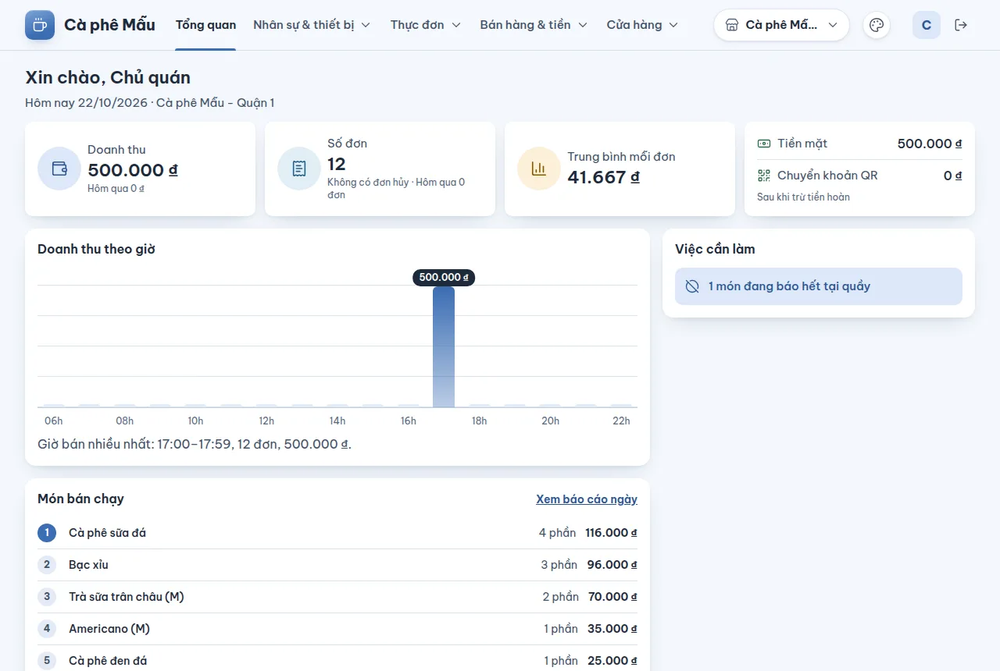
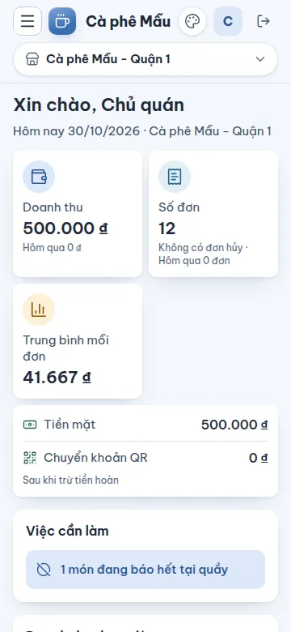

# Trang Tổng quan — số liệu hôm nay và việc cần làm

## Dùng để làm gì

Trang đầu tiên sau khi đăng nhập. Một cái nhìn cho chi nhánh đang xem: hôm nay bán được bao nhiêu, giờ nào đông, món nào chạy, và **những việc đang chờ người xử lý** (tiền QR cần hoàn, chuyển khoản chưa khớp, phiếu in lỗi, ngày hôm qua chưa chốt, món đang báo hết).

## Ai dùng, cần quyền gì

- Ai đăng nhập cũng mở được trang này.
- Số liệu và danh sách việc cần làm chỉ hiện với vai trò có quyền **Xem báo cáo**. Không có quyền đó thì trang chỉ chào và đưa lối tắt tới những trang vai trò mở được — trang không gọi số liệu nào.

## Các bước

1. Chọn chi nhánh ở ô **Chi nhánh đang xem** (góc trên).
2. Đọc dòng **Hôm nay <ngày> · <chi nhánh>**. "Hôm nay" là **ngày kinh doanh** của chi nhánh, không phải ngày lịch: ngày kinh doanh bắt đầu lúc **04:00** sáng (mặc định khi tạo chi nhánh), nên đơn lúc 01:30 sáng vẫn thuộc ngày hôm trước.
3. Bốn thẻ số liệu:
   - **Doanh thu** — tiền khách đã trả hôm nay; dưới là số của hôm qua để so.
   - **Số đơn** — số đơn bán, kèm số đơn hủy và số đơn hôm qua.
   - **Trung bình mỗi đơn** — doanh thu chia số đơn ("Chưa có đơn" khi chưa bán).
   - **Tiền mặt / Chuyển khoản QR** — tách theo cách trả, **sau khi trừ tiền hoàn**.
4. **Doanh thu theo giờ**: cột theo từng giờ, dòng dưới gọi tên giờ bán nhiều nhất.
5. **Món bán chạy**: món bán nhiều nhất hôm nay (tùy chọn như topping không tính là món). Bấm **Xem báo cáo ngày** để mở [Doanh thu ngày](10-doanh-thu-ngay.md).
6. **Việc cần làm** — mỗi dòng bấm được, dẫn thẳng tới trang xử lý:

| Dòng hiện | Khi nào | Bấm vào thì tới |
|---|---|---|
| N khoản tiền QR cần hoàn lại khách | Ngân hàng báo nhận tiền mà không đơn nào dùng (trả thiếu, thừa, trả hai lần) | [Khớp chuyển khoản](12-khop-chuyen-khoan-va-hoan-tien-qr.md) |
| N chuyển khoản chưa khớp đơn | Có giao dịch vào tài khoản mà hệ thống không tự ghép được | [Khớp chuyển khoản](12-khop-chuyen-khoan-va-hoan-tien-qr.md) |
| N phiếu in lỗi hôm nay (có dấu `+` khi còn nhiều hơn) | Máy quầy in không được và chưa in lại được | [Phiếu in lỗi](13-phieu-in-loi.md) |
| Ngày <hôm qua> chưa chốt | Hôm qua có bán (hoặc có hoàn) mà chưa chốt ngày | [Chốt ngày](11-chot-ngay.md) |
| N món đang báo hết tại quầy | Có món tắt "Còn bán" ở chi nhánh | [Hết món](03-thuc-don.md#hết-món) |

Không còn gì thì hiện **"Không có việc nào cần xử lý."**

Trên điện thoại các thẻ xếp dọc:

## Luật và giới hạn

- Mọi con số lấy từ cùng báo cáo với trang [Doanh thu ngày](10-doanh-thu-ngay.md) (cùng định nghĩa), chỉ khác là chỉ hiện hôm nay và hôm qua.
- Thẻ **Tiền mặt / Chuyển khoản QR** trừ tiền của **đơn hoàn** (hoàn món đã bán ở máy quầy). Còn "tiền QR đã hoàn lại khách" (tiền chuyển khoản không đơn nào dùng, ghi ở [Khớp chuyển khoản](12-khop-chuyen-khoan-va-hoan-tien-qr.md)) **không phải doanh thu** và không nằm trong thẻ nào ở đây.
- "Món đang báo hết tại quầy" chỉ đếm món tắt cho mọi kênh của chi nhánh, không đếm món chỉ tắt trên một kênh giao hàng.
- "Ngày hôm qua chưa chốt" chỉ nhắc khi hôm qua thật sự có bán hoặc có hoàn; ngày nghỉ không bị nhắc.

## Khi có lỗi

| Màn hình báo | Làm gì |
|---|---|
| Không kiểm tra được mục này. (trong Việc cần làm) | Một mục không đọc được (mạng chập chờn); các mục khác vẫn hiện. Tải lại trang |
| Chưa có đơn nào hôm nay. / Chưa bán món nào hôm nay. | Không phải lỗi: ngày chưa có đơn nào đồng bộ lên |
| Không kết nối được máy chủ. Kiểm tra mạng rồi thử lại. | Kiểm tra mạng |

## Mất mạng thì sao

Số liệu là những gì máy quầy **đã đồng bộ** lên máy chủ. Máy quầy đang mất mạng vẫn bán, nhưng đơn của nó chỉ hiện ở đây khi máy có mạng lại và gửi lên.

## Chưa làm / sắp có

- Chưa so sánh theo tuần/tháng, chưa có biểu đồ nhiều ngày.
- Chưa gộp số liệu nhiều chi nhánh trên một trang (mỗi lần xem một chi nhánh).
