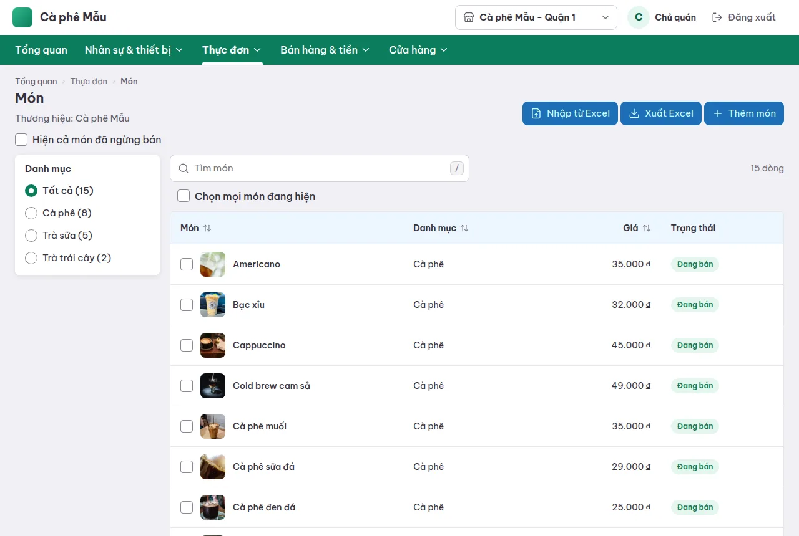
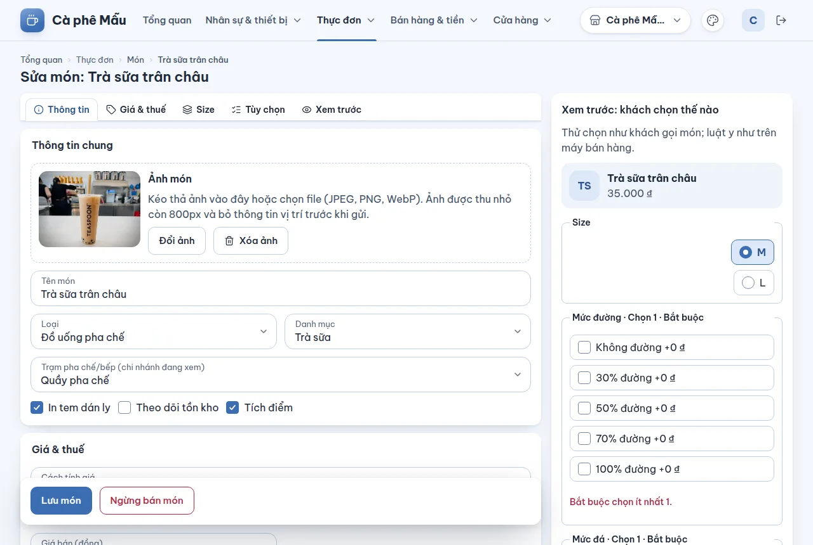
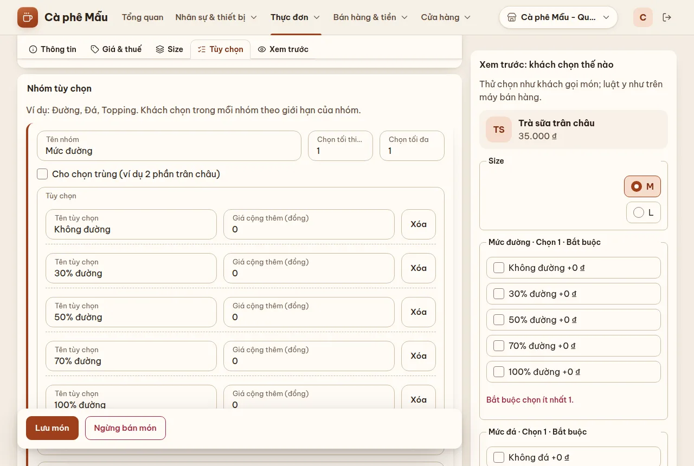
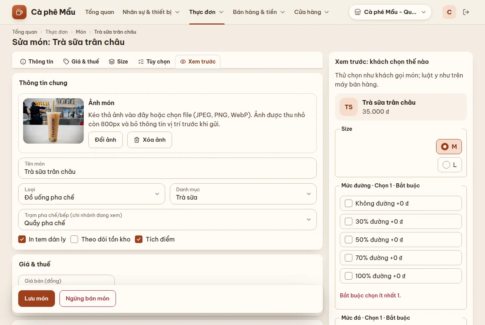
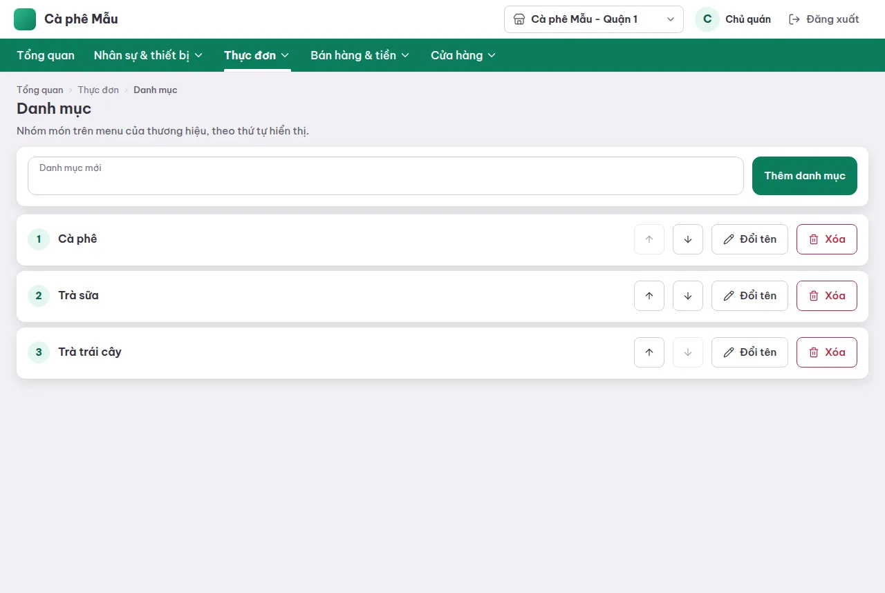
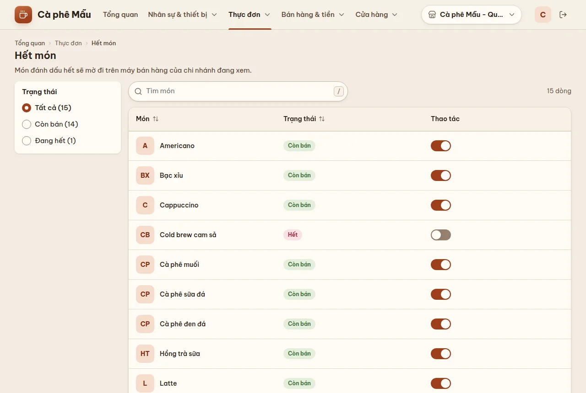
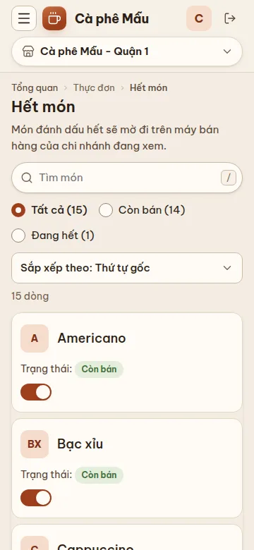

# Thực đơn — món, size, nhóm tùy chọn, danh mục, hết món

## Dùng để làm gì

Nhóm **Thực đơn** trên menu có ba trang: **Món** (danh sách + trang sửa từng món), **Danh mục** và **Hết món**. Mọi thay đổi ở đây tự tới mọi máy quầy của thương hiệu ở lần đồng bộ kế tiếp — không cần làm gì trên máy quầy.

Thực đơn thuộc **thương hiệu**: mọi chi nhánh cùng thương hiệu bán cùng một menu. Riêng **trạm pha chế/bếp** và **hết món** là theo từng chi nhánh.

## Ai dùng, cần quyền gì

- Xem: ai đăng nhập cũng xem được (menu không hiện mục nào cần quyền).
- Thêm, sửa, ngừng bán món, sửa danh mục, bật/tắt hết món: cần quyền **Sửa menu**. Không có quyền thì máy chủ từ chối với câu "Vai trò của bạn không có quyền làm việc này. Nhờ chủ quán cấp quyền."
- Vai trò mẫu có quyền Sửa menu: chỉ **Chủ quán** (Quản lý ca không có — người vừa sửa được giá vừa bán được dễ che giá thật).

## Các bước

### Danh sách món

1. Mở **Thực đơn → Món**. Bảng hiện ảnh, tên, danh mục, giá, trạng thái (Đang bán / Đã ngừng bán / Giá nhập tay). Món bán theo cân ghi giá kèm đơn vị, ví dụ "32.000 ₫ / 100 g".
2. Ô **Tìm món** lọc theo tên; tick **Hiện cả món đã ngừng bán** để thấy cả món đã ngừng. Danh sách hiện 25 món mỗi trang (đổi được 50 / 100 ở cuối danh sách, kèm **Trang trước** / **Trang sau**); hàng tiêu đề Món · Danh mục · Giá · Trạng thái đứng yên trên cùng khi cuộn.
3. **Chuyển nhiều món sang một danh mục**: tick ô đầu các dòng (hoặc **Chọn mọi món đang hiện**), chọn danh mục ở **Chuyển sang danh mục**, bấm **Chuyển**. Trang báo "Đã chuyển N món sang “…”"; món nào không chuyển được thì báo riêng lý do.
4. **Thêm món** mở trang món mới; bấm tên một món để sửa.
5. **Nhập từ Excel / Xuất Excel**: xem [Nhập và xuất Excel](05-nhap-xuat-excel.md).

### Sửa một món

Trang chia các phần (bấm tab trên cùng để nhảy tới): **Thông tin · Giá & thuế · Size · Tùy chọn · Xem trước**.

1. **Thông tin chung**: ảnh món (xem [Ảnh món](04-anh-mon.md)), **Tên món**, **Loại** (Đồ uống pha chế, Món làm tại quán, Hàng bán sẵn, Dịch vụ, Combo), **Danh mục**, **Trạm pha chế/bếp (chi nhánh đang xem)** — phiếu của món in ở trạm này, và ba ô tick **In tem dán ly**, **Theo dõi tồn kho**, **Tích điểm**.
2. **Giá & thuế**: **Cách tính giá** (Giá cố định / Thu ngân nhập giá / Bán theo cân) — chọn trong danh sách của trang, dưới ô có một câu nói máy quầy bán món này thế nào; **Giá bán (đồng)**; **Thuế VAT (%)**.
   - **Bán theo cân**: hiện thêm ô **Giá tính cho** (**Mỗi kg** / **Mỗi 100 g (1 lạng)**), ô giá đổi tên thành **Giá mỗi kg (đồng)** hoặc **Giá mỗi 100 g (đồng)**. Ở máy quầy thu ngân nhập cân nặng theo **gam**; tiền = giá × cân nặng, làm tròn tới đồng (350 g × 200.000 ₫/kg = 70.000 ₫).
   - **Thu ngân nhập giá**: ô giá không bắt buộc ("Không bắt buộc: máy quầy bán theo giá thu ngân gõ."); người không có quyền **Bán món giá nhập tay** cần quản lý nhập PIN duyệt đúng giá đó.
3. **Size / biến thể**: để trống nếu món chỉ bán một kiểu. Mỗi size có **Tên size** và **Giá riêng** — để trống giá riêng thì size đó bán theo giá món (ví dụ M = giá món, L = 45.000).
4. **Nhóm tùy chọn** (ví dụ Mức đường, Mức đá, Topping): mỗi nhóm có **Chọn tối thiểu**, **Chọn tối đa**, **Cho chọn trùng** (ví dụ 2 phần trân châu); mỗi tùy chọn có **Giá cộng thêm** và **Tối đa mỗi tùy chọn** (để trống = theo nhóm). Phần **Theo size** cho phép **Ẩn nhóm với size này** hoặc đặt tối thiểu/tối đa riêng cho từng size (ví dụ ly L cho tới 5 topping).

   

5. **Xem trước: khách chọn thế nào** — thử chọn như khách gọi; luật y như trên máy quầy. Dòng cuối báo "Lựa chọn hợp lệ." hoặc lỗi cụ thể ("Cần chọn ít nhất 1, đang chọn 0."…) và giá khách trả mỗi món.

   

6. Bấm **Lưu món**. Còn chỗ sai thì trang báo "Còn chỗ chưa đúng, đã đánh dấu bên dưới. Sửa rồi lưu lại." và đánh dấu từng ô.
7. **Ngừng bán món**: bấm nút đỏ, xác nhận. Món biến khỏi menu của mọi máy quầy; đơn cũ vẫn giữ món này.

### Danh mục

1. **Thực đơn → Danh mục**: danh sách theo thứ tự hiện trên máy quầy.
2. Gõ tên ở **Danh mục mới**, bấm **Thêm danh mục**.
3. Nút mũi tên **Đưa … lên trên / xuống dưới** đổi thứ tự; **Đổi tên**, **Xóa** ở từng dòng.

### Hết món

1. **Thực đơn → Hết món** (theo **chi nhánh đang xem**).
2. Tắt công tắc **Còn bán** của món vừa hết. Trên máy quầy của chi nhánh đó món mờ đi, không bán được; chi nhánh khác không bị ảnh hưởng.
3. Có hàng lại thì bật lại. Lọc nhanh bằng **Còn bán / Đang hết**.

Trang này dùng tiện trên điện thoại khi đang đứng quầy:

## Luật và giới hạn

- Tên món tối đa **120 ký tự**; tên danh mục tối đa 120 ký tự.
- Giá là **số đồng nguyên**, không âm. Món giá cố định hoặc bán theo cân phải có giá (ở món, hoặc ở từng size): thiếu thì báo "Món bán giá cố định hoặc theo cân cần có giá: nhập giá món, hoặc giá cho từng size."
- Món bán theo cân **luôn có đơn vị** (kg hoặc 100 g); món khác không có. Đổi món từ "Bán theo cân" sang cách khác thì đơn vị bỏ đi khi lưu. Món đặt "Theo cân" từ trước khi có ô đơn vị được coi là **giá mỗi kg**.
- Nhóm tùy chọn: tối thiểu ≥ 0, tối đa ≥ 1, tối thiểu không lớn hơn tối đa; nhóm bắt buộc phải có tùy chọn; giá cộng thêm không âm; nếu khách **không thể** chọn đủ số tối thiểu (ít tùy chọn, không cho chọn trùng) thì không lưu được.
- **Không xóa cứng** món, size hay tùy chọn: bỏ đi thì chúng được lưu trữ vì đơn cũ còn trỏ tới.
- Hai người sửa cùng một món: người lưu sau bị từ chối với "Có người đã sửa món này trước bạn. Tải lại để xem bản mới nhất — thay đổi chưa lưu của bạn sẽ mất." Bấm **Tải lại món**.
- Món **combo**: trang này chưa sửa được các phần combo ("Món combo: các phần combo chưa sửa được ở trang này và được giữ nguyên khi lưu.").
- Máy quầy bán món giá cố định, **giá nhập tay** và **bán theo cân** (xem [Bán tại quầy](../may-quay/03-ban-tai-quay.md)); combo chưa bán ở máy quầy.
- **Không nên đổi đơn vị** (kg ↔ 100 g) của món bán theo cân khi còn đơn đang mở có món đó: máy đọc lại cân nặng theo đơn vị mới.
- Hết món đặt tay ở trang này không tự bật lại theo giờ.

## Khi có lỗi

| Màn hình báo | Làm gì |
|---|---|
| Nhập tên. / Tên dài tối đa 120 ký tự. | Sửa tên |
| Số chọn tối thiểu đang lớn hơn số tối đa. | Sửa giới hạn nhóm |
| Khách không thể chọn đủ số tối thiểu: thêm tùy chọn, cho chọn trùng hoặc giảm số tối thiểu. | Như câu báo |
| Nhóm bắt buộc chọn nhưng chưa có tùy chọn nào. | Thêm tùy chọn hoặc đặt tối thiểu 0 |
| Số chọn tối đa phải từ 1 trở lên. Muốn bỏ nhóm ở một size thì tick “Ẩn nhóm” cho size đó. | Như câu báo |
| Món bán theo cân cần chọn giá tính cho mỗi kg hay mỗi 100 g. | Chọn ở ô **Giá tính cho** |
| Chỉ món bán theo cân mới chọn đơn vị cân. | (trang quản lý tự bỏ đơn vị khi lưu; câu này chỉ hiện với bản cũ) tải lại trang |
| Có người đã sửa món này trước bạn… | Tải lại món rồi sửa lại |
| Không tìm thấy món này. Có thể món đã bị xóa khỏi thương hiệu. | Quay về danh sách món |
| Mục này đang được món hoặc bảng giá dùng. Gỡ khỏi chúng trước khi xóa. | (khi xóa danh mục) chuyển món sang danh mục khác trước |
| Danh mục, trạm hoặc món được chọn không còn tồn tại. Tải lại rồi chọn lại. | Tải lại trang |
| Vai trò của bạn không có quyền làm việc này. Nhờ chủ quán cấp quyền. | Cần quyền Sửa menu |

## Mất mạng thì sao

Trang quản lý cần mạng để lưu. Máy quầy đang mất mạng vẫn bán theo menu nó đã có; món mới/giá mới tới khi máy có mạng lại.

## Chưa làm / sắp có

- **Bảng giá** (giá theo kênh, giá theo khung giờ): máy chủ đã có, nhưng **chưa có màn hình** trong trang quản lý; công tắc "Giá theo khung giờ" ở Cài đặt chưa có tác dụng.
- Chưa sửa được phần combo; chưa bán combo ở máy quầy.
- Chưa có cách **bán lại** món đã ngừng bán (xem [discrepancies](../discrepancies.md#backoffice-và-vận-hành)).
- Hết món có giờ tự có lại (máy chủ có trường này) chưa có trên màn hình.
- Công thức/định lượng và tồn kho: chưa làm (kho thuộc giai đoạn sau); ô "Theo dõi tồn kho" chỉ lưu lại lựa chọn.
