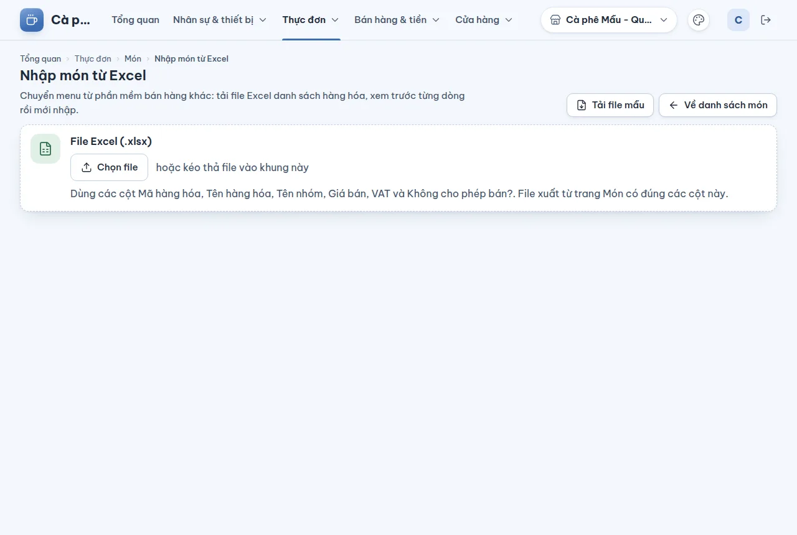

# Nhập và xuất thực đơn bằng Excel

## Dùng để làm gì

- **Nhập**: chuyển menu từ phần mềm bán hàng khác (file Excel "danh sách hàng hóa") hoặc nhập nhanh nhiều món một lần, **xem trước từng dòng rồi mới ghi**.
- **Xuất**: tải menu hiện tại ra file `.xlsx` cùng bố cục, để sửa giá hàng loạt trong Excel rồi nhập lại.

## Ai dùng, cần quyền gì

Xuất: ai xem được menu. Nhập: cần quyền **Sửa menu**.

## Các bước

### Xuất menu

1. **Thực đơn → Món**, bấm **Xuất Excel**. File tên `thuc-don-<ngày>.xlsx`, sheet "Thực đơn", đủ 24 cột của file danh sách hàng hóa mà các phần mềm bán hàng ở Việt Nam hay xuất (Mã hàng hóa, Tên hàng hóa, Tên nhóm, ĐVT, …, VAT…).

### Nhập menu

1. **Thực đơn → Món → Nhập từ Excel**. Chưa có file mẫu thì bấm **Tải file mẫu** (`mau-nhap-mon.xlsx`, có sẵn vài dòng ví dụ).
2. Kéo thả file vào khung hoặc bấm **Chọn file**. Trang đọc file ngay trên máy bạn ("Đang đọc file…") và báo "<tên file>: N dòng hàng hóa."
3. Trang chỉ dùng các cột **Mã hàng hóa, Tên hàng hóa, Tên nhóm, Giá bán, VAT, Không cho phép bán?**. Cột khác (tồn kho, giá vốn, đơn vị lớn, hình ảnh…) được liệt kê ở **Cột bỏ qua**.
4. Chọn **Danh mục cho món mới**: theo cột "Tên nhóm" (tạo danh mục còn thiếu), một danh mục cố định, hoặc không thuộc danh mục. Chọn **Loại của món mới** (đồ uống pha chế, món làm tại quán…).
5. Xem bảng **Các dòng trong file**: mỗi dòng có **Kết quả** — Món mới / Cập nhật (kèm "Giá thành …", "Đổi danh mục") / Đã có, không đổi / Bỏ qua / Lỗi. Lọc theo từng loại kết quả ở cột bên.
6. Bấm **Nhập N món**. Trang báo trước: "Sẽ tạo X món mới và cập nhật Y món. Dòng lỗi và dòng bỏ qua không được nhập."
7. Trong lúc nhập hiện "Đã xử lý a/b món"; bấm **Dừng** để dừng giữa chừng (những món đã nhập vẫn giữ; nhập lại cùng file để làm tiếp).
8. Xong: "Đã nhập N món." (hoặc kèm số món không nhập được). Bấm **Về danh sách món**.

## Luật và giới hạn

- File **.xlsx** (Excel 2007 trở lên), tối đa **5.000 dòng** hàng hóa (và 200 cột). File `.xls` cũ hay `.csv` không đọc được.
- Dòng tiêu đề phải có cột **“Tên hàng hóa”**.
- **Khớp theo tên** (không phân biệt hoa thường) với món đã có: trùng tên thì **cập nhật giá**, và **đổi danh mục** khi dòng có ghi Tên nhóm; không đổi gì thì "Đã có, không đổi". Nhập lại cùng một file **không tạo món đôi**.
- Dòng ghi "Không cho phép bán" bị **bỏ qua**.
- Dòng trùng mã hoặc trùng tên với một dòng khác trong file: báo lỗi ở dòng sau.
- Tên nhóm dài quá 120 ký tự: dòng lỗi (không tạo được danh mục).
- Món đã có mà đang dùng cách tính giá khác "Giá cố định": không cập nhật giá qua Excel, phải sửa trong trang món.
- Món mới tạo qua Excel là món **giá cố định**, không size, không tùy chọn; VAT đọc theo phần trăm (8 = 8%).
- Trang **không xóa** món nào: món có trên menu mà không có trong file vẫn giữ nguyên.

## Khi có lỗi

| Màn hình báo | Làm gì |
|---|---|
| Không đọc được file. Hãy chọn file .xlsx (Excel 2007 trở lên). | Mở file trong Excel, "Lưu thành" .xlsx |
| File quá lớn (tối đa 5.000 dòng). | Tách file |
| Không thấy cột “Tên hàng hóa” ở dòng tiêu đề. | Sửa dòng tiêu đề (dùng file mẫu cho chắc) |
| File không có dòng hàng hóa nào. | Kiểm tra file có dữ liệu dưới dòng tiêu đề |
| Trùng mã với dòng N. / Trùng tên với dòng N. | Sửa hoặc xóa một trong hai dòng |
| Đang ghi “Không cho phép bán”. | Dòng bị bỏ qua có chủ đích |
| Trùng tên với món đã ngừng bán: bán lại món đó trong trang món. | Mở món đó ở [trang sửa món](03-thuc-don.md) và bấm **Bán lại món**, rồi nhập lại file; hoặc đổi tên trong file để tạo món mới |
| Món đang có cách tính giá khác giá cố định: sửa trong trang món. | Sửa giá trong trang món |
| Không tạo được danh mục “…”. | Thử lại; các dòng của danh mục đó không được nhập |
| Không có dòng nào để nhập. | Mọi dòng đều lỗi, bỏ qua hoặc không đổi |

## Mất mạng thì sao

Đọc và xem trước file không cần mạng (làm ngay trên máy). Bấm nhập thì cần mạng; mất mạng giữa chừng thì những món đã nhập vẫn giữ, nhập lại cùng file để làm tiếp.

## Chưa làm / sắp có

- Chưa nhập size, tùy chọn, ảnh, tồn kho, giá vốn từ Excel.
- Chưa nhập file `.csv`.
