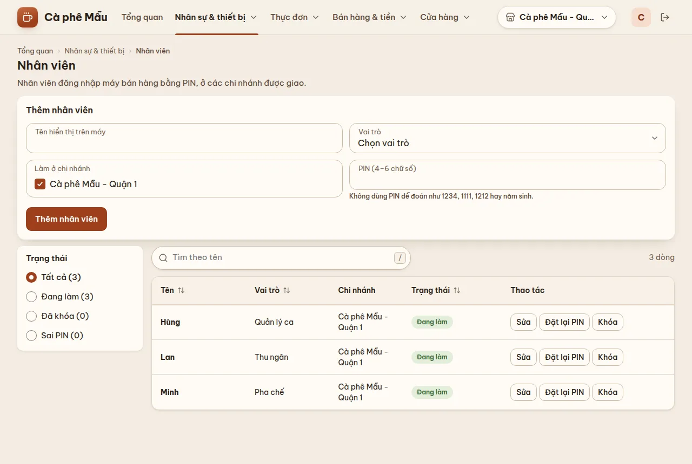
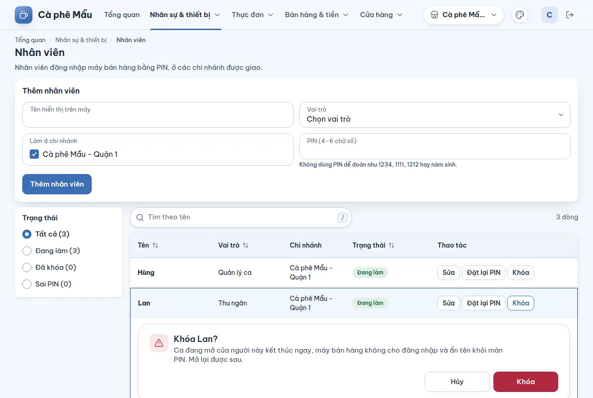
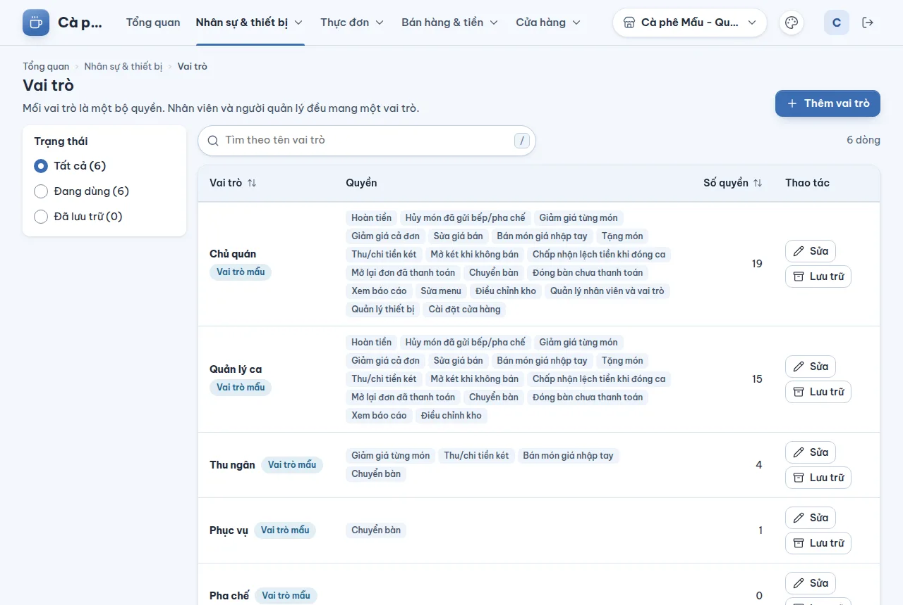
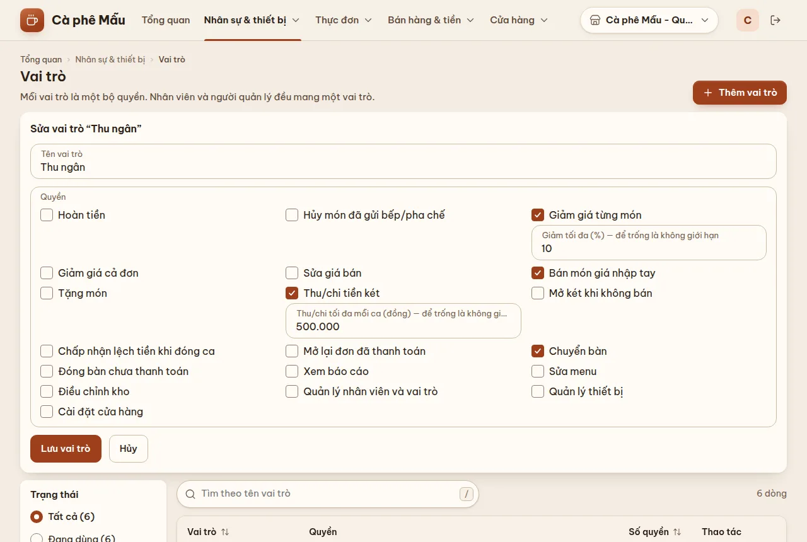

# Nhân viên, vai trò và quyền

## Dùng để làm gì

- **Nhân viên**: người đứng quầy, pha chế, phục vụ… đăng nhập **máy quầy bằng PIN** ở các chi nhánh được giao.
- **Vai trò**: một bộ **quyền** (hoàn tiền, giảm giá, thu/chi két…) kèm **ngưỡng** (giảm tối đa bao nhiêu %, thu/chi tối đa bao nhiêu tiền mỗi ca). Mỗi nhân viên và mỗi người quản lý (tài khoản trang quản lý) mang **đúng một** vai trò.

Việc vượt quyền hoặc vượt ngưỡng ở máy quầy không bị cấm hẳn: máy quầy hỏi **người có quyền duyệt tại chỗ** bằng PIN (xem phần máy quầy, mục duyệt).

## Ai dùng, cần quyền gì

Cả hai trang cần quyền **Quản lý nhân viên và vai trò**. Vai trò mẫu có quyền này: chỉ **Chủ quán**.

## Các bước

### Thêm nhân viên

1. **Nhân sự & thiết bị → Nhân viên**.
2. Ở khung **Thêm nhân viên**: **Tên hiển thị trên máy**, **Vai trò**, **Làm ở chi nhánh** (chọn ít nhất một), **PIN (4–6 chữ số)**. Bấm **Thêm nhân viên**.
3. Báo PIN riêng cho người đó. Họ thấy tên mình trên màn chọn nhân viên của máy quầy các chi nhánh đã chọn.

### Sửa, khóa, đặt lại PIN

Mỗi dòng nhân viên có nút ở cột **Thao tác**:

| Nút | Làm gì |
|---|---|
| **Sửa** | Đổi tên hiển thị và vai trò ("Chưa đổi gì để lưu." nếu không đổi gì). Lưu theo **số phiên bản** của người đó mà trang đã đọc: nếu người khác vừa đổi tên / vai trò (hoặc khóa, mở lại) thì máy chủ từ chối, trang tải lại danh sách và bạn lưu lại nếu vẫn cần — không ghi đè lên chỗ người kia vừa sửa |
| **Khóa** (với người đang làm) | Người nghỉ việc / tạm ngưng: **ca đang mở của người này kết thúc ngay**, máy quầy không cho đăng nhập và **ẩn tên khỏi màn PIN**. Mở lại được sau |
| **Mở lại** (thay nút Khóa với người đã khóa) | Cho đăng nhập lại bằng PIN; phiên đã kết thúc lúc khóa không sống lại |
| **Đặt lại PIN** | Đặt PIN mới (người quên PIN). Xóa luôn số lần nhập sai; **không** đăng xuất người đó khỏi máy đang dùng |
| **Mở khóa PIN** | Chỉ hiện khi người đó đang bị khóa PIN hoặc đã có lần nhập sai: xóa số lần sai, đăng nhập được ngay bằng PIN đúng |

Lọc **Sai PIN** để thấy ai đang có lần nhập sai hoặc đang bị khóa PIN ("PIN bị khóa đến …", "N lần nhập sai PIN").

### Vai trò và quyền

1. **Nhân sự & thiết bị → Vai trò**: bảng vai trò, các quyền, số quyền; lọc **Đang dùng / Đã lưu trữ**.
2. **Thêm vai trò** hoặc bấm **Sửa vai trò …** ở một dòng.
3. Đặt **Tên vai trò**, tick các **Quyền**. Với ba quyền có ngưỡng, ô ngưỡng hiện ngay dưới quyền:
   - **Giảm giá từng món**, **Giảm giá cả đơn**: "Giảm tối đa (%) — để trống là không giới hạn".
   - **Thu/chi tiền két**: "Thu/chi tối đa mỗi ca (đồng) — để trống là không giới hạn".
4. Bấm **Lưu vai trò**.

   

5. **Lưu trữ** vai trò không dùng nữa (chỉ khi không còn ai giữ).

## Danh mục quyền

| Quyền (tên trên màn) | Có ngưỡng | Duyệt tại chỗ được |
|---|---|---|
| Hoàn tiền | — | có |
| Hủy món đã gửi bếp/pha chế | — | có |
| Giảm giá từng món | % tối đa | có |
| Giảm giá cả đơn | % tối đa | có |
| Sửa giá bán | — | có |
| Bán món giá nhập tay | — | có |
| Tặng món | — | có |
| Thu/chi tiền két | số tiền tối đa mỗi ca | có |
| Mở két khi không bán | — | có |
| Chấp nhận lệch tiền khi đóng ca | — | có (duyệt đúng số tiền lệch) |
| Mở lại đơn đã thanh toán | — | có |
| Chuyển bàn | — | có |
| Đóng bàn chưa thanh toán | — | có |
| Điều chỉnh kho | — | có |
| Xem báo cáo | — | **không** |
| Sửa menu | — | **không** |
| Quản lý nhân viên và vai trò | — | **không** |
| Quản lý thiết bị | — | **không** |
| Cài đặt cửa hàng | — | **không** |

Năm quyền quản trị cuối không mượn được tại chỗ: đó là quyền truy cập dữ liệu, không phải một thao tác một lần.

## Vai trò mẫu (có sẵn khi tạo cửa hàng)

| Vai trò | Quyền |
|---|---|
| Chủ quán | tất cả, không giới hạn |
| Quản lý ca | hoàn tiền, hủy món đã gửi, giảm từng món, giảm cả đơn, sửa giá, giá nhập tay, tặng món, thu/chi két, mở két, chấp nhận lệch két, mở lại đơn đã trả, chuyển bàn, đóng bàn chưa trả, xem báo cáo, điều chỉnh kho — **không** có sửa menu, nhân viên, thiết bị, cài đặt |
| Thu ngân | giảm từng món **tối đa 10%**, thu/chi két **tối đa 500.000 đ mỗi ca**, bán món giá nhập tay, chuyển bàn |
| Phục vụ | chuyển bàn |
| Pha chế | không có quyền nào (pha chế không cần quyền) |
| Thủ kho | điều chỉnh kho |

Đây chỉ là điểm bắt đầu: đổi tên, thêm bớt quyền, đổi ngưỡng tùy quán.

## Luật và giới hạn

- **PIN**: 4–6 chữ số. Bị từ chối vì quá dễ đoán: một số lặp (0000), một khối lặp (1212, 123123), dãy tăng/giảm (1234, 9876), năm 1950–2029 (năm sinh) và các hình bàn phím quen thuộc (2580, 147258…).
- **Nhập sai PIN 5 lần** ở máy quầy ⇒ khóa **5 phút**; lần khóa kế tiếp (chưa nhập đúng lần nào xen giữa) gấp đôi: 10, 20, 40 phút… tối đa **24 giờ**. Nhập đúng thì về lại từ đầu. Mỗi lần khóa ghi nhật ký kèm máy quầy.
- Phiên đăng nhập PIN trên máy quầy sống tối đa **12 giờ** (một ca trên một máy).
- **Ngưỡng giảm giá** xét theo **tổng tỉ lệ giảm sau thao tác** (làm tròn lên), nên chia nhỏ nhiều lần giảm không lách được ngưỡng.
- **Ngưỡng thu/chi két** xét theo **tổng đã thu/chi trong ca, mọi nhân viên cộng chung**.
- Một vai trò có nhiều quyền trùng nhau thì lấy mức rộng nhất. Ngưỡng % từ 0 đến 100, tối đa 2 chữ số thập phân; ngưỡng tiền là số đồng nguyên.
- **Không bỏ được quyền "Quản lý nhân viên và vai trò"** khỏi vai trò cuối cùng còn quyền đó (cửa hàng sẽ không còn ai quản lý được nhân viên).
- **Lưu trữ vai trò là một chiều** (không bỏ lưu trữ được) và bị từ chối khi còn người giữ — kể cả nhân viên đã khóa. Trang liệt kê những người đó để chuyển họ sang vai trò khác trước.
- Khóa nhân viên được máy chủ kiểm ngay cả khi người đó đang nhập PIN dở: khóa xong là không đăng nhập hay duyệt được nữa.

## Khi có lỗi

| Màn hình báo | Làm gì |
|---|---|
| Có người đã sửa nhân viên này trước bạn. Danh sách đã được tải lại; xem lại rồi bấm lưu lần nữa nếu vẫn cần. | Xem bản mới trên danh sách, rồi **Lưu** lại |
| PIN gồm 4 đến 6 chữ số. | Nhập lại |
| PIN quá dễ đoán (như 1234, 1111, 1212, 2580 hoặc một năm sinh). Chọn PIN khác. | Chọn PIN khác |
| Chọn vai trò. / Chọn ít nhất một chi nhánh. / Nhập tên hiển thị. | Điền đủ |
| Nhân viên này đã bị khóa rồi. / … đang làm, không cần mở lại. / PIN … không bị khóa … | Người khác vừa làm trước bạn: tải lại danh sách |
| Vai trò này đã lưu trữ, không gán cho ai được nữa. Chọn vai trò khác. | Chọn vai trò khác |
| Vai trò đang có người giữ. Chuyển họ sang vai trò khác trước. | Chuyển người theo danh sách trang hiện |
| Không bỏ được quyền quản lý nhân viên: cửa hàng sẽ không còn ai quản lý được nhân viên và vai trò. | Giữ quyền đó ở ít nhất một vai trò có người giữ |
| Nhập phần trăm từ 0 đến 100, tối đa 2 chữ số thập phân. | Sửa ngưỡng |
| Ngưỡng không hợp lệ: giảm giá từ 0 đến 100%, thu/chi là số tiền nguyên; chỉ đặt cho quyền đã bật. | Sửa ngưỡng |

## Mất mạng thì sao

Máy quầy giữ danh sách nhân viên đã đồng bộ để đăng nhập PIN khi mất mạng. Nhân viên mới, PIN mới, khóa/mở lại tới máy quầy ở lần đồng bộ kế tiếp. Duyệt tại chỗ thì **cần mạng** (máy chủ kiểm PIN người duyệt).

## Chưa làm / sắp có

- Chưa đổi được **chi nhánh làm việc** của nhân viên sau khi tạo (Sửa chỉ đổi tên và vai trò).
- Chưa thêm/mời được **người quản lý** (tài khoản trang quản lý) từ màn hình; chưa đổi vai trò của người quản lý.
- Chưa có lịch làm, chấm công, nhật ký thao tác xem được trên màn hình (nhật ký có ở máy chủ).
