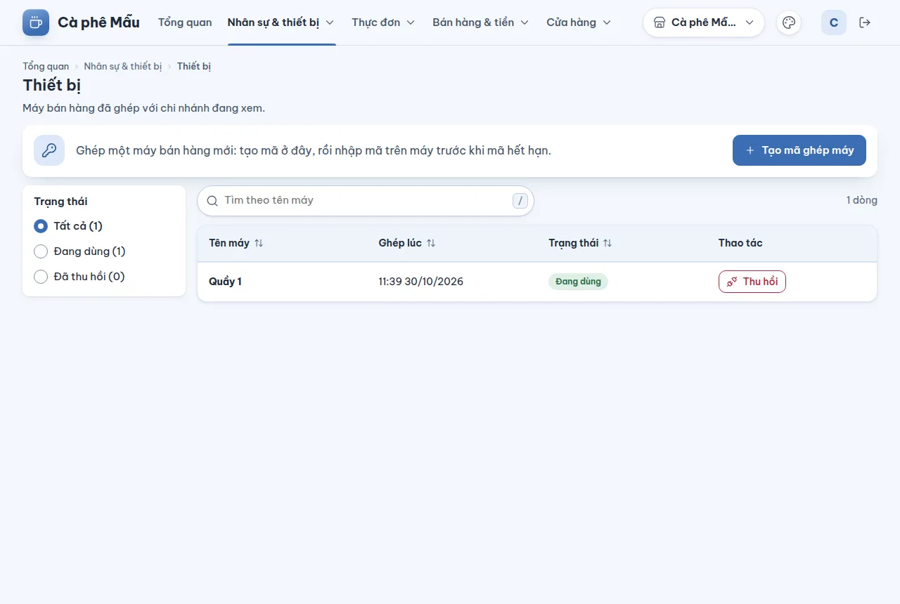
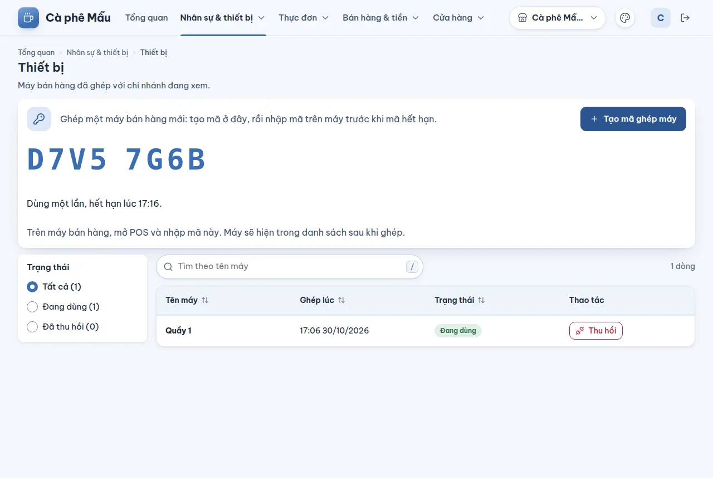

# Thiết bị — ghép và thu hồi máy quầy

## Dùng để làm gì

Mỗi máy bán hàng (máy tính tiền, tablet, điện thoại) phải được **ghép** với một chi nhánh trước khi bán. Trang **Thiết bị** tạo mã ghép, liệt kê các máy đã ghép và **thu hồi** máy bị mất hoặc không dùng nữa.

## Ai dùng, cần quyền gì

Cần quyền **Quản lý thiết bị**. Vai trò mẫu có quyền này: chỉ **Chủ quán** — để không ai ghép thêm máy mà chủ quán không biết.

## Các bước

### Ghép một máy mới

1. Chọn đúng chi nhánh ở **Chi nhánh đang xem**, mở **Nhân sự & thiết bị → Thiết bị**.
2. Bấm **Tạo mã ghép máy**. Trang hiện **Mã ghép máy** và giờ hết hạn ("Dùng một lần, hết hạn lúc …").

   

3. Trên máy bán hàng, mở trang POS, nhập mã này (và đặt tên máy, ví dụ "Quầy 1") — xem phần máy quầy, mục ghép máy.
4. Máy hiện trong danh sách với trạng thái **Đang dùng**.

### Thu hồi một máy

1. Ở dòng của máy, bấm **Thu hồi**. Trang hiện khung hỏi lại **Thu hồi máy "…"?** ngay trên danh sách: bấm nút đỏ **Thu hồi máy** để làm, **Hủy** để thôi.
2. Máy bị đăng xuất và **không bán được nữa** cho tới khi ghép lại bằng mã mới. Dòng chuyển sang "Đã thu hồi lúc …".
3. Lọc **Đang dùng / Đã thu hồi**, tìm theo tên máy.

## Luật và giới hạn

- **Số thứ tự máy trong chi nhánh (1–9)**: mỗi máy được cấp lúc ghép, số nhỏ nhất còn trống; chi nhánh có từ hai máy thì số gọi món của máy bắt đầu bằng số này (máy 2 gọi 201, 202…) để hai máy không gọi trùng. **Thu hồi** máy thì số trả lại, máy ghép sau lấy số đó. Trang Thiết bị chưa hiện số này; máy ghép từ trước được cấp khi nó tải lại dữ liệu khởi động.

- Mã ghép **dùng một lần**, sống **10 phút**. Hết hạn thì trang báo "Mã đã hết hạn. Tạo mã mới nếu cần."; mã hết hạn được máy chủ tự xóa (job dọn dẹp mỗi giờ).
- Mỗi máy ghép với **một chi nhánh**. Muốn đổi chi nhánh: thu hồi rồi ghép lại ở chi nhánh kia.
- Máy đã thu hồi bị máy chủ từ chối ở mọi lần gọi kế tiếp (đồng bộ, đăng nhập PIN).
- Một địa chỉ mạng chỉ được thử ghép **10 lần mỗi phút** (chống dò mã).
- Thu hồi không xóa đơn của máy: đơn đã đồng bộ vẫn nằm trong báo cáo. Đơn **chưa** đồng bộ trên máy bị thu hồi thì không gửi lên được nữa — đồng bộ hết trước khi thu hồi máy còn dùng được.

## Khi có lỗi

| Màn hình báo | Làm gì |
|---|---|
| Chọn chi nhánh để xem thiết bị. | Chọn chi nhánh ở góc trên |
| Chi nhánh chưa có máy nào. Tạo mã ghép rồi nhập mã trên máy bán hàng. | Không phải lỗi |
| Mã đã hết hạn. Tạo mã mới nếu cần. | Tạo mã mới |
| Mã ghép không đúng, đã hết hạn hoặc đã được dùng. (trên máy quầy) | Tạo mã mới, nhập lại |
| Không tìm thấy thiết bị này. Tải lại danh sách. | Máy đã bị thu hồi/xử lý ở nơi khác |

## Mất mạng thì sao

Ghép máy **cần mạng** cả ở trang quản lý lẫn ở máy quầy. Máy đã ghép thì bán được khi mất mạng; lệnh thu hồi chỉ có tác dụng khi máy đó gọi lại máy chủ.

## Chưa làm / sắp có

- Chưa đổi tên máy từ trang quản lý.
- Chưa xem được máy nào đang online, lần đồng bộ cuối, số lệnh còn chờ của từng máy.
- Chưa quản lý máy in (máy in đặt ở từng máy quầy).
