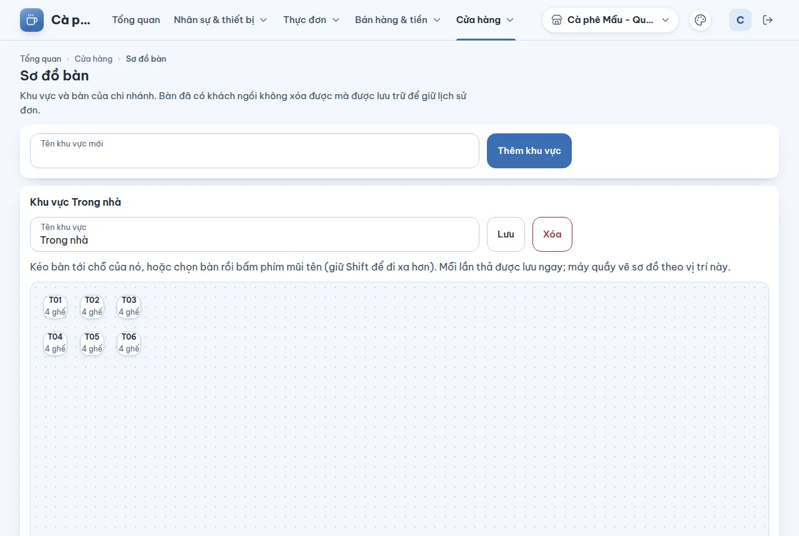

# Sơ đồ bàn — khu vực và bàn

## Dùng để làm gì

Khai báo **khu vực** (Tầng trệt, Sân vườn…) và **bàn** của chi nhánh, rồi kéo bàn tới đúng chỗ trên sơ đồ. Máy quầy vẽ sơ đồ bàn theo đúng vị trí này để phục vụ chọn bàn khi bán tại bàn.

## Ai dùng, cần quyền gì

Cần quyền **Cài đặt cửa hàng**. Muốn máy quầy hiện chế độ bán tại bàn thì công tắc **Quản lý bàn** ở [Cài đặt](09-cai-dat.md) phải bật cho chi nhánh.

## Các bước

1. Chọn chi nhánh, mở **Cửa hàng → Sơ đồ bàn**.
2. Gõ **Tên khu vực mới**, bấm **Thêm khu vực**.
3. Trong khung của khu vực: nhập **Tên bàn mới** và **Số ghế**, bấm **Thêm bàn**.
4. Sửa tên hoặc số ghế ở từng dòng bàn rồi bấm lưu bàn; đổi tên khu vực rồi bấm lưu tên khu vực.
5. Ở **Sơ đồ <khu vực>**: kéo bàn tới chỗ của nó, hoặc chọn bàn rồi bấm **phím mũi tên** (giữ **Shift** để đi xa hơn). **Mỗi lần thả được lưu ngay** ("Đã dời …").
6. Xóa bàn hoặc khu vực bằng nút xóa, xác nhận **Xóa**.

## Luật và giới hạn

- Tên khu vực tối đa **60 ký tự**, tên bàn tối đa **40 ký tự**; số ghế từ **1 đến 99**.
- **Xóa**: mục **chưa từng có đơn** thì bị xóa hẳn; mục **đã có đơn** thì được **lưu trữ** — không hiện trên máy quầy nữa nhưng giữ lịch sử đơn ("Đã lưu trữ …").
- Không xóa được bàn **đang có khách** (có đơn chưa thanh toán): thanh toán, hủy hoặc chuyển đơn trước.
- Không xóa được khu vực còn bàn đang dùng: lưu trữ/chuyển các bàn trước.
- Mục đã lưu trữ không sửa được nữa.
- Sơ đồ, khu vực và bàn tới máy quầy theo đồng bộ (cả khi máy quầy đang mở sơ đồ).

## Khi có lỗi

| Màn hình báo | Làm gì |
|---|---|
| Nhập tên, tối đa N ký tự. | Sửa tên |
| Số ghế từ 1 đến 99. | Sửa số ghế |
| Bàn đang có khách. Thanh toán, hủy hoặc chuyển đơn trước. | Xử lý đơn ở máy quầy trước |
| Khu vực còn bàn đang dùng. Lưu trữ hoặc chuyển các bàn trước. | Xóa/lưu trữ bàn trước |
| Mục này đã lưu trữ, không sửa được nữa. | Tạo mục mới |
| Khu vực đã lưu trữ: không thêm hay giữ bàn đang dùng trong đó. | Thêm bàn vào khu vực khác |
| Có người đã sửa mục này trước bạn. Tải lại để xem bản mới nhất. | Tải lại trang |
| Chi nhánh chưa có khu vực nào. Thêm khu vực trước, rồi thêm bàn vào khu vực. | Không phải lỗi |

## Mất mạng thì sao

Sửa sơ đồ cần mạng. Máy quầy giữ sơ đồ đã đồng bộ và vẫn hiện bàn khi mất mạng; trạng thái bàn trên máy đó tính theo đơn chính máy đó giữ.

## Chưa làm / sắp có

- Chưa đổi được hình dạng/kích thước bàn trên sơ đồ.
- Chưa có QR gọi món tại bàn (công tắc "Khách gọi món bằng QR tại bàn" chưa có tác dụng).
- Chưa gộp/tách bàn (giai đoạn sau).
