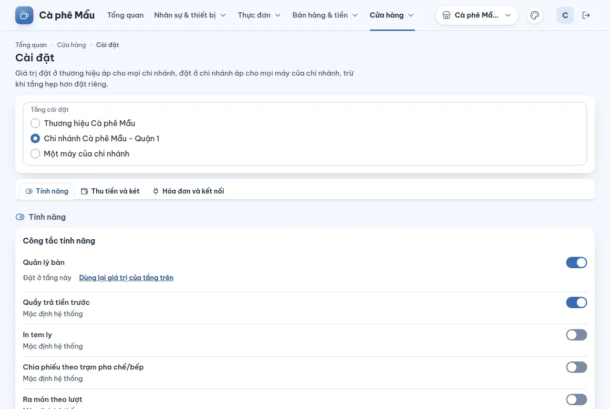
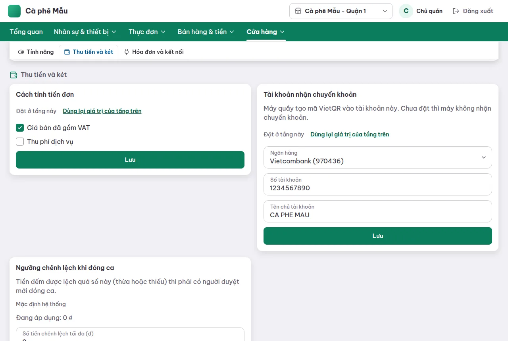
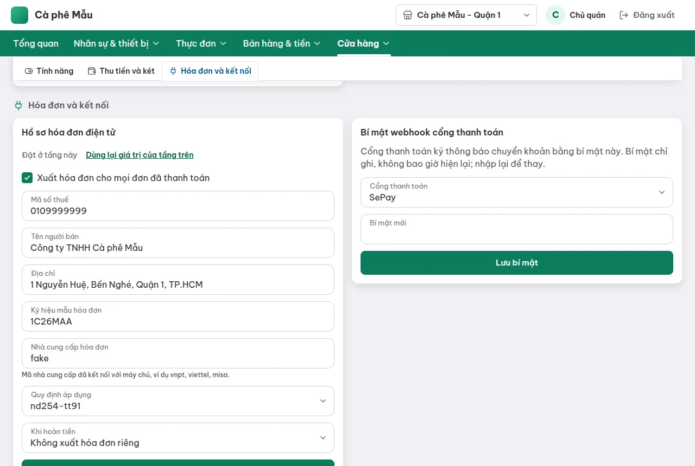

# Cài đặt — công tắc tính năng, phí, tài khoản nhận tiền, hóa đơn điện tử

## Dùng để làm gì

Một trang cho mọi lựa chọn vận hành của quán: bật/tắt tính năng, cách tính tiền đơn (VAT, phí dịch vụ), tài khoản nhận chuyển khoản QR, ngưỡng lệch két khi đóng ca, hồ sơ hóa đơn điện tử và bí mật webhook của cổng thanh toán.

## Ai dùng, cần quyền gì

Cần quyền **Cài đặt cửa hàng** (vai trò mẫu: chỉ Chủ quán). Chọn tầng **Một máy của chi nhánh** còn cần quyền **Quản lý thiết bị** để thấy danh sách máy.

## Các bước

1. Mở **Cửa hàng → Cài đặt**.
2. Chọn **Tầng cài đặt**:
   - **Thương hiệu …** — áp cho mọi chi nhánh của thương hiệu;
   - **Chi nhánh …** (chi nhánh đang xem) — áp cho mọi máy của chi nhánh;
   - **Một máy của chi nhánh** — chọn máy ở ô **Máy**.
   Tầng hẹp hơn đặt riêng thì thắng tầng rộng hơn.
3. Mỗi mục ghi giá trị đang áp dụng lấy từ đâu: **Mặc định hệ thống / Lấy từ thương hiệu / Lấy từ chi nhánh / Đặt riêng cho máy**. Mục đã đặt ở tầng đang chọn có chữ **Đặt ở tầng này** và nút **Dùng lại giá trị của tầng trên** để bỏ giá trị riêng.
4. Ba nhóm (tab): **Tính năng**, **Thu tiền và két**, **Hóa đơn và kết nối**. Sửa rồi bấm **Lưu** của từng khung.
5. Mục không đặt được ở tầng đang chọn hiện "Không sửa ở tầng này: đặt ở chi nhánh hoặc thương hiệu."

## Công tắc tính năng

| Công tắc | Mặc định | Đặt được tới tầng | Ràng buộc | Hiện có tác dụng gì |
|---|---|---|---|---|
| Quản lý bàn | tắt | chi nhánh | — | Máy quầy hiện chế độ **bán tại bàn** và sơ đồ bàn |
| Quầy trả tiền trước | **bật** | máy | — | chưa có tác dụng (máy quầy chưa đọc) |
| In tem ly | tắt | máy | — | chưa có tác dụng (tem ly theo ô "In tem dán ly" của từng món) |
| Chia phiếu theo trạm pha chế/bếp | tắt | chi nhánh | — | chưa có tác dụng |
| Ra món theo lượt | tắt | chi nhánh | cần **Quản lý bàn** | chưa có tác dụng |
| Khách gọi món bằng QR tại bàn | tắt | chi nhánh | cần **Quản lý bàn** | chưa có tác dụng |
| Giá theo khung giờ | tắt | thương hiệu | — | chưa có tác dụng |
| Theo dõi tồn kho | tắt | chi nhánh | — | chưa có tác dụng |
| Tự báo hết món khi tồn về 0 | tắt | chi nhánh | cần **Theo dõi tồn kho**; không bật cùng **Cho bán khi tồn âm** | chưa có tác dụng |
| Cho bán khi tồn âm | tắt | chi nhánh | cần **Theo dõi tồn kho**; không bật cùng **Tự báo hết món…** | chưa có tác dụng |
| Hóa đơn điện tử | tắt | chi nhánh | — | chưa có tác dụng: việc xuất hóa đơn do ô **"Xuất hóa đơn cho mọi đơn đã thanh toán"** trong hồ sơ hóa đơn quyết định |
| Làm tròn tiền mặt | tắt | chi nhánh | — | chưa có tác dụng |
| Hủy món đã gửi bếp phải có người duyệt | **bật** | chi nhánh | — | Bật: thu ngân không có quyền "Hủy món đã gửi bếp/pha chế" phải nhờ người duyệt; tắt: ai cũng hủy được món đã gửi |

"Chưa có tác dụng" nghĩa là giá trị được lưu, kiểm ràng buộc và gửi tới máy quầy, nhưng chưa phần nào của hệ thống làm theo nó (xem [discrepancies](../discrepancies.md#backoffice-và-vận-hành)).

## Thu tiền và két

- **Cách tính tiền đơn** (đặt tới tầng chi nhánh): **Giá bán đã gồm VAT** (mặc định bật); **Thu phí dịch vụ**: **Phí dịch vụ (%)**, **Áp cho kênh** (Tại bàn, Mang đi, Quán tự giao, Ứng dụng giao hàng — chọn ít nhất một), **Tính phí trên** tiền hàng trước hoặc sau giảm giá, **Thuế suất VAT của phí (%)**. Đơn mới chép cách tính đang áp dụng lúc mở đơn; đổi cài đặt **không tính lại** đơn đã mở.
- **Tài khoản nhận chuyển khoản** (chi nhánh): **Ngân hàng** (chọn trong danh sách, hoặc "Ngân hàng khác" rồi nhập **Mã BIN** 6 số), **Số tài khoản**, **Tên chủ tài khoản**. Máy quầy tạo mã VietQR vào tài khoản này. **Chưa đặt thì máy quầy không nhận chuyển khoản.**
- **Ngưỡng chênh lệch khi đóng ca** (đặt tới tầng máy): tiền đếm được lệch quá số này (thừa hoặc thiếu) thì phải có người duyệt mới đóng ca. Mặc định **0 đ** — lệch bất kỳ đồng nào cũng cần duyệt.

## Hóa đơn và kết nối

- **Hồ sơ hóa đơn điện tử** (chi nhánh): **Xuất hóa đơn cho mọi đơn đã thanh toán**, **Mã số thuế**, **Tên người bán**, **Địa chỉ**, **Ký hiệu mẫu hóa đơn**, **Nhà cung cấp hóa đơn** (mã nhà cung cấp đã kết nối với máy chủ, ví dụ vnpt, viettel, misa), **Quy định áp dụng**, **Khi hoàn tiền** (không xuất hóa đơn riêng / xuất hóa đơn điều chỉnh). Chưa đặt hồ sơ thì chi nhánh không xuất hóa đơn nào.
- **Bí mật webhook cổng thanh toán** (chỉ ở tầng chi nhánh): chọn **Cổng thanh toán** (SePay, PayOS), dán **Bí mật mới**, bấm **Lưu bí mật**. Cổng thanh toán ký thông báo chuyển khoản bằng bí mật này; có nó máy chủ mới tin được thông báo "đã nhận tiền" để QR tự xác nhận. Bí mật **chỉ ghi, không bao giờ hiện lại**; muốn thay thì nhập bí mật mới.

## Luật và giới hạn

- Bật một công tắc mà công tắc nó cần đang tắt, hoặc bật hai công tắc loại trừ nhau, bị từ chối ngay — ở **mọi tầng** (kể cả khi xung đột nằm ở một máy hay một chi nhánh khác). Trang nói rõ xung đột ở đâu.
- Phí dịch vụ: tỉ lệ **> 0 và ≤ 100%**, tối đa 2 chữ số thập phân; thuế suất của phí 0–100%.
- Số tài khoản 1–19 chữ số hoặc chữ cái không dấu; tên chủ tài khoản tối đa 80 ký tự.
- Mã số thuế: 10 số, 10 số-3 số, hoặc 12 số. Ký hiệu mẫu như **1C26MAB**: 1 hoặc 2, chữ C, 2 số năm, chữ M, 2 chữ cái in hoa.
- Quy định áp dụng hiện chỉ có một lựa chọn (`nd254-tt91`), soạn từ nguồn thứ cấp và **chưa đối chiếu công báo** — hỏi kế toán trước khi dùng với dữ liệu thật.
- Bí mật webhook: 16–256 ký tự, không khoảng trắng, không dấu tiếng Việt; **mỗi chi nhánh một bí mật riêng** cho cùng cổng; được máy chủ mã hóa bằng khóa `FNB_PAYMENT_SECRET_KEY`.
- Cài đặt tới máy quầy ở lần đồng bộ kế tiếp, chỉ tới các máy nằm trong phạm vi của tầng vừa sửa.

## Khi có lỗi

| Màn hình báo | Làm gì |
|---|---|
| “X” cần bật “Y” trước. · Xung đột ở … | Bật công tắc Y (ở đúng nơi được nêu) trước |
| “X” và “Y” không bật cùng lúc được. | Tắt một trong hai |
| Cài đặt này không đặt được ở tầng đang chọn. | Chọn tầng rộng hơn |
| Nhập tỉ lệ lớn hơn 0 và không quá 100, tối đa 2 chữ số thập phân. | Sửa phí dịch vụ |
| Chọn ít nhất một kênh. | Chọn kênh áp phí |
| Chọn ngân hàng hoặc nhập đủ 6 chữ số mã BIN. | Sửa ngân hàng |
| Số tài khoản gồm 1 đến 19 chữ số hoặc chữ cái, không dấu. | Sửa số tài khoản |
| Mã số thuế gồm 10 số, 10 số-3 số, hoặc 12 số. | Sửa MST |
| Ký hiệu như 1C26MAB: … | Sửa ký hiệu |
| Máy chủ chưa kết nối nhà cung cấp hóa đơn này. Kiểm tra lại mã nhà cung cấp. | Sửa mã nhà cung cấp, hoặc nhờ người vận hành bật nhà cung cấp |
| Quy định đã chọn không cho cách xử lý hoàn tiền này. | Chọn cách hoàn tiền khác |
| Bí mật dài 16 đến 256 ký tự, không có khoảng trắng hay dấu tiếng Việt. | Dán lại đúng bí mật cổng cấp |
| Một chi nhánh khác đã dùng bí mật này cho cùng cổng thanh toán. Mỗi chi nhánh cần bí mật riêng. | Tạo bí mật khác ở cổng thanh toán |
| Máy chủ chưa được cấu hình để lưu bí mật cổng thanh toán. Báo hỗ trợ. | Người vận hành đặt `FNB_PAYMENT_SECRET_KEY` |
| Cần quyền quản lý thiết bị để chọn máy. | Nhờ chủ quán, hoặc đặt ở tầng chi nhánh |

## Mất mạng thì sao

Sửa cài đặt cần mạng. Máy quầy đang mất mạng dùng cài đặt đã đồng bộ lần trước.

## Chưa làm / sắp có

- Phần lớn công tắc tính năng (bảng trên) chưa có tác dụng: tồn kho, giá theo giờ, gọi món QR, ra món theo lượt, chia phiếu theo trạm, làm tròn tiền mặt.
- Chưa có cài đặt giờ bắt đầu ngày kinh doanh hay múi giờ trên màn hình (mặc định 04:00, giờ Việt Nam khi tạo chi nhánh).
- Chưa có cài đặt máy in, mẫu hóa đơn in, logo.
