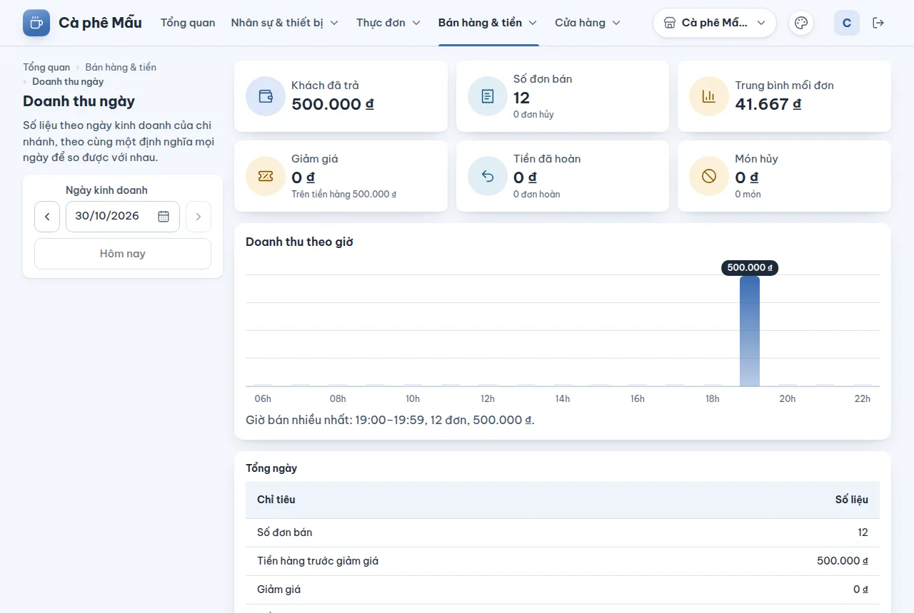

# Doanh thu ngày

## Dùng để làm gì

Báo cáo đầy đủ của **một ngày kinh doanh** ở chi nhánh đang xem: tóm tắt, tổng ngày theo từng chỉ tiêu (tiền hàng, giảm giá, phí dịch vụ, VAT…), theo phương thức thanh toán, theo giờ và theo món. Mọi ngày dùng **cùng một định nghĩa** nên so được với nhau.

## Ai dùng, cần quyền gì

Cần quyền **Xem báo cáo** (vai trò mẫu: Chủ quán, Quản lý ca).

## Các bước

1. Mở **Bán hàng & tiền → Doanh thu ngày**.
2. Chọn **Ngày kinh doanh**: gõ ngày vào ô theo dạng **ngày/tháng/năm** (ví dụ `30/10/2026`, ô luôn hiện đúng dạng này dù trình duyệt dùng ngôn ngữ nào), hoặc bấm biểu tượng lịch cạnh ô để chọn trên **lịch** (tuần bắt đầu từ T2; ngày hôm nay có viền, ngày sau hôm nay mờ và không chọn được; mũi tên đổi tháng; phím mũi tên đi từng ngày / tuần, Page Up / Page Down đổi tháng, Enter chọn, Esc đóng). Hoặc dùng nút **Ngày trước / Ngày sau / Hôm nay**. Gõ chưa đúng thì ô báo ngay dưới ("Nhập ngày theo dạng ngày/tháng/năm, ví dụ 30/10/2026.") và báo cáo giữ ngày cũ.
3. Đọc **Tóm tắt ngày**: Khách đã trả, Số đơn bán (kèm số đơn hủy), Trung bình mỗi đơn, Giảm giá (trên tiền hàng …), Tiền đã hoàn (số đơn hoàn), Món hủy (số món).
4. **Doanh thu theo giờ**: biểu đồ cột.
5. **Tổng ngày**: bảng chỉ tiêu — Số đơn bán · Tiền hàng trước giảm giá · Giảm giá · Tiền hàng sau giảm giá · Phí dịch vụ · Doanh thu chưa VAT · Thuế VAT (tách theo từng mức VAT) · Khách đã trả · Số đơn hoàn · Tiền đã hoàn · VAT của phần hoàn · Số đơn hủy · Số món hủy · Giá trị món hủy · Số lần hoàn tiền QR cho khách · Tiền QR đã hoàn lại khách.
6. **Theo phương thức thanh toán**: Tiền mặt, Chuyển khoản QR, Thẻ — cột Thu, Hoàn, Còn lại.
7. **Theo giờ**: bảng giờ (ví dụ 07:00–07:59), số đơn, khách đã trả.
8. **Theo món**: tìm món; lọc **Món** hoặc **Tùy chọn và phần combo**; cột Số lượng, Tiền hàng, Giảm, Sau giảm, VAT.

## Luật và giới hạn

Định nghĩa (đúng như trang ghi dưới bảng):

- **Tiền hàng** tính theo giá bán (đã gồm VAT nếu giá gồm VAT), **không tính món đã hủy**.
- **Doanh thu chưa VAT** = tổng phần chưa thuế của các mức VAT; **Khách đã trả** = doanh thu chưa VAT + VAT.
- Thuế tính theo **từng mức thuế suất**, làm tròn **một lần mỗi mức**; giảm giá từng món tính trước, giảm cả đơn tính sau.
- **Đơn hoàn tính riêng, vào ngày hoàn** (không trừ ngược vào ngày bán).
- **Tiền QR đã hoàn lại khách** là tiền ngân hàng báo nhận mà không đơn nào dùng (trả thiếu, trả thừa, hoặc đơn đã trả cách khác), tính vào **ngày ghi hoàn**: **không phải doanh thu**, không nằm trong số liệu nào khác.
- **Ngày kinh doanh** của chi nhánh bắt đầu lúc **04:00** (mặc định): bảng theo giờ xếp từ 04:00 tới 03:59 hôm sau, nên đơn 01:00 sáng nằm cuối ngày hôm trước.
- Ngày **đã chốt** giữ nguyên số liệu: đơn trả tiền hoặc tiền QR hoàn sau lúc chốt **không** làm đổi báo cáo ngày đó (được liệt kê riêng ở [Chốt ngày](11-chot-ngay.md)). Đơn **hủy** và món **hủy bớt** mà máy mất mạng qua lúc chốt chỉ báo lên máy chủ sau đó cũng **không** làm đổi số "Hủy món" và "Đơn hủy" của ngày đã chốt.
- Số liệu là những gì máy quầy **đã đồng bộ**.

## Khi có lỗi

| Màn hình báo | Làm gì |
|---|---|
| Chọn một ngày. | Chọn ngày ở ô Ngày kinh doanh |
| Nhập ngày theo dạng ngày/tháng/năm, ví dụ 30/10/2026. · Không chọn được ngày sau … | Gõ sai dạng, ngày không có thật, hoặc ngày quá hôm nay | Gõ lại hoặc chọn trên lịch |
| Ngày này chưa bán được đơn nào. | Không phải lỗi |
| Khoảng thời gian không hợp lệ: giờ bắt đầu phải trước giờ kết thúc. | Chọn lại ngày |
| Vai trò của bạn không có quyền làm việc này. Nhờ chủ quán cấp quyền. | Cần quyền Xem báo cáo |

## Mất mạng thì sao

Báo cáo cần mạng. Đơn của máy quầy đang mất mạng chỉ vào báo cáo khi máy đó đồng bộ lên — trước khi chốt ngày hãy chắc mọi máy đã đồng bộ.

## Chưa làm / sắp có

- Chưa xuất báo cáo ra Excel/PDF, chưa in báo cáo ngày.
- Chưa có báo cáo nhiều ngày (tuần, tháng), theo nhân viên, theo ca, theo kênh, gộp nhiều chi nhánh.
- Phương thức **Thẻ** có cột trong bảng nhưng máy quầy chưa nhận thanh toán thẻ.
