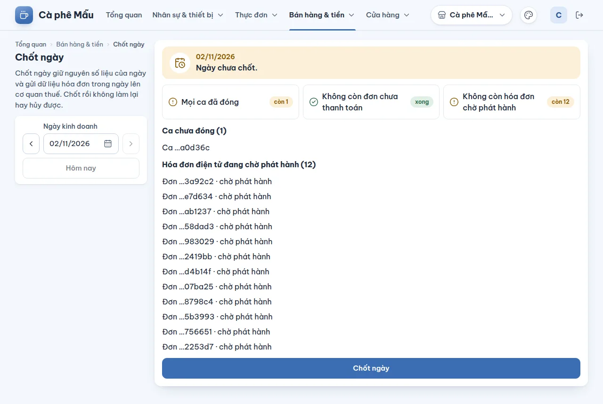
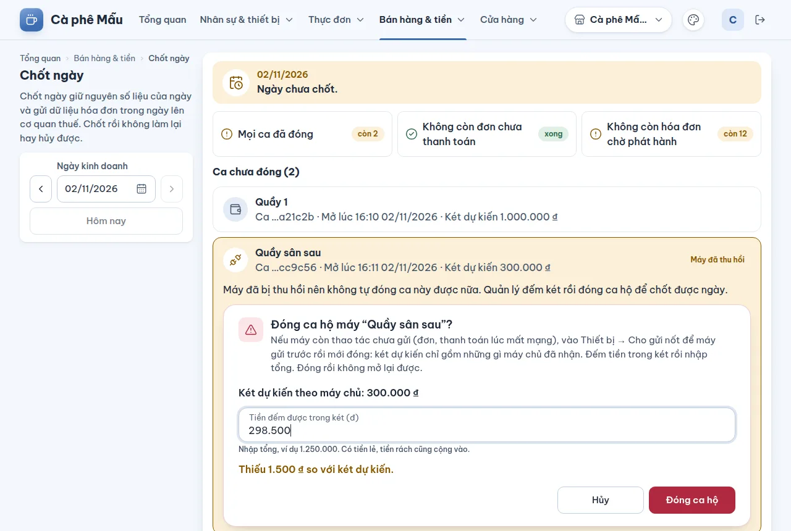

# Chốt ngày

## Dùng để làm gì

Cuối ngày kinh doanh, **chốt ngày** để:

- **giữ nguyên số liệu** của ngày đó — báo cáo ngày không đổi nữa;
- gửi **dữ liệu hóa đơn điện tử trong ngày** lên cơ quan thuế (theo quy định đang chọn ở hồ sơ hóa đơn).

Chốt rồi **không làm lại hay hủy được**.

## Ai dùng, cần quyền gì

- Xem trạng thái ngày: quyền **Xem báo cáo**.
- Bấm chốt: cần **cả** **Xem báo cáo** **và** **Chấp nhận lệch tiền khi đóng ca** (vai trò mẫu: Chủ quán, Quản lý ca). Thiếu quyền thứ hai thì trang báo "Vai trò của bạn xem được trạng thái ngày nhưng không chốt được: cần quyền duyệt chênh lệch két."

## Các bước

1. Mở **Bán hàng & tiền → Chốt ngày**, chọn **Ngày kinh doanh** (mặc định hôm nay).
2. Đọc khung **Trước khi chốt** — ba điều kiện, mỗi điều kiện ghi "xong" hoặc "còn N":
   - **Mọi ca đã đóng** — đóng ca ở từng máy quầy (xem phần máy quầy, đóng ca);
   - **Không còn đơn chưa thanh toán** — thanh toán hoặc hủy ở máy quầy; trang ghi "Máy …xxxxxx · đơn số N" để tìm đúng máy;
   - **Không còn hóa đơn chờ phát hành** — đợi hệ thống phát hành xong.
3. Danh sách bên dưới nói rõ còn gì: **Ca chưa đóng**, **Đơn chưa thanh toán**, **Hóa đơn điện tử đang chờ phát hành**, **Hóa đơn điện tử lỗi hẳn (cần xử lý tay)**, **Hóa đơn đã phát hành nhưng chưa gửi cơ quan thuế**. Hết vướng thì hiện "Không còn gì chặn việc chốt ngày."
   Mỗi hóa đơn ghi đơn nào và trạng thái: **chờ phát hành**, **đã phát hành**, **lỗi, máy chủ đang thử lại** hoặc **lỗi hẳn, cần xử lý tay**, kèm mã lỗi nhà cung cấp trả về nếu có.
4. Bấm **Chốt ngày**, đọc hộp xác nhận "Chốt ngày <ngày>?" — "Số liệu ngày được giữ nguyên từ lúc này. Không hủy được thao tác này." — bấm xác nhận.
5. Trang báo "Đã chốt ngày <ngày>." và từ đó hiện "Đã chốt lúc …".

### Đóng ca hộ máy đã bị thu hồi

Máy bị **thu hồi** khi ca của nó còn mở thì không tự đóng ca được nữa (ghép lại là thành máy mới), nên ngày không chốt được. Mục **Ca chưa đóng** ghi tên máy, "Ca …xxxxxx", giờ mở và **két dự kiến** của từng ca; ca của máy đã thu hồi có nhãn **Máy đã thu hồi** và nút **Đóng ca hộ**.

1. Nếu máy còn thao tác chưa gửi (đơn, thanh toán lúc mất mạng): vào **Thiết bị → Cho gửi nốt** để máy gửi trước (xem [Thiết bị](07-thiet-bi.md)). Làm việc này **trước**: két dự kiến chỉ gồm những gì máy chủ đã nhận.
2. Đếm tiền trong két của máy đó.
3. Bấm **Đóng ca hộ**. Hộp "Đóng ca hộ máy "…"?" ghi **Két dự kiến theo máy chủ**; nhập **Tiền đếm được trong két (đ)** — tổng, số nào cũng được (tiền lẻ, tiền rách cũng cộng vào). Trang tính ngay "Thừa … / Thiếu … so với két dự kiến" hoặc "Khớp với két dự kiến."

   

4. Bấm **Đóng ca hộ**. Trang báo "Đã đóng ca hộ máy "…". Thừa/Thiếu …" và ca chuyển sang mục **Ca quản lý đã đóng hộ máy bị thu hồi** (đếm, dự kiến, chênh lệch). Rồi chốt ngày như trên.

## Luật và giới hạn

- Chốt bị **chặn** khi còn: ca chưa đóng, đơn chưa thanh toán của ngày đó, hoặc hóa đơn điện tử đang chờ phát hành. Hóa đơn **lỗi hẳn** (thử tới 20 lần không được) không chặn chốt nhưng được liệt kê để xử lý tay.
- Chốt được ngày hôm nay và các ngày trước; **không** chốt được ngày chưa bắt đầu.
- Ngày kinh doanh bắt đầu lúc **04:00** (mặc định), nên chốt ngày lúc 23:00 hay 02:00 sáng hôm sau đều là chốt cùng một ngày.
- **Sau khi chốt**, máy quầy vẫn có thể gửi lên đơn trả tiền của ngày đó (ví dụ máy mất mạng cả buổi): tiền đã thu thật nên vẫn được nhận, nhưng **không** vào số liệu ngày đã chốt. Trang liệt kê riêng: **Đơn trả tiền sau khi đã chốt** và **Tiền QR hoàn cho khách sau khi đã chốt**.
- Hệ thống nhắc ở [Tổng quan](02-tong-quan.md) khi hôm qua có bán mà chưa chốt.
- **Đóng ca hộ** chỉ làm được cho ca của máy **đã thu hồi** (máy còn dùng thì thu ngân đóng ca trên máy), và cần đúng hai quyền của chốt ngày. Chênh lệch nào cũng được ghi (người đóng giữ quyền chấp nhận lệch). Nhật ký ghi ai đóng, lúc nào, và máy đã bị thu hồi. Đóng rồi không mở lại được.
- Hai quản lý đóng hộ cùng lúc: chỉ một người được, người kia nhận "Ca này đã được đóng…". Máy gửi thêm tiền vào ca trong lúc quản lý đang đếm: lần đóng bị từ chối, trang tải lại két dự kiến mới.
- Máy gửi nốt **sau** khi đã đóng hộ: tiền của các đơn đó **vẫn được nhận** vào ca nhưng **không** đổi số đã đóng — ghi cạnh ca ("Máy gửi nốt sau khi đóng hộ: … tiền mặt — không cộng vào số đã đóng, đối chiếu với chênh lệch."). Lệnh đóng ca hay thu chi két của máy gửi tới sau bị từ chối, không ghi hai lần, và hiện ở màn thu hồi của máy.
- Ca nào đã đóng mà sau đó còn tiền mặt của ca về (ví dụ máy order thu tiền vào két quầy lúc mất mạng, gửi lên sau khi quầy đóng ca) được liệt kê ở mục **Tiền mặt về sau khi ca đã đóng**.

## Khi có lỗi

| Màn hình báo | Làm gì |
|---|---|
| Chưa chốt được. Còn: … | Xử lý từng mục trong danh sách rồi chốt lại |
| Còn ca chưa đóng trong ngày. Đóng các ca dưới đây rồi chốt lại. | Đóng ca ở máy quầy (mã ca ghi "Ca …xxxxxx") |
| Còn đơn chưa thanh toán trong ngày. Thanh toán hoặc hủy các đơn dưới đây rồi chốt lại. | Xử lý đơn ở máy quầy |
| Còn hóa đơn điện tử đang chờ phát hành. Đợi phát hành xong (danh sách dưới đây) rồi chốt lại. | Chờ vài phút rồi tải lại; nhà cung cấp hóa đơn đang chậm thì đợi lâu hơn |
| Ngày này đã chốt rồi. Chốt ngày không làm lại hay hủy được. | Không cần làm gì |
| Ngày kinh doanh này chưa bắt đầu ở chi nhánh, chưa chốt được. | Chọn đúng ngày |
| Nhập số tiền nguyên, không âm, ví dụ 1.250.000. | Sửa số tiền đếm được |
| Máy vừa gửi thêm tiền vào ca này nên két dự kiến đã đổi. Xem lại số mới rồi đóng lại. | Đọc két dự kiến mới, đối chiếu rồi bấm đóng lại |
| Ca này đã được đóng (trên máy, hoặc bởi một quản lý khác). Tải lại để xem số đã đóng. | Không cần làm gì |
| Máy của ca này vẫn đang dùng: thu ngân đếm két và đóng ca trên máy. Chỉ ca của máy đã thu hồi mới đóng hộ được. | Đóng ca ở máy quầy |
| Cần quyền duyệt chênh lệch két để đóng ca hộ. | Nhờ người có quyền |

## Mất mạng thì sao

Chốt ngày cần mạng. Máy quầy nào đang mất mạng mà còn đơn chưa gửi thì đơn đó chưa có trong danh sách: chờ máy đồng bộ trước khi chốt, nếu không đơn sẽ vào mục "trả tiền sau khi đã chốt".

## Chưa làm / sắp có

- Chưa có nút phát hành lại hay hủy một hóa đơn lỗi từ màn hình.
- Chưa có báo cáo két theo ca ở trang quản lý (báo cáo ca in ở máy quầy); đóng hộ chỉ nhập tổng, không đếm theo mệnh giá, và không in phiếu đóng ca.
