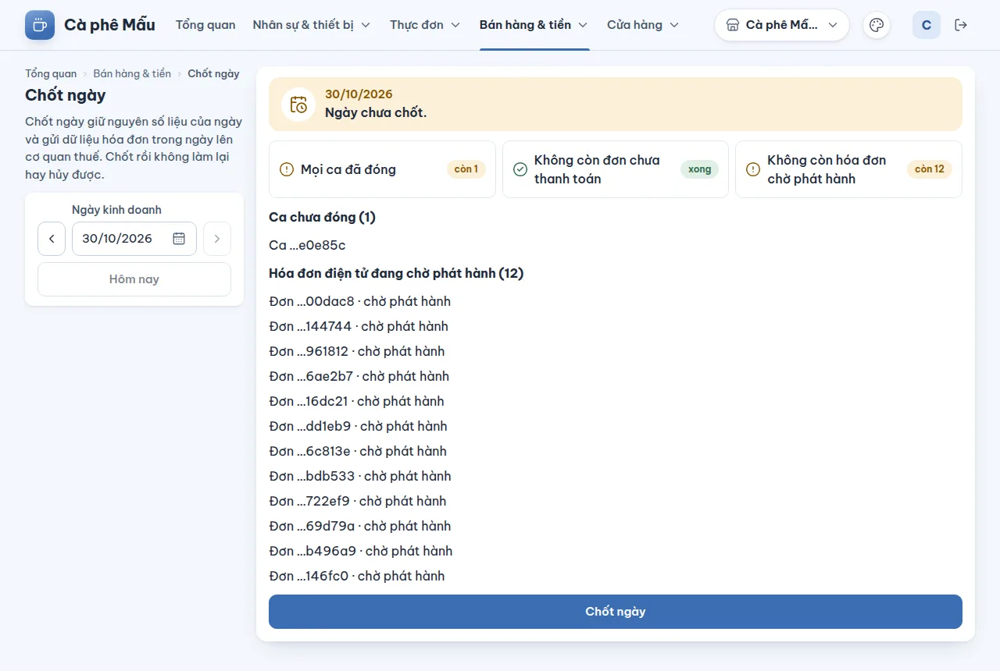

# Chốt ngày

## Dùng để làm gì

Cuối ngày kinh doanh, **chốt ngày** để:

- **giữ nguyên số liệu** của ngày đó — báo cáo ngày không đổi nữa;
- gửi **dữ liệu hóa đơn điện tử trong ngày** lên cơ quan thuế (theo quy định đang chọn ở hồ sơ hóa đơn).

Chốt rồi **không làm lại hay hủy được**.

## Ai dùng, cần quyền gì

- Xem trạng thái ngày: quyền **Xem báo cáo**.
- Bấm chốt: cần **cả** **Xem báo cáo** **và** **Chấp nhận lệch tiền khi đóng ca** (vai trò mẫu: Chủ quán, Quản lý ca). Thiếu quyền thứ hai thì trang báo "Vai trò của bạn xem được trạng thái ngày nhưng không chốt được: cần quyền duyệt chênh lệch két."

## Các bước

1. Mở **Bán hàng & tiền → Chốt ngày**, chọn **Ngày kinh doanh** (mặc định hôm nay).
2. Đọc khung **Trước khi chốt** — ba điều kiện, mỗi điều kiện ghi "xong" hoặc "còn N":
   - **Mọi ca đã đóng** — đóng ca ở từng máy quầy (xem phần máy quầy, đóng ca);
   - **Không còn đơn chưa thanh toán** — thanh toán hoặc hủy ở máy quầy; trang ghi "Máy …xxxxxx · đơn số N" để tìm đúng máy;
   - **Không còn hóa đơn chờ phát hành** — đợi hệ thống phát hành xong.
3. Danh sách bên dưới nói rõ còn gì: **Ca chưa đóng**, **Đơn chưa thanh toán**, **Hóa đơn điện tử đang chờ phát hành**, **Hóa đơn điện tử lỗi hẳn (cần xử lý tay)**, **Hóa đơn đã phát hành nhưng chưa gửi cơ quan thuế**. Hết vướng thì hiện "Không còn gì chặn việc chốt ngày."
4. Bấm **Chốt ngày**, đọc hộp xác nhận "Chốt ngày <ngày>?" — "Số liệu ngày được giữ nguyên từ lúc này. Không hủy được thao tác này." — bấm xác nhận.
5. Trang báo "Đã chốt ngày <ngày>." và từ đó hiện "Đã chốt lúc …".

## Luật và giới hạn

- Chốt bị **chặn** khi còn: ca chưa đóng, đơn chưa thanh toán của ngày đó, hoặc hóa đơn điện tử đang chờ phát hành. Hóa đơn **lỗi hẳn** (thử tới 20 lần không được) không chặn chốt nhưng được liệt kê để xử lý tay.
- Chốt được ngày hôm nay và các ngày trước; **không** chốt được ngày chưa bắt đầu.
- Ngày kinh doanh bắt đầu lúc **04:00** (mặc định), nên chốt ngày lúc 23:00 hay 02:00 sáng hôm sau đều là chốt cùng một ngày.
- **Sau khi chốt**, máy quầy vẫn có thể gửi lên đơn trả tiền của ngày đó (ví dụ máy mất mạng cả buổi): tiền đã thu thật nên vẫn được nhận, nhưng **không** vào số liệu ngày đã chốt. Trang liệt kê riêng: **Đơn trả tiền sau khi đã chốt** và **Tiền QR hoàn cho khách sau khi đã chốt**.
- Hệ thống nhắc ở [Tổng quan](02-tong-quan.md) khi hôm qua có bán mà chưa chốt.

## Khi có lỗi

| Màn hình báo | Làm gì |
|---|---|
| Chưa chốt được. Còn: … | Xử lý từng mục trong danh sách rồi chốt lại |
| Còn ca chưa đóng trong ngày. Đóng các ca dưới đây rồi chốt lại. | Đóng ca ở máy quầy (mã ca ghi "Ca …xxxxxx") |
| Còn đơn chưa thanh toán trong ngày. Thanh toán hoặc hủy các đơn dưới đây rồi chốt lại. | Xử lý đơn ở máy quầy |
| Còn hóa đơn điện tử đang chờ phát hành. Đợi phát hành xong (danh sách dưới đây) rồi chốt lại. | Chờ vài phút rồi tải lại; nhà cung cấp hóa đơn đang chậm thì đợi lâu hơn |
| Ngày này đã chốt rồi. Chốt ngày không làm lại hay hủy được. | Không cần làm gì |
| Ngày kinh doanh này chưa bắt đầu ở chi nhánh, chưa chốt được. | Chọn đúng ngày |

## Mất mạng thì sao

Chốt ngày cần mạng. Máy quầy nào đang mất mạng mà còn đơn chưa gửi thì đơn đó chưa có trong danh sách: chờ máy đồng bộ trước khi chốt, nếu không đơn sẽ vào mục "trả tiền sau khi đã chốt".

## Chưa làm / sắp có

- Trạng thái hóa đơn trong danh sách đang hiện mã tiếng Anh của hệ thống (ví dụ `pending`) thay vì chữ tiếng Việt (xem [discrepancies](../discrepancies.md#backoffice-và-vận-hành)).
- Chưa có nút phát hành lại hay hủy một hóa đơn lỗi từ màn hình.
- Chưa có báo cáo két theo ca ở trang quản lý (báo cáo ca in ở máy quầy).
