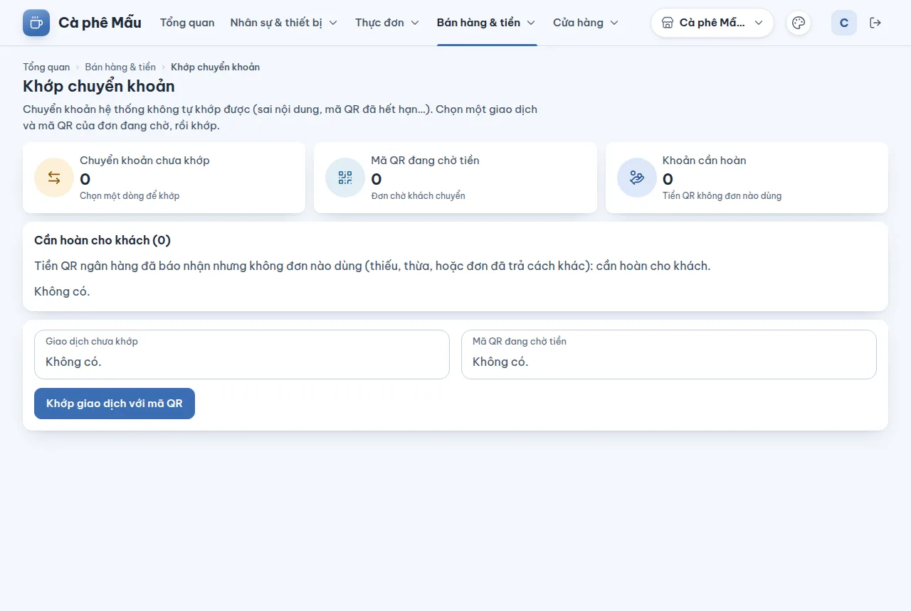

# Khớp chuyển khoản và hoàn tiền QR cho khách

## Dùng để làm gì

Khi khách trả bằng **chuyển khoản QR**, ngân hàng (qua cổng SePay/PayOS) báo về và hệ thống **tự khớp** với mã QR của đơn theo nội dung chuyển khoản. Trang này xử lý hai trường hợp hệ thống không tự xong được:

1. **Chuyển khoản chưa khớp** — khách gõ sai nội dung, chuyển sau khi mã QR đã hết hạn… ⇒ người quản lý **khớp tay** giao dịch với mã QR của đơn đang chờ.
2. **Cần hoàn cho khách** — ngân hàng đã báo nhận tiền mà **không đơn nào dùng** (khách chuyển thiếu, chuyển thừa, chuyển hai lần, hoặc đơn đã trả bằng cách khác) ⇒ trả lại tiền cho khách rồi **ghi đã hoàn**.

## Ai dùng, cần quyền gì

- Xem danh sách: **Xem báo cáo**.
- **Khớp tay** và **ghi đã hoàn**: cần **cả** **Xem báo cáo** **và** **Cài đặt cửa hàng** (vai trò mẫu: chỉ Chủ quán). Đây là tiền ra/vào không qua quầy nên không cho mượn quyền tại chỗ.

## Các bước

1. Mở **Bán hàng & tiền → Khớp chuyển khoản**. Ba ô đếm: **Chuyển khoản chưa khớp**, **Mã QR đang chờ tiền**, **Khoản cần hoàn**.

### Khớp tay một chuyển khoản

2. Ở ô chọn **Giao dịch chưa khớp** chọn giao dịch (số tiền · “nội dung” · giờ).
3. Ở ô chọn **Mã QR đang chờ tiền** chọn mã QR của đơn (mã · số tiền · hạn · trạng thái: đang chờ, đã hết hạn, trả thiếu…).
4. Bấm **Khớp giao dịch với mã QR**, xác nhận: "Đơn của mã QR sẽ được tính là đã nhận số tiền của giao dịch. Không hủy được thao tác này."
5. Trang báo "Đã khớp với mã QR …". Máy quầy thấy đơn đã nhận tiền ở lần đồng bộ kế tiếp.

### Ghi đã hoàn tiền QR cho khách

6. Ở **Cần hoàn cho khách**, mỗi dòng ghi "Mã …: đã nhận X (mã QR yêu cầu Y) — cần hoàn cho khách". Đơn đã đóng bằng mã QR khách chuyển thừa thì dòng ghi "Mã …: đã nhận X, đơn đã thu Y — cần hoàn phần thừa Z cho khách": chỉ **phần thừa** Z phải trả.
7. **Trả tiền cho khách trước** (tiền mặt, hoặc chuyển khoản lại cho khách).
8. Bấm **Đã hoàn cho khách**, chọn **Hoàn bằng** (Tiền mặt / Chuyển khoản lại), ghi **Ghi chú (hoàn cho ai, vì sao)**, bấm **Ghi đã hoàn**.
9. Trang báo "Đã ghi: hoàn X của mã QR … cho khách."

## Luật và giới hạn

- Mã QR của máy quầy có hiệu lực **15 phút** tính theo **giờ máy chủ**; mỗi đơn chỉ có tối đa một mã QR đang chờ. Trả đơn bằng cách khác hoặc hủy đơn thì mã QR bị hủy; tiền chuyển muộn vào mã đó sẽ nằm ở đây.
- Giao dịch chỉ khớp được với mã QR **cùng chi nhánh** (cùng tài khoản nhận).
- Không khớp được vào đơn đã trả bằng cách khác, đã hủy, hoặc đã có QR khác nhận đủ: khi đó tiền đó là tiền **cần hoàn cho khách**.
- Khớp tay và ghi đã hoàn đều **không sửa, không hủy được**, và được ghi nhật ký.
- **Chỉ ghi đã hoàn khi tiền đã thật sự trả lại khách.** Ghi chú và cách hoàn là bắt buộc.
- Tiền QR đã hoàn **không phải doanh thu**: nó vào báo cáo **ngày ghi hoàn** ở dòng "Tiền QR đã hoàn lại khách", và **không trừ vào két của ca nào** — hoàn bằng tiền mặt từ két thì két ca sẽ lệch đúng số đó, cần ghi chú khi đóng ca.
- Hoàn sau khi ngày của tiền đó đã chốt: vẫn ghi được, báo cáo ngày đã chốt không đổi, và mục này được liệt kê riêng ở [Chốt ngày](11-chot-ngay.md).
- Khoản **chuyển thừa** mà thu ngân đã **Thối lại tiền mặt** ở quầy thì không vào danh sách này: máy quầy đã ghi "đã hoàn" (cách hoàn: tiền mặt từ két) và một khoản chi két của ca. Báo cáo ngày vẫn có nó ở dòng "Tiền QR đã hoàn lại khách".
- Khoản **chuyển thiếu** của đơn còn mở vẫn nằm ở "cần hoàn", nhưng thu ngân có thể **dùng nó trả đơn** (thu nốt phần còn lại bằng tiền mặt hoặc QR mới): đơn trả xong thì dòng đó **tự biến mất**. Đã ghi "đã hoàn" thì máy quầy không dùng khoản đó trả đơn được nữa — nên chỉ ghi hoàn khi khách thật sự lấy lại tiền.
- Tiền ngân hàng báo về **không bao giờ bị bỏ qua**: hoặc khớp đơn, hoặc nằm trong "chưa khớp", hoặc trong "cần hoàn".

## Khi có lỗi

| Màn hình báo | Làm gì |
|---|---|
| Chọn một giao dịch và một mã QR để khớp. | Chọn đủ hai bên |
| Giao dịch này đã được khớp với mã QR khác, hoặc là tiền chuyển ra. Làm mới danh sách. | Tải lại trang |
| Mã QR này đã được trả hoặc đã hủy, không nhận thêm giao dịch. | Chọn mã khác; tiền thừa sẽ nằm ở "cần hoàn" |
| Giao dịch vào tài khoản của chi nhánh khác với mã QR này. | Đổi chi nhánh đang xem |
| Đơn của mã QR này đã trả bằng cách khác, đã hủy, hoặc đã có QR khác nhận đủ tiền. Không khớp được: tiền này cần hoàn lại cho khách. | Hoàn tiền cho khách |
| Chọn hoàn bằng tiền mặt hay chuyển khoản lại. / Ghi chú hoàn cho ai, vì sao. | Điền đủ |
| Tiền của mã QR này không phải tiền cần hoàn: … Làm mới danh sách. | Máy quầy còn có thể dùng tiền đó; tải lại trang |
| Tiền của mã QR này đã được ghi là đã hoàn cho khách. Làm mới danh sách. | Người khác vừa ghi; không ghi lại |
| Khớp tay cần quyền quản lý cài đặt. / Ghi đã hoàn tiền cần quyền quản lý cài đặt. | Nhờ chủ quán |

## Mất mạng thì sao

Trang cần mạng. Ở máy quầy, mã QR tạo được khi mất mạng nhưng **tự xác nhận** chỉ khi máy chủ nhận được báo có của ngân hàng và máy quầy đồng bộ lại (xem phần máy quầy, mục thanh toán và mất mạng).

## Chưa làm / sắp có

- Chưa tự ghi "chi két" khi hoàn tiền QR bằng tiền mặt từ két (đang chờ chủ dự án quyết).
- Chưa tách được một giao dịch cho nhiều đơn.
- Chưa có đối soát sao kê ngân hàng theo ngày.
