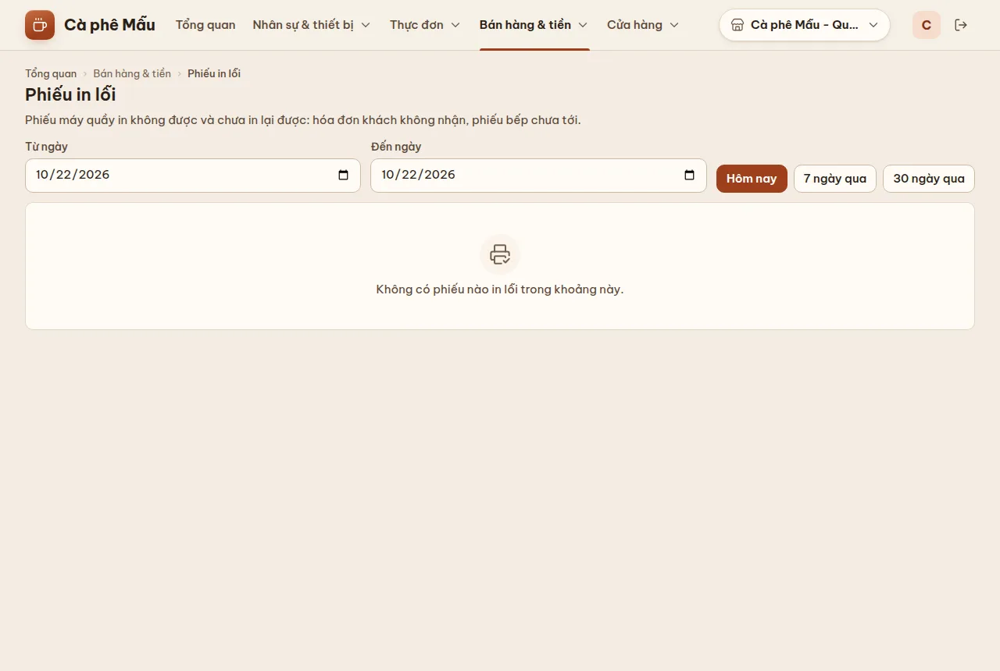

# Phiếu in lỗi

## Dùng để làm gì

Liệt kê các phiếu mà máy quầy **in không được và chưa in lại được**: hóa đơn khách không nhận được, phiếu bếp/pha chế chưa tới quầy pha chế, tem ly, phiếu tạm tính, báo cáo ca. Dùng để tìm đơn nào khách có thể chưa nhận đồ, và máy in nào hay hỏng.

## Ai dùng, cần quyền gì

Cần quyền **Xem báo cáo**.

## Các bước

1. Mở **Bán hàng & tiền → Phiếu in lỗi**.
2. Chọn **Từ ngày / Đến ngày**, hoặc bấm nhanh **Hôm nay / 7 ngày qua / 30 ngày qua**, rồi bấm **Xem**.
3. Bảng: **Lúc**, **Loại phiếu** (Hóa đơn, Phiếu tạm tính, Phiếu bếp/pha chế, Tem ly, Báo cáo ca), **Đơn** (đơn số, số gọi), **Máy quầy** (6 ký tự cuối mã máy), **Máy in**, **Lỗi**, **Số lần thử**.
4. Ô **Tìm máy in, đơn, mã lỗi** lọc nhanh.
5. Xử lý ngoài đời: hỏi khách/pha chế xem đã nhận chưa, kiểm tra giấy, cáp, nguồn của máy in đó; in lại từ máy quầy (xem phần máy quầy, phiếu in).

## Luật và giới hạn

- Chỉ hiện phiếu máy quầy đã **báo lên** máy chủ là in hỏng (máy quầy gửi khi có mạng).
- Mỗi lần xem tối đa **500 phiếu mới nhất**; nhiều hơn thì trang báo "Có nhiều phiếu lỗi hơn số hiển thị: chỉ hiện những phiếu mới nhất. Thu hẹp khoảng ngày để xem hết."
- Trang [Tổng quan](02-tong-quan.md) nhắc số phiếu in lỗi **hôm nay**.

## Khi có lỗi

| Màn hình báo | Làm gì |
|---|---|
| Chọn ngày bắt đầu không sau ngày kết thúc. | Sửa khoảng ngày |
| Không có phiếu nào in lỗi trong khoảng này. | Không phải lỗi |
| Khoảng thời gian không hợp lệ: giờ bắt đầu phải trước giờ kết thúc. | Sửa khoảng ngày |

## Mất mạng thì sao

Máy quầy đang mất mạng chưa báo được phiếu lỗi; phiếu đó hiện ở đây khi máy có mạng lại.

## Chưa làm / sắp có

- Chưa in lại phiếu từ trang quản lý; chưa đánh dấu "đã xử lý" một phiếu lỗi.
- Chưa cảnh báo tức thời (tin nhắn/thông báo) khi máy in hỏng.
