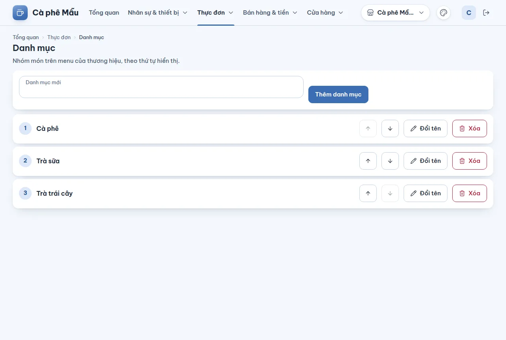
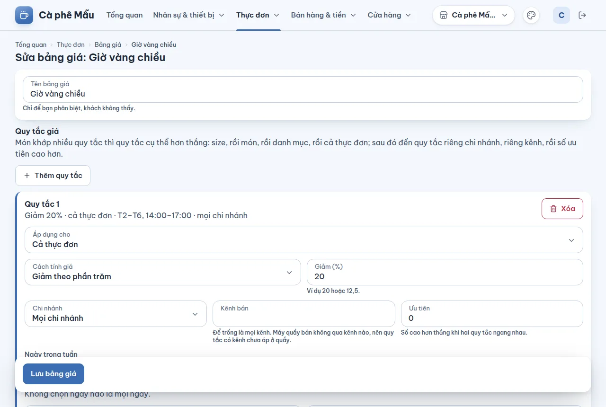

# Bảng giá — giờ vàng, giá theo chi nhánh, giá theo ngày

## Dùng để làm gì

Đặt một giá khác giá niêm yết cho một lúc nào đó: **giờ vàng** 14:00–17:00 giảm 20%, giá riêng cho một chi nhánh, giảm cuối tuần, giá riêng một món trong tuần lễ khai trương. Máy quầy tự áp đúng giá theo chi nhánh và giờ lúc bán; thu ngân không phải làm gì.

Một **bảng giá** là một tên gọi cùng nhiều **quy tắc**. Mỗi quy tắc nói: áp cho cái gì (cả thực đơn, một danh mục, một món hay một size), tính giá thế nào (giảm phần trăm hoặc giá cố định), và khi nào (chi nhánh, kênh, ngày trong tuần, khung giờ, khoảng ngày).

## Ai dùng, cần quyền gì

- Xem: ai đăng nhập cũng xem được.
- Tạo, sửa, xóa bảng giá: cần quyền **Sửa menu** (như món và danh mục).

## Các bước

1. Mở **Thực đơn → Bảng giá**. Mỗi dòng là một bảng giá với số quy tắc của nó; ô **Tìm bảng giá** lọc theo tên.
2. Bấm **Tạo bảng giá**, gõ **Tên bảng giá** (chỉ để bạn phân biệt, khách không thấy), rồi bấm **Thêm quy tắc**.

   

3. Trong mỗi quy tắc:
   - **Áp dụng cho**: **Cả thực đơn**, **Một danh mục**, **Một món** hoặc **Một size của món** — rồi chọn danh mục / món / size cụ thể. Danh sách dài có **ô tìm** ở đầu: gõ "tra sua" ra "Trà sữa" (không cần dấu, không phân biệt hoa thường), mũi tên đi qua kết quả, **Enter** chọn, **Esc** đóng; không có kết quả thì hiện "Không tìm thấy".
   - **Cách tính giá**: **Giảm theo phần trăm** (gõ **Giảm (%)**, ví dụ `20` hoặc `12,5`) hoặc **Giá cố định** (gõ **Giá bán (đồng)**; chỉ dùng cho một món hoặc một size).
   - **Chi nhánh**: **Mọi chi nhánh** hoặc một chi nhánh. **Kênh bán**: để trống là mọi kênh.
   - **Ngày trong tuần**: bấm các nút T2…CN; không chọn ngày nào là mọi ngày.
   - **Từ giờ / Đến giờ**: dạng `14:00`; để trống cả hai là cả ngày. Giờ bắt đầu sau giờ kết thúc (22:00 → 02:00) là qua nửa đêm; `24:00` ở **Đến giờ** là hết ngày.
   - **Từ ngày / Đến hết ngày**: dạng `31/10/2026`, để trống là không giới hạn; "Đến hết ngày 07/11" giữ quy tắc suốt ngày 07/11.
   - **Ưu tiên**: số cao hơn thắng khi hai quy tắc ngang nhau (mặc định 0).
   Dòng đầu thẻ quy tắc đọc lại bằng chữ quy tắc đang nói gì: "Giảm 20% · Trà sữa · T2–T6, 14:00–17:00 · mọi chi nhánh".
4. Bấm **Lưu bảng giá**. Quy tắc tới mọi máy quầy của thương hiệu ở lần đồng bộ kế tiếp.
5. Sửa: bấm **Sửa** ở dòng bảng giá. Xóa quy tắc bằng nút **Xóa** của thẻ rồi **Lưu bảng giá**.
6. Xóa cả bảng giá: bấm **Xóa** ở dòng, xác nhận. Nếu người khác vừa lưu bảng giá đó, việc xóa bị từ chối với "Có người đã sửa mục này trước bạn", danh sách được tải lại và bạn xem bản mới rồi quyết định có xóa không. Các quy tắc của nó ngừng áp dụng; đơn đã bán giữ nguyên giá đã bán.

## Luật và giới hạn

- Khi nhiều quy tắc cùng khớp một món, **quy tắc cụ thể hơn thắng**: size, rồi món, rồi danh mục, rồi cả thực đơn; cùng mức thì quy tắc riêng chi nhánh, rồi riêng kênh, rồi số **Ưu tiên** cao hơn. Chỉ một quy tắc được áp, không cộng dồn.
- **Giá cố định** chỉ cho một món hoặc một size: một giá cho cả danh mục sẽ san phẳng các món giá khác nhau; muốn giảm cả nhóm thì dùng phần trăm.
- Phần trăm từ 0 đến 100, tối đa 2 số lẻ; giá là số đồng nguyên, không âm. Tiền giảm làm tròn **xuống** đồng.
- Giờ và ngày tính theo **giờ của chi nhánh**; ngày nhập theo giờ Việt Nam (UTC+7).
- Một bảng giá có tối đa **500 quy tắc**; tên tối đa 120 ký tự, kênh tối đa 40 ký tự.
- Quy tắc **có kênh** chỉ áp khi đơn thuộc kênh đó. Máy quầy bán không qua kênh nào (kênh giao hàng là giai đoạn sau), nên quy tắc có kênh chưa áp ở quầy.
- Quy tắc **có hẹn** (khung giờ, ngày trong tuần, từ ngày – tới ngày) chỉ áp khi công tắc **Giá theo khung giờ** ở [Cài đặt](09-cai-dat.md) **bật** (công tắc đặt ở tầng thương hiệu, mặc định tắt). Tắt thì máy quầy và máy chủ bỏ các quy tắc đó, bán theo giá gốc. Quy tắc **không hẹn** (giá riêng của chi nhánh, của kênh bán) vẫn áp như cũ.
- Hai người sửa cùng một bảng giá: người lưu sau bị từ chối ("Có người đã sửa mục này trước bạn") và được mời tải bản mới; thay đổi chưa lưu của họ mất.

## Khi có lỗi

| Màn hình báo | Làm gì |
|---|---|
| Nhập tên bảng giá. / Tên bảng giá dài tối đa 120 ký tự. | Sửa tên |
| Chọn mục áp dụng. / Chọn size. | Chọn danh mục, món hoặc size |
| Nhập phần trăm từ 0 đến 100, tối đa 2 số lẻ. | Sửa ô **Giảm (%)** |
| Nhập giá là số đồng nguyên, ví dụ 45.000. | Sửa ô **Giá bán** |
| Giá cố định chỉ dùng cho một món hoặc một size. Cho cả danh mục hay cả thực đơn thì chọn giảm theo phần trăm. | Đổi cách tính hoặc thu hẹp phạm vi |
| Nhập giờ dạng 14:00. / Nhập cả giờ bắt đầu và giờ kết thúc, hoặc để trống cả hai. | Sửa **Từ giờ / Đến giờ** |
| Giờ bắt đầu và giờ kết thúc phải khác nhau. | Sửa giờ |
| Nhập ngày dạng 31/10/2026. / Ngày bắt đầu phải trước ngày kết thúc. | Sửa **Từ ngày / Đến hết ngày** |
| Ưu tiên là số nguyên, ví dụ 0 hoặc -1. | Sửa **Ưu tiên** |
| Một bảng giá có tối đa 500 quy tắc. | Tách bảng giá |
| Có người đã sửa mục này trước bạn. Tải lại để xem bản mới nhất. | **Tải lại bản mới nhất** |
| Không tìm thấy bảng giá này. | Quay về danh sách |
| Vai trò của bạn không có quyền làm việc này. Nhờ chủ quán cấp quyền. | Cần quyền Sửa menu |

## Mất mạng thì sao

Trang quản lý cần mạng để lưu. Máy quầy đang mất mạng vẫn bán theo bảng giá nó đã nhận; quy tắc mới tới khi máy có mạng lại.

## Chưa làm / sắp có

- Chưa có **tắt tạm** một bảng giá (chỉ xóa); chưa xem trước "giá món X lúc 15:00 là bao nhiêu".
- Chưa chọn được **nhóm khách** hoặc **số lượng tối thiểu** cho quy tắc.
- Giá theo kênh (Grab…) nhập được nhưng chưa có kênh nào bán ở máy quầy.
