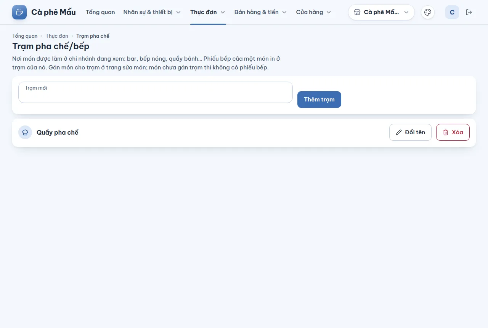
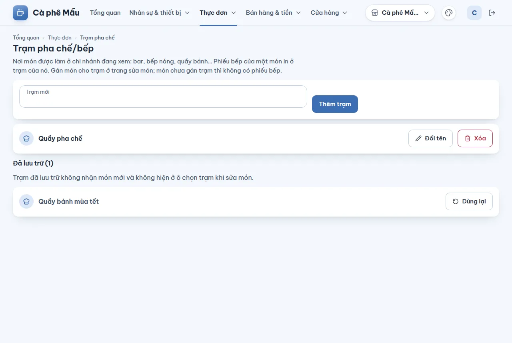

# Trạm pha chế/bếp — thêm, đổi tên, xóa và lưu trữ trạm của chi nhánh

## Dùng để làm gì

**Trạm** là nơi một món được làm ở chi nhánh: **Bar**, **Bếp nóng**, **Quầy bánh**… Khi thu ngân bấm gửi bếp, mỗi trạm nhận một phiếu riêng chỉ có món của nó. Trang này khai báo danh sách trạm của **chi nhánh đang xem**; việc **gán món cho trạm** làm ở ô **Trạm pha chế/bếp** của [trang sửa món](03-thuc-don.md).

## Ai dùng, cần quyền gì

- Xem: ai đăng nhập cũng xem được.
- Thêm, đổi tên, xóa, lưu trữ, dùng lại trạm: cần quyền **Sửa menu**.

## Các bước

1. Chọn chi nhánh ở thanh trên, mở **Thực đơn → Trạm pha chế**.
2. Gõ tên ở **Trạm mới**, bấm **Thêm trạm**. Bấm khi ô còn trống thì dòng đỏ "Nhập tên." hiện dưới ô.
3. **Đổi tên**: bấm **Đổi tên** ở dòng, gõ tên mới, bấm **Lưu** (hoặc **Hủy**). Phiếu in từ lần sau mang tên mới.
4. **Xóa**: bấm **Xóa** ở dòng, xác nhận **Xóa**.
5. Sang trang sửa món, chọn trạm ở ô **Trạm pha chế/bếp (chi nhánh đang xem)** cho từng món.

## Luật và giới hạn

- Trạm thuộc **một chi nhánh**; chi nhánh khác có danh sách trạm riêng. Tên tối đa **120 ký tự**.
- **Món chưa gán trạm thì không in phiếu bếp**, và món gán cho một trạm của chi nhánh khác cũng không in ở chi nhánh này. Vì vậy máy chủ **không cho xóa hay lưu trữ trạm còn món đang bán gán cho nó**: món ấy sẽ mất phiếu. Chuyển các món sang trạm khác ở trang sửa món rồi làm lại.
- **Xóa** một trạm làm một trong hai việc, tùy lịch sử của nó: trạm **chưa từng in phiếu** và không món nào (kể cả món ngừng bán) trỏ tới thì **xóa hẳn**; trạm **đã từng in phiếu bếp** (hoặc còn món ngừng bán trỏ tới) thì **lưu trữ**: ẩn khỏi danh sách làm việc và khỏi ô chọn trạm ở trang sửa món, máy quầy không còn nhận trạm đó, nhưng phiếu cũ vẫn trỏ về nó. Trang báo "Trạm … đã từng in phiếu nên được lưu trữ".
- Trạm đã lưu trữ nằm ở mục **Đã lưu trữ (n)** dưới danh sách, mỗi dòng có nút **Dùng lại**: trạm hiện lại trong danh sách, ô chọn trạm và trên máy quầy.

- Không gán được trạm đã lưu trữ cho món (báo "Trạm này đã lưu trữ nên không gán cho món đang bán được"), và không cho một món ngừng bán đang giữ trạm đã lưu trữ **bán lại** cho tới khi trạm được dùng lại. Món ngừng bán vẫn sửa được và vẫn hiện trạm cũ của nó, ghi "(đã lưu trữ)".
- Mẫu loại quán thêm trạm còn thiếu **theo tên trong các trạm đang dùng**: trạm cùng tên đã lưu trữ không tính là đã có.
- Thêm, đổi tên, xóa tới mọi máy quầy của chi nhánh ở lần đồng bộ kế tiếp.
- Hai người sửa cùng một trạm: người lưu sau bị từ chối, trang tải lại danh sách và báo "Có người đã sửa trạm này trước bạn." **Xóa** cũng vậy: nút xóa gửi kèm số phiên bản của trạm trang đã đọc, nên người A không xóa được trạm mà người B vừa đổi tên; trang báo như trên, tải lại, và bấm xóa lần nữa nếu vẫn muốn.

## Khi có lỗi

| Màn hình báo | Làm gì |
|---|---|
| Nhập tên. / Tên dài tối đa 120 ký tự. | Sửa tên |
| Chưa xóa được: còn món đang bán gán cho trạm này, món đó sẽ không có phiếu bếp. Chuyển các món sang trạm khác ở trang sửa món rồi xóa lại. | Gán các món sang trạm khác rồi xóa lại |
| Trạm “…” đã từng in phiếu nên được lưu trữ… | Không phải lỗi: trạm đã sang mục **Đã lưu trữ**; bấm **Dùng lại** nếu cần |
| Trạm này đã lưu trữ nên không gán cho món đang bán được… | Chọn trạm khác, hoặc **Dùng lại** trạm ở trang này |
| Có người đã sửa trạm này trước bạn. Danh sách đã được tải lại. | Sửa lại trên danh sách mới |
| Không tìm thấy trạm pha chế/bếp này. Tải lại trang. | Tải lại trang |
| Vai trò của bạn không có quyền làm việc này. Nhờ chủ quán cấp quyền. | Cần quyền Sửa menu |

## Mất mạng thì sao

Trang quản lý cần mạng để lưu. Máy quầy đang mất mạng vẫn in phiếu theo trạm đã nhận; thay đổi tới khi máy có mạng lại.

## Chưa làm / sắp có

- Chưa gán **máy in** cho trạm trên trang quản lý; việc đó nằm ở thiết lập máy quầy.
- Món là của cả thương hiệu nhưng trạm là của từng chi nhánh: một món chỉ gán được một trạm, nên ở chi nhánh khác món đó không in phiếu cho tới khi có cách gán trạm theo chi nhánh.
